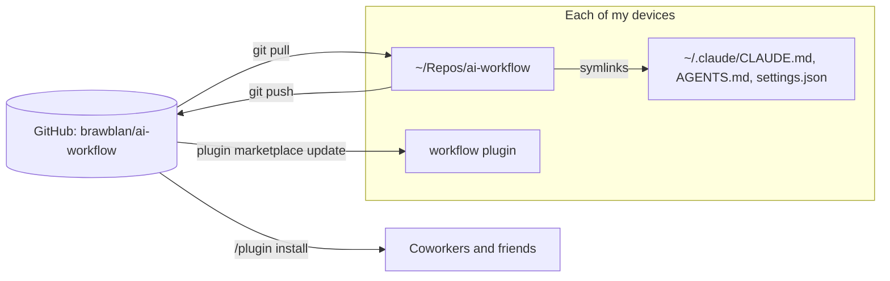

# ai-workflow

My AI coding workflow in one place: skills, global rules, settings, and tips.
Use it with Claude Code, with other AI agents, or as notes to read.

| Folder | What it has | Who uses it |
| --- | --- | --- |
| [`plugins/workflow/skills/`](plugins/workflow/skills/) | Seven skills in the open `SKILL.md` format | Anyone |
| [`plugins/workflow/skills/project-setup/templates/`](plugins/workflow/skills/project-setup/templates/) | Templates: constitution, repo `AGENTS.md`, user `AGENTS.md`, OpenSpec config | Anyone |
| [`global/`](global/) | My personal rules (`AGENTS.md`) and Claude Code settings | Me. Copy what you like. |
| [`docs/tips/`](docs/tips/) | How I work, and why | Anyone |
| [`framework/`](framework/README.md) | Draft: Cornerstone, the tool-neutral workflow framework (principles, modes, profiles, gates, adapters) | Anyone |
| [`docs/research/`](docs/research/dossier.md) | The cited research behind the framework | Anyone |

## The skills

| Skill | What it does |
| --- | --- |
| `project-setup` | Set up a repo for agents: `constitution/`, `AGENTS.md`, and the OpenSpec wiring. It asks only for facts the repo does not have. |
| `dev-pr` | Branch, commit, rebase, validate, and open a PR into the integration branch. |
| `ticket-delivery` | Check the work against an issue's acceptance criteria. Then branch, commit, and open a PR. |
| `backlog-sequencer` | Sync a `status:blocked` label from "Depends on #N" text. Suggest priority labels. |
| `sdd-plan` | Plan a GitHub issue as an [OpenSpec](https://github.com/Fission-AI/OpenSpec) change. No code. |
| `sdd-build` | Build, verify, and archive an OpenSpec change. Then open a PR. |
| `ste-writing` | Write with Simplified Technical English rules, and add diagrams. |

`sdd-plan` and `sdd-build` need OpenSpec in the repo (`openspec init`). The other skills need only
`git` and the GitHub CLI (`gh`).

## Set up a new repo

Run `/workflow:project-setup` in the repo. In another tool, tell your agent:

```text
Follow plugins/workflow/skills/project-setup/SKILL.md from github.com/brawblan/ai-workflow.
Use the templates next to it.
```

The skill reads the repo first. Then it asks you only for the missing facts, and writes:

```text
AGENTS.md              how to work in the repo (every tool loads it)
CLAUDE.md              @AGENTS.md
constitution/
  README.md            index
  mission.md           vision, audience, tone, scope, non-goals
  principles.md        MUST rules (or a pointer to openspec/config.yaml)
  tech-stack.md        approved technology, ownership, deploy limits, gates
  roadmap.md           phases and milestones, in order
```

## Install for Claude Code

1. In Claude Code, add the marketplace:

   ```
   /plugin marketplace add brawblan/ai-workflow
   ```

2. Install the plugin:

   ```
   /plugin install workflow@brawblan
   ```

3. Restart Claude Code. The skills have the `workflow:` prefix, for example `/workflow:dev-pr`.

To get updates, run `/plugin marketplace update brawblan`. You can also turn on auto-update for
the marketplace in the `/plugin` menu.

## Install for other agents

1. Copy a folder from `plugins/workflow/skills/` into your agent's skills folder.
   See [docs/tips/other-tools.md](docs/tips/other-tools.md) for each tool.
2. If you want my writing rules, copy [`global/AGENTS.md`](global/AGENTS.md) into your
   `AGENTS.md` or your tool's instructions file.

## My setup on each device (owner only)

This setup keeps all my devices on the same version. Git is the source of truth.



`global/settings.json` declares the `brawblan` marketplace (GitHub source) and enables the plugin.
So a new device needs only the clone and `install.sh`.

### New device

1. Clone the repo:

   ```bash
   git clone https://github.com/brawblan/ai-workflow.git ~/Repos/ai-workflow
   ```

2. Link the global files. The script backs up each file that it replaces.

   ```bash
   ~/Repos/ai-workflow/install.sh
   ```

3. Start Claude Code. It reads the marketplace from the linked `settings.json`.
   If `/plugin` does not show `workflow@brawblan`, run:

   ```
   /plugin install workflow@brawblan
   ```

### Change the workflow

1. Edit the files in `~/Repos/ai-workflow`.
2. If you changed a skill, increase `version` in
   [`plugins/workflow/.claude-plugin/plugin.json`](plugins/workflow/.claude-plugin/plugin.json).
3. Run `claude plugin validate .` from the repo root.
4. To test a skill before you push, run `claude --plugin-dir plugins/workflow`.
5. Commit and push.
6. Run `/plugin marketplace update brawblan`, also on this device.

### Get changes on another device

1. Run `git -C ~/Repos/ai-workflow pull`.
2. In Claude Code, run `/plugin marketplace update brawblan`.
3. Restart Claude Code.

The global files are symlinks, so they change at once after the pull.

### If a link breaks

Claude Code can write `settings.json` (for example from `/config`). If a write replaces the link
with a plain file, run `./install.sh` again. The script backs up the plain file and prints a
`diff` command. Copy the changes that you want into `global/`.

## Rules for this repo

This repo is public. Read each `git diff` before you push.

- Do not commit secrets, tokens, `settings.local.json`, or MCP credentials.
- Do not commit employer code, employer names, or private project details.
- Keep skills generic. Put repo-specific facts in that repo's `CLAUDE.md` or `AGENTS.md`.

## License

[MIT](LICENSE)
