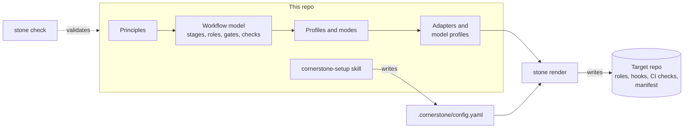

# ai-workflow

**Cornerstone: a framework for agent-assisted software delivery, where checks decide that work is
done.**

Version 1.2.0. All 10 profiles are supported, and each generated check blocks.

This repo holds Cornerstone, its `stone` CLI, the `workflow` plugin skills, my personal agent
rules, and tips. Read the docs at [brawblan.github.io/ai-workflow](https://brawblan.github.io/ai-workflow/).

## What Cornerstone is

Cornerstone says how a human and an agent deliver software together. It is a set of written rules
and a CLI that turns the rules into files for your repo.

- **Stages and roles.** The work moves through Intake, Shape, Plan, Build, Test, Verify, Review,
  Deliver, and Learn. A shaper, a planner, an implementer, a tester, a reviewer, and an
  investigator do the work.
- **Gates.** A human approves the ticket, the plan, and the change. Only CI passes the checks gate.
- **Profiles.** Ten profiles set the plan form and the gates for each type of work, from a spike to
  a full project.
- **A neutral core.** The core never names a tool. An adapter turns it into files for one harness.
  `stone render` writes those files into your repo.

## Why use it

| Problem | What Cornerstone does |
| --- | --- |
| An agent stops when the work looks done, and it can claim a check that it did not run. | Check output from CI, outside the agent session, shows that work is done (P1). |
| An agent that writes the code and its tests proves only that the code agrees with itself. | A different role writes the tests and reviews, each in a fresh session. A hook and a CI check stop the implementer from changing tests (P2). |
| A vague ticket gives a drifting result, and a long prompt does not fix it. | A human makes the ticket ready first: acceptance criteria, non-goals, a test oracle, and the users it serves (P3). |
| The same heavy process for a one-line fix and for a new product wastes time. | The profile sets how much plan and how many gates the work needs (P7). |
| A rule that helps one model can hurt the next model. | Each rule, skill, and role has an eval and a review date. When the evidence goes, the part goes (P5). |
| A framework tied to one tool breaks when the tool changes. | Only the adapter changes. The core stays the same (P12). |

Each rule cites its evidence in the [research dossier](docs/research/dossier.md).

## Who it is for

- A developer who uses a coding agent on real repos and wants the result checked, not trusted.
- A team that wants one process for many types of work, with the heavy gates only where the risk is
  high.
- A person who already uses Spec Kit, OpenSpec, or BMAD and wants a layer that does not depend on
  one tool. See [the migration guide](docs/guides/migrate.md).

It is not for you if you want a prompt library or an IDE. It is also not for you if you need a
harness other than Claude Code today. The only adapter at this time is for Claude Code.

## How it compares

Many tools cover one part of this: a gated flow, role agents, or a file generator. In the sources
that we read, none joins a neutral core, harness adapters, gates by profile, and an eval and review
date for each part. The [prior art section](docs/research/dossier.md#5-prior-art) has the table and
its limits.

## Status

Draft v0. The framework is complete enough to use on one profile. Other parts are design only.

| Part | State |
| --- | --- |
| [Framework](framework/README.md): principles, workflow model, gates, checks, modes, 10 profiles | Draft v0 |
| [Harness adapter](framework/adapters/claude-code.md) and [model profile](framework/adapters/claude-code/models/claude-5.yaml) | First adapter. The model profile evals are not written yet. |
| [`stone`](stone/README.md) 0.9 | `stone check`, `stone check-writing` (K17), `stone check-evidence` (K14), `stone spec apply` and `sync`, `stone render` for the roles of all 10 profiles, and `stone eval`. Some profile checks and the triggers are not rendered yet. |
| [`workflow` plugin](plugins/workflow/) 0.6.0 | Six skills. `cornerstone-setup` is the entry skill. |
| This repo | Uses Cornerstone on itself: [`.cornerstone/config.yaml`](.cornerstone/config.yaml) and CI in [`stone.yml`](.github/workflows/stone.yml) |

The next steps are in the [roadmap](framework/README.md#roadmap). The design decisions (D1, D2, ...)
are in the [decisions table](framework/README.md#decisions).

## How the parts fit



Caption: the setup skill collects the repo facts. `stone render` combines them with the framework
and writes the generated files.

| Concept | What it is | Read more |
| --- | --- | --- |
| Stages | Intake, Shape, Plan, Build, Test, Verify, Review, Deliver, Learn | [workflow-model.md](framework/workflow-model.md) |
| Roles | Shaper, planner, implementer, tester, reviewer, investigator | [workflow-model.md](framework/workflow-model.md#roles) |
| Gates | G1 Ready, G2 Plan approved, G3 Checks pass, G4 Change approved, G5 Release approved | [gates.md](framework/gates.md) |
| Checks | K1 to K19. Programs that run in CI, outside the agent session. | [checks.md](framework/checks.md) |
| Profiles | One configuration for each type of work, for example single-ticket, debugging, or spike | [profiles/](framework/profiles/README.md) |
| Modes | Who drives each stage: agent-centric, hybrid, or human-centric | [modes.md](framework/modes.md) |
| Adapters | The only place for harness, vendor, model, and spec-tool details | [adapters/](framework/adapters/contract.md) |

## Set up a repo with Cornerstone

The [guides](docs/guides/README.md) cover each situation: a new project, an existing repo, a
migration from another framework, and the daily work after the setup. This section is the short
version.

You need Python 3.11 or later, `git`, the GitHub CLI (`gh`), and Claude Code. Claude Code is the
only harness adapter at this time.

1. Clone this repo and install the CLI:

   ```bash
   git clone https://github.com/brawblan/ai-workflow.git
   pip install ./ai-workflow/stone
   ```

2. Install the `workflow` plugin (see [Install the plugin](#install-the-plugin-for-claude-code)).
3. In the target repo, run `/workflow:cornerstone-setup`.

The skill runs `project-setup` first. That skill writes `AGENTS.md`, `CLAUDE.md`, and
`constitution/`. Then `cornerstone-setup` asks only for the facts that it cannot find in the repo.
It writes `.cornerstone/config.yaml`, and runs `stone render` and `stone check`.

For the single-ticket profile, `stone render` writes:

```text
.claude/agents/            shaper, implementer, tester, and reviewer roles
.cornerstone/hooks/        a hook that stops the implementer from changing tests and checks
.claude/settings.json      the hook entry (other keys stay as they are)
.cornerstone/checks/       check K6 (protected paths), for CI
.github/workflows/         the G3 CI workflow
.cornerstone/manifest.yaml what stone render owns, with a hash for each file
```

For the app-slice profile, it also writes the planner role. Profiles with the investigator role write
that role too. A profile with no G3 gate writes no CI workflow and no K6. A second run changes only
the files whose input changed. The repo config fields are in
[customization.md](framework/customization.md).

## The skills

The plugin skills are the first harness implementation of parts of the framework. `stone render`
writes the planner, tester, and reviewer roles, so the plugin has no skill for them (D14, D18).

| Skill | What it does |
| --- | --- |
| `cornerstone-setup` | Set up a repo for Cornerstone. It runs `project-setup`, writes `.cornerstone/config.yaml`, and runs `stone render` and `stone check`. |
| `project-setup` | Set up a repo for agents: `constitution/` (with personas and job stories), and `AGENTS.md`. It asks only for facts the repo does not have. |
| `ticket-delivery` | Collect the tester, reviewer, and check evidence for each acceptance criterion. Then open the PR with `dev-pr`. |
| `dev-pr` | Branch, commit, rebase, validate, and open a PR into the integration branch, with the evidence sections. |
| `backlog-sequencer` | Sync a `status:blocked` label from "Depends on #N" text. Suggest priority labels. |
| `ste-writing` | Write with Simplified Technical English rules, and add diagrams. |

`cornerstone-setup` needs the `stone` CLI and a clone of this repo. The other skills need only `git`
and `gh`.

## Install the plugin for Claude Code

1. In Claude Code, add the marketplace:

   ```
   /plugin marketplace add brawblan/ai-workflow
   ```

2. Install the plugin:

   ```
   /plugin install workflow@brawblan
   ```

3. Restart Claude Code. The skills have the `workflow:` prefix, for example `/workflow:dev-pr`.

To get updates, run `/plugin marketplace update brawblan`. You can also turn on auto-update for
the marketplace in the `/plugin` menu.

## Use the skills with other agents

The skills use the open `SKILL.md` format. `stone render` has no adapter for other harnesses yet.

1. Copy a folder from `plugins/workflow/skills/` into your agent's skills folder.
   See [docs/tips/other-tools.md](docs/tips/other-tools.md) for each tool.
2. To set up a repo without the plugin, tell your agent:

   ```text
   Follow plugins/workflow/skills/project-setup/SKILL.md from github.com/brawblan/ai-workflow.
   Use the templates next to it.
   ```

3. If you want my writing rules, copy [`global/AGENTS.md`](global/AGENTS.md) into your
   `AGENTS.md` or your tool's instructions file.

## Repo map

| Path | What it has |
| --- | --- |
| [`framework/`](framework/README.md) | Cornerstone: principles, workflow model, gates, checks, modes, profiles, lifecycle, writing standard, generator design |
| [`framework/adapters/`](framework/adapters/contract.md) | Harness adapters, model profiles, spec-tool adapters, and the templates for `stone render` |
| [`stone/`](stone/README.md) | The `stone` CLI (Python 3.11+, PyYAML only) and its tests |
| [`plugins/workflow/skills/`](plugins/workflow/skills/) | The plugin skills, and the `project-setup` templates |
| [`docs/research/`](docs/research/dossier.md) | The cited evidence for the framework |
| [`docs/guides/`](docs/guides/README.md) | How to use Cornerstone, one situation at a time |
| [`docs/tips/`](docs/tips/README.md) | How I work with agents, and why |
| [`website/`](website/), [`mkdocs.yml`](mkdocs.yml) | The [docs site](https://brawblan.github.io/ai-workflow/), built with MkDocs Material |
| [`global/`](global/README.md) | My personal agent rules and settings, and how I sync them across devices |
| [`AGENTS.md`](AGENTS.md) | How agents work in this repo: commands, rules, branches, and writing |

## Contribute

Read [AGENTS.md](AGENTS.md) and [framework/README.md](framework/README.md) before you change the
framework. Run all checks before a push:

```bash
python -m unittest discover -s stone/tests && stone check && stone check-writing --diff origin/main
```

This repo is public. Read each `git diff` before you push.

- Do not commit secrets, tokens, `settings.local.json`, or MCP credentials.
- Do not commit employer code, employer names, or private project details.
- Keep skills generic. Put repo-specific facts in that repo's `CLAUDE.md` or `AGENTS.md`.
- Keep harness, vendor, model, and spec-tool names out of the framework core (P12).

## License

[MIT](LICENSE)
