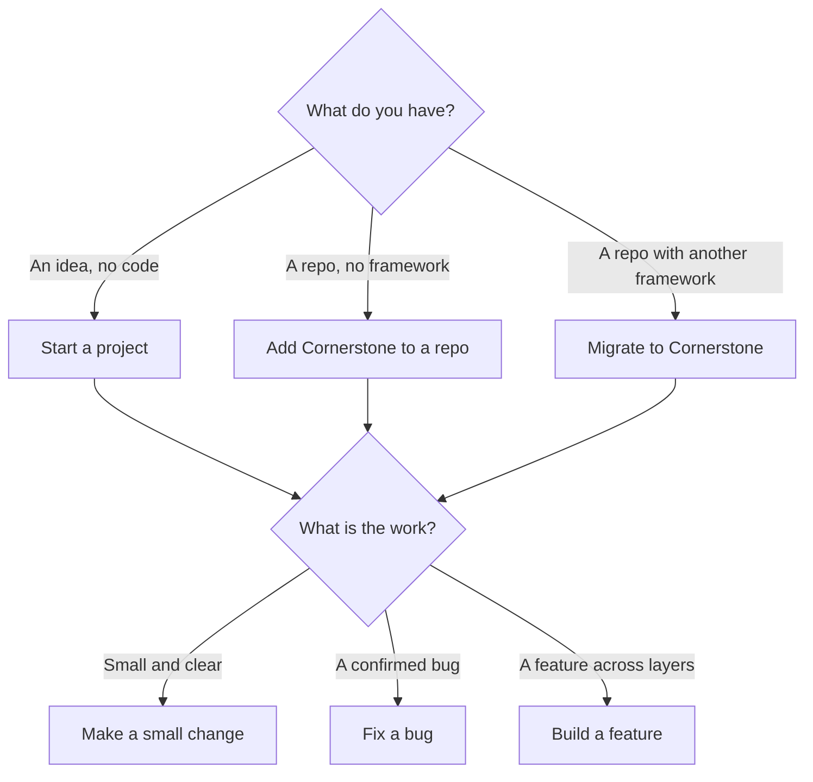

# Guides

How to use Cornerstone, one situation at a time. Each guide names its
[profile](../../framework/profiles/README.md) and its default [mode](../../framework/modes.md).

Cornerstone is draft v0. `stone render` supports only the single-ticket profile. So each guide has
two parts:

- **Today:** the steps that work now, with the tools in this repo.
- **When the profile ships:** the target flow from the framework. Use it to know what changes later.

## Pick a guide

| Situation | Guide | Profile | Default mode | Status |
| --- | --- | --- | --- | --- |
| I have an empty folder and an idea | [Start a project](start-a-project.md) | full-project | hybrid | Partial |
| I have a repo with no agent framework | [Add Cornerstone to a repo](add-to-a-repo.md) | single-ticket | agent-centric | Works today |
| I use Spec Kit, OpenSpec, BMAD, or rule files | [Migrate to Cornerstone](migrate.md) | (setup) | — | Partial |
| I want to make one small, clear change | [Make a small change](small-change.md) | single-ticket | agent-centric | Works today |
| I have a confirmed bug | [Fix a bug](fix-a-bug.md) | debugging | hybrid | Partial |
| I want a feature that touches many layers | [Build a feature](build-a-feature.md) | app-slice | hybrid | Partial |

All guides use [Run the roles](run-the-roles.md). It shows how to start each role in its own
session, and how to commit its work.

## Profile or mode?

The two words have different meanings in Cornerstone.

| Word | Answers | Values |
| --- | --- | --- |
| Profile | What type of work is this? Which gates and checks apply? | single-ticket, debugging, app-slice, full-project, and [6 more](../../framework/profiles/README.md) |
| Mode | Who does each stage: an agent, a human, or the two together? | agent-centric, hybrid, human-centric |

The profile sets the gates. The mode does not change them. Each profile can run in each mode.

| Mode | Use when |
| --- | --- |
| agent-centric | The ticket is complete and the work is routine. Ticket in, draft PR out. |
| hybrid | You own the design. An agent does the build. |
| human-centric | The build needs your judgment, or you want to learn the code. An agent still writes the tests. |

To change the mode for one ticket, add a `mode:<name>` label or field to the ticket. To change the
default, see [customization.md](../../framework/customization.md).

## What you need

| Tool | Why |
| --- | --- |
| A clone of [this repo](https://github.com/brawblan/ai-workflow) | The framework files that `stone render` reads |
| Python 3.11 or later, and `pip install ./stone` from the clone | The `stone` CLI |
| `git` and the GitHub CLI (`gh`) | Branches, issues, and PRs |
| Claude Code, with the `workflow` plugin | The only harness adapter at this time. See the [install steps](../../README.md#install-the-plugin-for-claude-code). |
