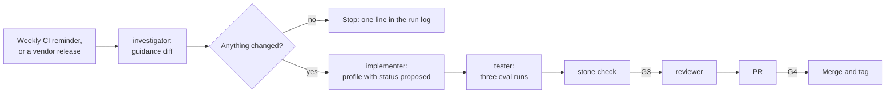

# Refresh an adapter

Use this guide after a vendor releases a new model, or changes its published guidance. You update
the model profile, and you keep only the changes that evals support. This profile runs on the
framework repo, not on a target repo.

| | |
| --- | --- |
| Profile | [adapter-refresh](../../framework/profiles/adapter-refresh.md) |
| Default mode | agent-centric |
| Gates | G3 (CI checks), G4 (a human approves the PR). G1 and G2 are skipped. |
| Status | Partly works today. A weekly CI run posts a reminder. You start each role by hand, and you run the evals by hand. |

If only the harness software changed, for example a new CLI flag, do not use this guide. Edit the
adapter in a [small change](small-change.md).

## Flow



Caption: each role is a new session.

## Today

### 1. Select the profile

In the framework repo, add the profile to `.cornerstone/config.yaml`, then render:

```yaml
profiles: [single-ticket, adapter-refresh]
```

```bash
stone render
```

`stone render` writes these files for this profile:

| File | What it is |
| --- | --- |
| `.claude/agents/` | Four role files: investigator, implementer, tester, and reviewer |
| `.cornerstone/hooks/protect-paths.py`, `.claude/settings.json` | The protected-path hook |
| `.cornerstone/checks/protected_paths.py`, `.cornerstone/checks/change_size.py` | K6 and K7 |
| `.github/workflows/cornerstone-checks.yml` | G3: K6, K7, K14, and `commands.all_checks` |
| `.github/workflows/cornerstone-adapter-refresh-schedule.yml` | Runs each Monday at 06:00 UTC, and by hand |

`stone render` writes no model profile. A target repo gets a new model profile only from a new
framework version.

### 2. Get the weekly reminder

Add the secret `CLAUDE_CODE_OAUTH_TOKEN`. See the
[adapter](../../framework/adapters/claude-code.md#trigger-workflows). The weekly workflow posts a
new issue, "Cornerstone adapter-refresh report" and the date. To start it by hand:

```bash
gh workflow run cornerstone-adapter-refresh-schedule.yml
```

The investigator in CI has read-only tools, no shell, and no web tools. It cannot open a source URL
or a release note. It reads the repo, which includes the model profiles. So the report is a
reminder, not the Watch step. Do the Watch step in step 3.

### 3. Watch: find the guidance diff

1. Make a branch, for example `chore/refresh-claude-5`.
2. Start the investigator: `STONE_ROLE=investigator claude --agent investigator`.
3. Give it this prompt:

   ```text
   Read each source URL in the active model profile in framework/adapters/claude-code/models/,
   and the release notes of the vendor. Compare them with the read dates in sources.
   If nothing changed, write one line in docs/reports/adapter-refresh.md and stop.
   If something changed, write the guidance diff in that file. For each new, changed, or removed
   idiom, give the source and a quote of 2 sentences or fewer.
   ```

The role file lists no web tool. The investigator can fetch a page with Bash, or you can paste the
page text into the prompt. The investigator changes only `paths.reports` (default
`docs/reports/`). See [Run the roles](run-the-roles.md).

> WARNING: The investigator reads web pages that you do not control. Give it no secrets and no
> write access other than the PR branch (P9).

### 4. Build the proposal

Start the implementer: `STONE_ROLE=implementer claude --agent implementer`. Give it this prompt:

```text
Read docs/reports/adapter-refresh.md. Write a new model profile with status: proposed, or update
the current one. Do not change the core framework files. Keep a decision log.
```

The implementer cannot change tests, checks, CI, `.claude/`, or `.cornerstone/`. It changes the
model profile and the adapter files.

### 5. Test each idiom

Start the tester: `STONE_ROLE=tester claude --agent tester`. For each new or changed idiom, the
profile needs three eval runs of each component in `affects`. Use `--model` to set the model:

| Run | Adapter | Model | Example |
| --- | --- | --- | --- |
| 1 | Current | Current | `stone eval role.tester --variant with --model claude-opus-5-5` |
| 2 | Current | New | `stone eval role.tester --variant with --model <new-model-id>` |
| 3 | Changed | New | Change the adapter file in the branch. Run the command of run 2 again. |

Each run writes a result file in `evals/results/`. Keep an idiom only if run 3 is better than run 2,
or equal at a lower cost. Remove the other idioms from the proposal. Record the results in the
decision log.

If a component has no eval, keep the idiom as `proposed` and open a ticket to write the eval (P5).

### 6. Verify, review, and deliver

1. Run `stone check` and `stone render --dry-run`. Use a sample repo for the second command (G3).
2. Start the reviewer: `STONE_ROLE=reviewer claude --agent reviewer`. Ask it to check each kept
   idiom against its source and its eval result.
3. Run `/workflow:ticket-delivery` to open the PR. The PR body needs the line
   `Profile: adapter-refresh`, the guidance diff, the eval table, and the decision log. K7 then uses
   the limit of this profile: 600 changed lines. A human approves the PR (G4).
4. After the merge, tag a new framework version. Each target repo changes `framework_version` and
   runs `stone render`.

| Failure | Action |
| --- | --- |
| A source page is not reachable | Keep the old idiom. Record the failure. Try again on the next run. |
| The new model is worse on the baseline evals | Do not change `role_models`. Report it in the PR. |

## Switching vendors

All vendor adapters and model profiles stay in the repo. A target repo selects one with the lines
`harness` and `model_profile` in its config. To switch, change the two lines and run `stone render`.

## Not built yet

- The CI investigator cannot read a source URL. The Watch step is a local run.
- No role starts the next role. You start each one.
- Only the components `role.tester` and `role.planner` have an eval. An idiom for another component
  stays `proposed`.
- `stone eval` has no option to compare adapter versions. Run 3 needs a manual change to the
  adapter file.
- `stone check` finds a vendor name in the core. It does not find each change to a core file. The
  reviewer checks that no core file changed (P12).
