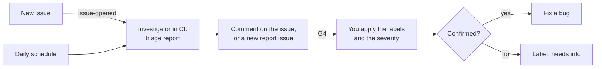

# Triage bug reports

Use this guide to sort new bug reports. The investigator searches for duplicates, tries to reproduce
the bug, and writes a triage report. This profile changes no code.

| | |
| --- | --- |
| Profile | [bug-triage](../../framework/profiles/bug-triage.md) |
| Default mode | agent-centric |
| Gates | G4 (a human approves the labels and the severity). G1, G2, and G3 are skipped. |
| Status | Partly works today. CI runs the investigator and posts its report. You apply the labels by hand. |

When a bug is confirmed, go on with [Fix a bug](fix-a-bug.md).

## Flow



Caption: the CI run has no shell. A triage in CI is a lead, not a reproduction.

## Today

### 1. Select the profile

Add the profile to `.cornerstone/config.yaml`:

```yaml
profiles: [bug-triage]
```

Then render and commit. See [Add Cornerstone to a repo](add-to-a-repo.md).

```bash
stone render
```

`stone render` writes these files for this profile:

| File | What it is |
| --- | --- |
| `.claude/agents/investigator.md` | The investigator role file |
| `.cornerstone/hooks/protect-paths.py`, `.claude/settings.json` | The protected-path hook |
| `.github/workflows/cornerstone-bug-triage-issue-opened.yml` | Runs on each new issue |
| `.github/workflows/cornerstone-bug-triage-schedule.yml` | Runs each day at 06:00 UTC, and by hand |

This profile has no G3 checks, so `stone render` writes no `cornerstone-checks.yml`.

### 2. Add the secret

Add the repository secret `CLAUDE_CODE_OAUTH_TOKEN`. Make it with `claude setup-token`. See the
[adapter](../../framework/adapters/claude-code.md#trigger-workflows).

### 3. Let CI run the first triage

| Trigger | When it runs | Where the report goes |
| --- | --- | --- |
| `ci:issue-opened` | An issue is opened | A comment on that issue |
| `schedule:daily` | Each day at 06:00 UTC. To start it by hand: `gh workflow run cornerstone-bug-triage-schedule.yml` | A new issue, "Cornerstone bug-triage report" and the date |

The scheduled run reads the 100 newest open issues that `gh issue list` returns. The
issue-opened run reads the one new issue, with its comments.

The investigator in CI has read-only tools and no shell. It can search the repo and read the
issue. It cannot run a test. So its report says "Reproduced: not tried" in most cases. The
workflow posts the report as text. It applies no label.

### 4. Reproduce the bug by hand

To get a real reproduction, start the investigator on your computer:

```bash
STONE_ROLE=investigator claude --agent investigator
```

Give it this prompt:

```text
Read issue #57 and the triage comment on it. Search open and closed issues for the same symptom.
Try to reproduce the bug in a test environment. Do not use production data.
Write the triage report in docs/reports/issue-57.md. Use the fields of the bug-triage profile:
reproduced, steps, expected and actual result, suspected area with a confidence level, suggested
severity and labels with a reason, and the duplicate, if any.
```

The investigator changes only `paths.reports` (default `docs/reports/`). The hook blocks each other
path. See [Run the roles](run-the-roles.md).

### 5. Decide (G4)

Read the report. Do not trust it without a check, because the investigator reads text from the
issue. Then do these steps:

| Report says | Action |
| --- | --- |
| Duplicate of an issue | Close the issue as a duplicate. Link the original. |
| Not reproduced | Add the label `needs info`. Ask the reporter for the missing facts. |
| Reproduced | Add the severity and the labels that you approve. Write the reproduction steps in the issue. Go on with [Fix a bug](fix-a-bug.md). |

> WARNING: The investigator reads untrusted text from bug reports. Give it no production data and
> no secrets. If a report contains a secret, do not copy it into a comment. Tell the repo owner.

## Not built yet

- No role applies a label or sets a severity. The post job posts text only, and you apply the labels
  after G4.
- No role marks a confirmed bug "ready" for the debugging profile. You do it.
- The CI run cannot reproduce a bug. It has no shell. Reproduction is a local run (step 4).
- No check tests the writing of the report. Run `stone check-writing` on a report file if you
  need K17.
