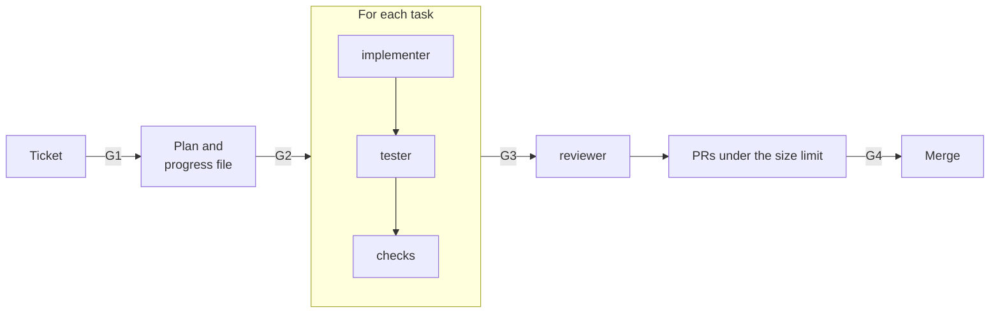

# Build a feature

Use this guide for a user-visible feature that touches more than one layer, or that needs a design
decision. You approve the plan before an agent writes code.

| | |
| --- | --- |
| Profile | [app-slice](../../framework/profiles/app-slice.md) |
| Default mode | hybrid: you own the plan, an agent does the build |
| Gates | G1, G2 (plan), G3, G4 |
| Status | Partial. `stone render` does not write the planner role yet. You write the plan in a new session with a prompt. |

## Flow



## Today

### 1. Shape the ticket (G1)

Start the shaper with the issue: `claude --agent shaper`. It interviews you until the ticket has
the [Definition of Ready](../../framework/workflow-model.md#definition-of-ready-default) fields. A
feature ticket must name its personas, for example `Personas: farmer, worker`.

Add the `agent-ready` label when the ticket is ready. That label is G1.

### 2. Write the plan (G2)

Pick one spec tool. Use the same one for each feature in the repo.

| Spec tool | How |
| --- | --- |
| Plain (default) | Start a new session with the prompt below. |
| OpenSpec | Run `/workflow:sdd-plan` with the issue number. |

Prompt for the plain spec tool:

```text
Read issue #64 and constitution/personas.md. Write docs/plans/issue-64.md with these sections:
Understanding, Files to change, Approach, Acceptance criteria coverage, Out of scope and risks,
Open questions. Map each acceptance criterion to a job story ID.
Write docs/plans/issue-64.progress.json with one task for each step. Set "passes": false.
Do not write code.
```

Read the plan. Edit the plan, not the code. Open a PR with the plan. Your approval of that PR is G2.

### 3. Build each task

For each task in the progress file, follow [Run the roles](run-the-roles.md):

1. Start the implementer with the issue, the plan, and the task ID. It does one task only.
2. Start the tester with the issue, the plan, and the branch. It writes the acceptance tests from
   the job stories, and the integration tests for the task.
3. Run `commands.all_checks`. If they pass, set `"passes": true` for the task.

Do not use `/workflow:sdd-build` in a Cornerstone repo. It builds and tests in one session, and
that breaks the separation rule (P2).

### 4. Review and deliver

1. Start the reviewer with the plan and the branch. It reports scope drift from the plan.
2. Open one PR for each group of tasks that stays under the size limit. Use
   `/workflow:ticket-delivery`.
3. A human approves each PR (G4).

| Failure | Action |
| --- | --- |
| The build needs a change that the plan does not have | Stop. Update the plan. Get G2 again. |
| An end-to-end test cannot run in CI | Record a waiver. Add a manual verify step to the PR. |
| The reviewer finds scope drift | Remove the extra change, or open a new ticket for it. |

## When the profile ships

| Step | Today | Target |
| --- | --- | --- |
| Plan | A prompt in a new session | The planner role, in a fresh session |
| Progress | You set `passes` by hand | The pipeline sets `passes` after the checks pass |
| Architecture | Your CI rules | Fitness checks (K8) |
| Test quality | Not measured | Mutation score on the changed code (K10) |
| OpenSpec build | Not usable (P2) | `sdd-build` split into an implementer step and a tester step |
