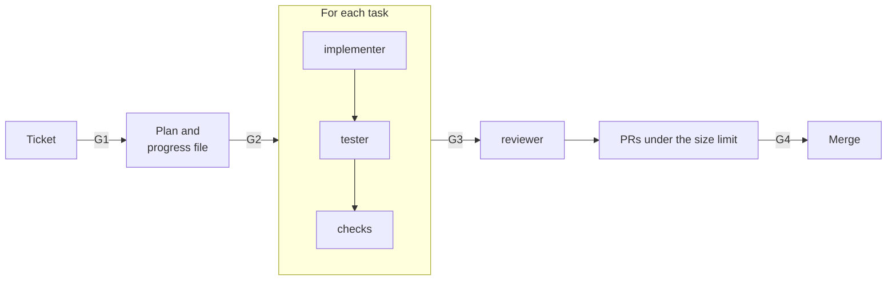

# Build a feature

Use this guide for a user-visible feature that touches more than one layer, or that needs a design
decision. You approve the plan before an agent writes code.

| | |
| --- | --- |
| Profile | [app-slice](../../framework/profiles/app-slice.md) |
| Default mode | hybrid: you own the plan, an agent does the build |
| Gates | G1, G2 (plan), G3, G4 |
| Status | Partial. The pipeline does not set `passes` in the progress file yet. You set it by hand. |

## Flow



## Today

### 1. Shape the ticket (G1)

Start the shaper with the issue: `claude --agent shaper`. It interviews you until the ticket has
the [Definition of Ready](../../framework/workflow-model.md#definition-of-ready-default) fields. A
feature ticket must name its personas, for example `Personas: farmer, worker`.

Add the `agent-ready` label when the ticket is ready. That label is G1.

### 2. Write the plan (G2)

Start the planner with the ready issue: `STONE_ROLE=planner claude --agent planner`. It writes
`docs/plans/<id>.md` with the six plan sections, and `docs/plans/<id>.progress.json` with one task
for each step. It maps each acceptance criterion to a job story ID. It does not write code.

If the feature adds, changes, or removes a behavior, the planner also writes the spec delta,
`docs/plans/<id>.spec.md`. Each section is one requirement, for example `ADDED export.R3`, with
WHEN and THEN scenarios. The format is in [Specs](../../framework/workflow-model.md#specs).

Read the plan and the delta. Edit the plan, not the code. Open a PR with the plan. Your approval of that PR is G2.

### 3. Build each task

For each task in the progress file, follow [Run the roles](run-the-roles.md):

1. Start the implementer with the issue, the plan, and the task ID. It does one task only.
2. Start the tester with the issue, the plan, and the branch. It writes the acceptance tests from
   the job stories, and the integration tests for the task.
3. Run `commands.all_checks`. If they pass, set `"passes": true` for the task.

### 4. Review and deliver

1. Start the reviewer with the plan and the branch. It reports scope drift from the plan, and
   each scenario of the spec delta that has no test.
2. Open one PR for each group of tasks that stays under the size limit. Use
   `/workflow:ticket-delivery`. It applies the spec delta and commits the output alone. To do it
   by hand:

   ```bash
   stone spec apply issue-64
   git add docs/specs docs/plans/issue-64.spec.md
   git commit -m "chore(specs): apply the spec delta of issue-64" \
     --trailer "Role: generator" --trailer "Actor: human"
   ```

3. A human approves each PR (G4).

| Failure | Action |
| --- | --- |
| The build needs a change that the plan does not have | Stop. Update the plan. Get G2 again. |
| An end-to-end test cannot run in CI | Record a waiver. Add a manual verify step to the PR. |
| The reviewer finds scope drift | Remove the extra change, or open a new ticket for it. |
| K19 reports the same `apply_order` after a merge | Run `stone spec sync`. Commit its output with `Role: generator`. |
| Apply or sync says that a requirement exists, after a merge | Another branch added the same ID. In your delta, change the ID of the ADDED requirement to a free number. Then run `stone spec sync`. |

## When the profile ships

| Step | Today | Target |
| --- | --- | --- |
| Progress | You set `passes` by hand | The pipeline sets `passes` after the checks pass |
| Architecture | Your CI rules | Fitness checks (K8) |
| Test quality | Not measured | Mutation score on the changed code (K10) |
