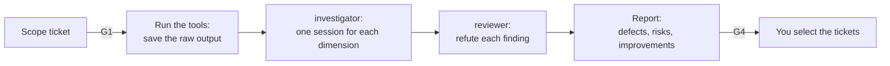

# Audit an area of the code

Use this guide to get a structured view of the health of one area of the code, for example before a
refactor. The output is a findings report. This profile changes no code. A human selects the
findings that become tickets.

| | |
| --- | --- |
| Profile | [code-audit](../../framework/profiles/code-audit.md) |
| Default mode | agent-centric |
| Gates | G1 (a human sets the scope), G4 (a human selects the findings). G2 and G3 are skipped. |
| Status | Partly works today. A monthly CI run posts a first report. You run the tools and the other roles by hand. |

If you already know the defect, use [Fix a bug](fix-a-bug.md).

## Flow



Caption: each role is a new session.

## Today

### 1. Select the profile

Add the profile to `.cornerstone/config.yaml`, then render:

```yaml
profiles: [code-audit]
```

```bash
stone render
```

`stone render` writes these files for this profile:

| File | What it is |
| --- | --- |
| `.claude/agents/investigator.md`, `.claude/agents/reviewer.md` | The two role files |
| `.cornerstone/hooks/protect-paths.py`, `.claude/settings.json` | The protected-path hook |
| `.github/workflows/cornerstone-code-audit-schedule.yml` | Runs on the first day of each month at 06:00 UTC, and by hand |

This profile has no G3 checks, so `stone render` writes no `cornerstone-checks.yml`.

### 2. Set the scope (G1)

Write the scope in an issue. Without a scope, the report is too wide to use.

```markdown
## Scope
Paths: src/billing/
Dimensions: correctness, security, architecture drift, test strength, maintainability
Time box: 2 hours
```

### 3. Run the tools first

Run the deterministic tools before any role. The roles use the tool output as evidence, before
their own opinion.

| Tool | Check | Config key |
| --- | --- | --- |
| Complexity | K9 | none: use your tool |
| Architecture fitness | K8 | `commands.architecture` |
| Mutation score | K10 | `commands.mutation` |
| CRAP score | none | none: use your tool |
| Secret scan | K13 | none: use your tool |

Save the raw output in the reports path, for example `docs/reports/audit-billing/tools.txt`.

The K10 command reads two environment variables, `BASE_REF` and `MUTATION_SCORE_MIN`. See
[customization.md](../../framework/customization.md#commands-for-the-by-profile-checks).

### 4. Run one investigator for each dimension

Start a new session for each dimension:

```bash
STONE_ROLE=investigator claude --agent investigator
```

Give it this prompt:

```text
Audit the dimension "security" in src/billing/. The tool output is in docs/reports/audit-billing/tools.txt.
Use the tool output first. Write the findings in docs/reports/audit-billing/security.md.
For each finding give the file and line, the evidence, the severity (High, Medium, or Low), and a fix.
```

The investigator changes only `paths.reports` (default `docs/reports/`). Commit each file with the
trailers `Role: investigator` and `Actor: agent`. See [Run the roles](run-the-roles.md).

### 5. Try to refute the findings

Start the reviewer in a new session: `STONE_ROLE=reviewer claude --agent reviewer`. Give it this
prompt:

```text
Read the reports in docs/reports/audit-billing/. Try to refute each finding. List each finding
that has no evidence. Do not change any file.
```

The reviewer changes no file. It prints its verdicts in the session.

### 6. Write the report and decide (G4)

1. Start a new investigator session.
2. Give it the dimension reports and the verdicts of the reviewer.
3. Ask it to write `docs/reports/audit-billing.md` in this order: defects, risks, improvements.
4. Remove each finding that the reviewer refuted.

Read the report. Select the findings that become tickets. You must decide on each High finding.

| Failure | Action |
| --- | --- |
| Too many findings | Keep High and Medium. Put the rest in an appendix. |
| A finding needs a check that does not exist | Open a ticket to create the check. |

### Start a first report from CI

The monthly workflow starts one investigator in CI. It has read-only tools and no shell. It cannot
run the tools of step 3. It reads the repo and the open issues. It posts the report as a new issue,
"Cornerstone code-audit report" and the date. To start it by hand:

```bash
gh workflow run cornerstone-code-audit-schedule.yml
```

Add the secret `CLAUDE_CODE_OAUTH_TOKEN` first. See the
[adapter](../../framework/adapters/claude-code.md#trigger-workflows). Use the report as a lead, not
as the audit.

## Not built yet

- The CI run starts one investigator with no scope and no tool output. It does not start one
  investigator for each dimension, and it does not start the reviewer.
- No role runs the tools of step 3. You run them.
- No role writes the final report from the dimension reports. You start that session.
- No check tests the writing of the report. Run `stone check-writing` on a report file if you
  need K17.
