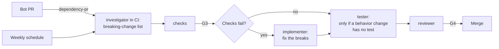

# Upgrade a dependency

Use this guide to upgrade one dependency, fix the breaks, and prove that behavior did not change.
Start from a PR of a dependency bot, or from a scheduled report. The upgrade must be one
dependency, or one group that must move together.

| | |
| --- | --- |
| Profile | [dependency-upgrade](../../framework/profiles/dependency-upgrade.md) |
| Default mode | agent-centric |
| Gates | G3 (CI checks), G4 (a human approves the PR). G1 and G2 are skipped. |
| Status | Partly works today. CI runs the investigator on a bot PR and on a weekly schedule. You start the other roles by hand. |

If the upgrade needs a large code change, use the
[refactor-migration](../../framework/profiles/refactor-migration.md) profile.

## Flow



Caption: each role is a new session.

## Today

### 1. Select the profile

Add the profile to `.cornerstone/config.yaml`, then render:

```yaml
profiles: [dependency-upgrade]
```

```bash
stone render
```

`stone render` writes these files for this profile:

| File | What it is |
| --- | --- |
| `.claude/agents/` | Four role files: investigator, implementer, tester, and reviewer |
| `.cornerstone/hooks/protect-paths.py`, `.claude/settings.json` | The protected-path hook |
| `.cornerstone/checks/protected_paths.py`, `.cornerstone/checks/change_size.py` | K6 and K7 |
| `.github/workflows/cornerstone-checks.yml` | G3: K6, K7, K14, and `commands.all_checks` |
| `.github/workflows/cornerstone-dependency-upgrade-dependency-pr.yml` | Runs on a PR of `dependabot[bot]` or `renovate[bot]` |
| `.github/workflows/cornerstone-dependency-upgrade-schedule.yml` | Runs each Monday at 06:00 UTC, and by hand |

Make the `cornerstone-checks` job a required status check (G3). Require a PR review (G4).

### 2. Add the secrets

Add the secret `CLAUDE_CODE_OAUTH_TOKEN` in two places: as a repository secret, and as a Dependabot
secret. A run that Dependabot starts gets only Dependabot secrets. See the
[adapter](../../framework/adapters/claude-code.md#trigger-workflows).

### 3. Read the investigator report

| Trigger | When it runs | Where the report goes |
| --- | --- | --- |
| `ci:dependency-pr` | A bot opens or reopens a PR | A comment on that PR |
| `schedule:weekly` | Each Monday at 06:00 UTC. To start it by hand: `gh workflow run cornerstone-dependency-upgrade-schedule.yml` | A new issue, "Cornerstone dependency-upgrade report" and the date |

The investigator in CI has read-only tools, no shell, and no web tools. For a bot PR it reads the
PR title, the PR body, the list of files, and the repo. Bot PR bodies often include the release
notes, so it uses those. It cannot open a changelog page. In the scheduled run it reads the repo and
the open issues. It cannot ask a package registry for new versions.

Use the report as a lead. For the real breaking-change list, run the investigator by hand:

```bash
STONE_ROLE=investigator claude --agent investigator
```

```text
Read PR #88. Read the release notes and the changelog between the old and the new version.
List the breaking changes that apply to this repo, with file paths.
Write the list in docs/reports/pr-88.md.
```

The investigator changes only `paths.reports` (default `docs/reports/`). See
[Run the roles](run-the-roles.md).

### 4. Fix the breaks

1. Check out the PR branch: `gh pr checkout 88`.
2. Wait for the `cornerstone-checks` job. If all checks pass, go to step 6.
3. Start the implementer: `STONE_ROLE=implementer claude --agent implementer`.
4. Give it this prompt:

   ```text
   Read docs/reports/pr-88.md and the failing check output. Fix the breaks. Keep a decision log.
   Do not change tests or checks.
   ```

5. Commit with the trailers `Role: implementer` and `Actor: agent`. If the fix needs a test change,
   stop. The implementer cannot make it (K6).

### 5. Cover a behavior change

If the dependency changes a behavior that the tests do not cover, start the tester:
`STONE_ROLE=tester claude --agent tester`. Ask it for tests of the behavior that the repo uses.
Commit with `Role: tester`.

### 6. Review and approve (G4)

1. Start the reviewer: `STONE_ROLE=reviewer claude --agent reviewer`. Ask it to check the diff
   against the breaking-change list.
2. Edit the PR body. A bot PR body does not have what the checks need:
   - A line `Profile: dependency-upgrade`. K7 then uses the limit of this profile: 300 changed lines.
   - The sections Evidence, Decision log, Review findings, and Confidence (K14).
   - The breaking-change list. Mark each change fixed, or "does not apply" with a reason.
3. Approve the PR. A human must approve it (G4).

| Failure | Action |
| --- | --- |
| The upgrade is over the size limit | Stop. Open a ticket for the [refactor-migration](../../framework/profiles/refactor-migration.md) profile. |
| The new version has a known security issue | Stop. Report it. Do not merge. |
| A bot commit changes a protected path, for example a workflow file | K6 fails. A human makes the change. |

## Not built yet

- The CI investigator cannot read release notes outside the PR text. It has no web tools.
- The scheduled run cannot find new versions. It has no shell and no registry access.
- No role starts the implementer, the tester, or the reviewer after the report. You start them.
- A bot PR has no `Profile:` line and no K14 sections. You add them.
- The patch-version waiver for G4 is only a record. `stone check` validates it (D84), and nothing
  else reads a G4 waiver. `stone render` does not change the branch protection, and no file
  that it writes merges a PR. Do not rely on it to skip the review.
