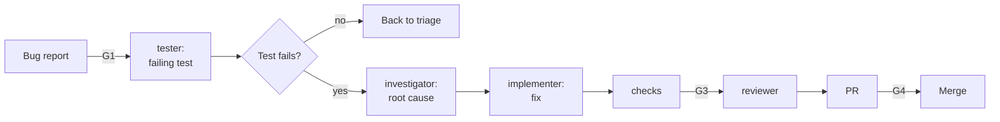

# Fix a bug

Use this guide for a confirmed defect that has reproduction steps. The test that shows the bug comes
before the fix. So the test comes from the bug report, not from the fix.

| | |
| --- | --- |
| Profile | [debugging](../../framework/profiles/debugging.md) |
| Default mode | hybrid |
| Gates | G1 (a check on the bug fields), G3, G4 |
| Status | Works today. The investigator finds the root cause. You start each role by hand. |

If the report is not confirmed, sort it first with the
[bug-triage](../../framework/profiles/bug-triage.md) profile.

## Flow



Caption: each role is a new session.

## Today

### 1. Write the bug report (G1)

```markdown
## Steps to reproduce
1. Sign in.
2. Wait 61 minutes on the dashboard.
3. Select Refresh.

## Expected result
The dashboard refreshes.

## Actual result
The page shows "401 Unauthorized".

## Known good commit
a1b2c3d (optional)

Personas: farmer
```

### 2. Write the failing test first

1. Make a branch, for example `fix/token-expiry`.
2. Start the tester: `STONE_ROLE=tester claude --agent tester`.
3. Give it this prompt:

   ```text
   Read issue #57. Write one test that reproduces the defect. The test must fail on the current code.
   Do not fix the code. Commit the test.
   ```

4. Run the test. If it passes, the defect is not reproduced. Stop, and send the issue back to triage.

### 3. Find the root cause

Start the investigator: `STONE_ROLE=investigator claude --agent investigator`. Give it this prompt:

```text
Read issue #57 and the failing test on this branch. Find the root cause. Do not fix it.
If the issue has a known good commit, run git bisect run with the failing test.
Write the cause and the evidence in docs/reports/issue-57.md.
```

The investigator changes only the reports path (`paths.reports`, default `docs/reports/`). The hook
blocks each other path. Commit the report:

```bash
git add docs/reports/issue-57.md
git commit -m "docs(reports): add the root cause of issue 57" \
  --trailer "Role: investigator" --trailer "Actor: agent"
```

### 4. Fix the root cause

Start the implementer: `STONE_ROLE=implementer claude --agent implementer`. Give it this prompt:

```text
Read issue #57, the failing test on this branch, and docs/reports/issue-57.md.
Copy the root cause and the evidence into the decision log, and link the report.
Then fix the root cause, not the symptom.
```

The implementer cannot change the test. A fix that weakens an assertion fails K6, or the reviewer
flags it.

### 5. Check, review, and deliver

1. Run `commands.all_checks`. The new test and all old tests must pass.
2. Start the reviewer. Ask it to confirm that the fix addresses the root cause and does not hide
   the error.
3. Run `/cornerstone:ticket-delivery` to open the PR. A human approves it (G4).

The PR body needs the line `Profile: debugging`. Check K7 then uses the limit of this profile:
200 changed lines. It also needs the sections Evidence, Decision log, Review findings, and
Confidence (K14).

### Start the investigator from a label

`stone render` writes the workflow `cornerstone-debugging-label.yml`. When you add the label
`agent-ready` to an issue, the workflow starts the investigator in CI. The investigator has read-only
tools and no shell. It cannot run the test. It posts a report on the issue. Use the report as a lead.

Do step 3 by hand for the real root cause. Add the secret `CLAUDE_CODE_OAUTH_TOKEN` first. See the
[adapter](../../framework/adapters/claude-code.md#trigger-workflows).
If the repo selects more than one profile with the label `agent-ready`, add the label
`profile:<id>` before it.

## If the fix is not small

| Failure | Action |
| --- | --- |
| No test can reproduce the defect | Stop. Record what you tried in the issue. You decide the next step. |
| The fix needs a design change | Stop. Open a new ticket and use [Build a feature](build-a-feature.md). |

## Not built yet

- Automatic bisect. Check K12 adds a step that runs `commands.differential` from the repo config, if
  the command has a value. It does not run `git bisect`. The bisect stays in the prompt of step 3.
