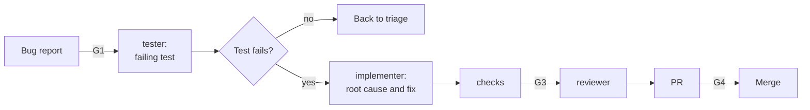

# Fix a bug

Use this guide for a confirmed defect that has reproduction steps. The test that shows the bug comes
before the fix. So the test comes from the bug report, not from the fix.

| | |
| --- | --- |
| Profile | [debugging](../../framework/profiles/debugging.md) |
| Default mode | hybrid |
| Gates | G1 (a check on the bug fields), G3, G4 |
| Status | Partial. `stone render` does not write the investigator role yet. The implementer finds the root cause. |

If the report is not confirmed, sort it first with the
[bug-triage](../../framework/profiles/bug-triage.md) profile.

## Flow



Caption: each role is a new session.

## Today

### 1. Write the bug report (G1)

```markdown
## Steps to reproduce
1. Sign in.
2. Wait 61 minutes on the dashboard.
3. Select Refresh.

## Expected result
The dashboard refreshes.

## Actual result
The page shows "401 Unauthorized".

## Known good commit
a1b2c3d (optional)

Personas: farmer
```

### 2. Write the failing test first

1. Make a branch, for example `fix/token-expiry`.
2. Start the tester: `STONE_ROLE=tester claude --agent tester`.
3. Give it this prompt:

   ```text
   Read issue #57. Write one test that reproduces the defect. The test must fail on the current code.
   Do not fix the code. Commit the test.
   ```

4. Run the test. If it passes, the defect is not reproduced. Stop, and send the issue back to triage.

### 3. Find the root cause and fix it

Start the implementer: `STONE_ROLE=implementer claude --agent implementer`. Give it this prompt:

```text
Read issue #57 and the failing test on this branch. Find the root cause before you change code.
If the issue has a known good commit, run git bisect with the failing test.
Write the cause and the evidence in the decision log. Then fix the root cause, not the symptom.
```

The implementer cannot change the test. A fix that weakens an assertion fails K6, or the reviewer
flags it.

### 4. Check, review, and deliver

1. Run `commands.all_checks`. The new test and all old tests must pass.
2. Start the reviewer. Ask it to confirm that the fix addresses the root cause and does not hide
   the error.
3. Run `/workflow:ticket-delivery` to open the PR. A human approves it (G4).

## If the fix is not small

| Failure | Action |
| --- | --- |
| No test can reproduce the defect | Stop. Record what you tried in the issue. You decide the next step. |
| The fix needs a design change | Stop. Open a new ticket and use [Build a feature](build-a-feature.md). |

## When the profile ships

| Step | Today | Target |
| --- | --- | --- |
| Root cause | The implementer, in the same session as the fix | The investigator role, in its own session, before the implementer |
| Bisect | A prompt asks for it | Check K12 runs `git bisect run` with the failing test |
| Personas | K18 warns on an unknown persona ID in a plan | K18 fails on it |
