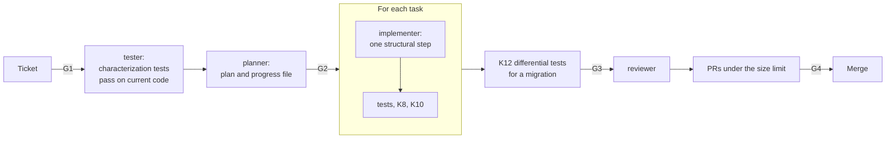

# Refactor or migrate

Use this guide to change the structure of the code, or to move it to a new library or platform, with
no change in behavior. The rule: a structure change and a behavior change never go in the same
commit.

| | |
| --- | --- |
| Profile | [refactor-migration](../../framework/profiles/refactor-migration.md) |
| Default mode | hybrid |
| Gates | G1 (ticket), G2 (plan), G3 (CI checks), G4 (PR review) |
| Checks | K1, K2, K3, K6, K7, K8, K9, K10, K12, K13, K14, K17 |
| Status | Works today. You start each role by hand, and you set `passes` by hand. |

If the behavior must change too, do the refactor first with this guide. Then change the behavior
with [Make a small change](small-change.md) or [Build a feature](build-a-feature.md).

## Flow



Caption: each role is a new session.

## Today

### 1. Set up the checks

This profile needs three commands that the roles do not write. Put them in
`.cornerstone/config.yaml`, then render.

```yaml
profiles: [refactor-migration]
commands:
  all_checks: make check                          # K1, K2, K3, K9, K13
  architecture: lint-imports                      # K8
  mutation: scripts/mutation-score.sh             # K10
  differential: pytest tests/differential         # K12, for a migration
paths:
  tests: [tests/]
  plans: docs/plans/
limits:
  pr_changed_lines: 600
  mutation_score_changed_code: 0.6
```

```bash
stone render
```

`stone render` writes these files for this profile:

| File | What it is |
| --- | --- |
| `.claude/agents/` | Five role files: shaper, planner, tester, implementer, and reviewer |
| `.cornerstone/hooks/protect-paths.py`, `.claude/settings.json` | The protected-path hook |
| `.cornerstone/checks/protected_paths.py`, `.cornerstone/checks/change_size.py` | K6 and K7 |
| `.github/workflows/cornerstone-checks.yml` | G3: K6, K7, K14, `commands.all_checks`, and one step for each of K8, K12, and K10 |

This profile has only the `command` trigger, so `stone render` writes no trigger workflow. Make the
`cornerstone-checks` job a required status check (G3).

The G3 workflow adds a step for K8, K12, and K10 only if the command has a value. If it has none,
render skips the step and warns. K10 also needs `limits.mutation_score_changed_code`. Without it,
render stops.

Each step warns for 2 weeks after render adds it (`continue-on-error`). Then it blocks.
CI does not know the profile of a PR, so each step runs on each PR of the repo.

K9 (complexity) and K13 (secret scan) have no step of their own. Put them in `commands.all_checks`.

### 2. Write the K10 command

The K10 step runs the command with two environment variables. The command must read them:

| Variable | Value |
| --- | --- |
| `BASE_REF` | The base branch of the PR, for example `origin/main`. Test only the mutants in the code changed since it. |
| `MUTATION_SCORE_MIN` | `limits.mutation_score_changed_code`. Exit with an error if the score is lower. |

Most mutation tools do not read these variables, so wrap the tool in a repo script, for example
`scripts/mutation-score.sh`. See
[customization](../../framework/customization.md#commands-for-the-by-profile-checks).

### 3. Shape the ticket (G1)

Start the shaper: `claude --agent shaper`. The ticket must state two things:

```markdown
## Target structure
Move the payment code from src/shop/ to src/payments/. No module outside src/payments/
imports from src/payments/internal/.

## Behavior that must not change
Each public function of src/shop/payments.py gives the same output for the same input.
```

### 4. Pin the behavior with characterization tests

1. Make a branch, for example `chore/move-payments`.
2. Start the tester: `STONE_ROLE=tester claude --agent tester`.
3. Give it this prompt:

   ```text
   Read issue #70. Write characterization tests for the current behavior of src/shop/payments.py.
   The tests must pass on the current code. Do not change source code. Commit the tests.
   ```

4. Run the tests. If one fails, the test does not describe the current behavior. Fix the test
   before you go on.

### 5. Write the plan (G2)

Start the planner: `STONE_ROLE=planner claude --agent planner`. Ask for one task for each small
structural step. It writes `docs/plans/<id>.md` and `docs/plans/<id>.progress.json`. See
[Build a feature](build-a-feature.md#2-write-the-plan-g2). A refactor changes no behavior, so it
needs no spec delta.

The planner changes only `paths.plans`. It cannot write the new K8 rules in the repo. Put the
rules in the plan as text. Then add them to the K8 config yourself. Only a human changes a check
(K6).

Open a PR with the plan. Your approval of that PR is G2.

### 6. Do each structural step

For each task, start a new implementer session:
`STONE_ROLE=implementer claude --agent implementer`. Give it the issue, the plan, and one task ID.

After each task:

1. Run the characterization tests. They must all pass, with no change to an assertion.
2. Run `commands.all_checks` and `commands.architecture`.
3. Set `"passes": true` for the task in the progress file.

The implementer cannot change tests or checks (K6). If a characterization test must change, stop.
That is a behavior change. You decide.

### 7. Prove a migration with differential tests (K12)

For a migration, the old and the new code get the same inputs. They must give the same outputs.

1. Keep the old code available while you migrate, for example in a copy of the module.
2. Start the tester. Ask it to write a differential test in a test path that
   `commands.differential` runs (for example `tests/differential/`). The test calls both implementations with the same inputs
   and compares the outputs.
3. Run `commands.differential`. CI runs it too, as the K12 step.

If the test finds a difference, stop. Record the input. Find which side is correct.

### 8. Fan out a change to many files

If many files need the same change, run one session for each file or group. Test the prompt on 2 or
3 files first. Read the diff of those files. Then run the rest:

```bash
for f in $(cat files.txt); do
  STONE_ROLE=implementer claude --agent implementer \
    -p "Apply the change in plan docs/plans/issue-70.md, task 4, to $f only. Do not touch other files."
done
```

Run the characterization tests after each file or group.

### 9. Review and deliver

1. Start the reviewer: `STONE_ROLE=reviewer claude --agent reviewer`. Ask it to check that no
   behavior changed.
2. Open PRs that stay under the size limit (600 changed lines). Use `/workflow:ticket-delivery`.
3. Put the line `Profile: refactor-migration` in each PR body, for check K7. Add the sections
   Evidence, Decision log, Review findings, and Confidence, for check K14.
4. A human approves each PR (G4).

The exit criteria are:

- All characterization tests pass with no change to their assertions.
- The new K8 rules pass.
- The mutation score of the changed code is at or above the limit.

## Not built yet

- A pipeline that sets `passes` in the progress file. You set it by hand.
- A run script that starts each role in order, and a fan-out command. The loop in step 8 is by hand.
- A role that writes the K8 rules into the repo. The planner can write only in `paths.plans`.
- A mutation tool. The repo supplies the K10 command and the differential harness.
- K9 and K13 have no step of their own in the G3 workflow.
