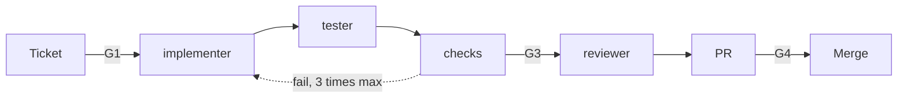

# Make a small change

Use this guide for one small, clear change in one area of the code. You can describe it in one or
two sentences.

| | |
| --- | --- |
| Profile | [single-ticket](../../framework/profiles/single-ticket.md) |
| Default mode | agent-centric: ticket in, PR out |
| Gates | G1 (a check on the ticket fields), G3, G4 |
| Status | Works today |

Do not use this guide if the change crosses several layers or needs a design decision. Use
Build a feature. If you do not know the cause of a defect, use
Fix a bug.

## Flow



Caption: each box after the ticket is a new session.

## Today

### 1. Write the ticket (G1)

The ticket meets the Definition of Ready when it has these fields:

```markdown
## Goal
Show the last sync time on the settings page.

## Acceptance criteria
1. The settings page shows "Last sync: <date and time>" under the sync button.
2. If no sync has happened, it shows "Last sync: never".

## Non-goals
- No change to how the sync works.

## Test oracle
Open the settings page after a sync. The time matches the sync log.

Personas: farmer
```

Write `Personas: none` if the change does not affect users. If a field is missing, start the shaper
(`claude --agent shaper`) with the issue number. It asks you for the missing fields.

### 2. Run the roles

Follow [Run the roles](run-the-roles.md). Each step is a new session.

1. Make a branch, for example `feature/last-sync-time`.
2. Start the implementer with the issue number. It changes the code and writes the decision log.
3. Start the tester with the issue number and the branch. It writes one test or more for each
   acceptance criterion.
4. Run `commands.all_checks`. If a check fails, give the output to a new implementer session.
5. Start the reviewer with the issue, the branch, the check output, and the decision log.

### 3. Open the PR (G4)

Run `/workflow:ticket-delivery`. It maps each acceptance criterion to its evidence and opens the PR.
A human approves the PR.

## Change the mode

| If you want to | Do this |
| --- | --- |
| Write the code yourself | Use human-centric mode. Commit with `Role: implementer` and `Actor: human`. Then start the tester and the reviewer as above. |
| Approve each edit of the agent | Use a `pair` session for the Build stage: `STONE_ROLE=implementer claude --agent implementer`, in manual permission mode. |
| Run with no human at the terminal | Add `-p` to each role command. See [Run the roles](run-the-roles.md#start-a-role). |

The gates do not change with the mode. The tester is always a different session from the
implementer.

## When the profile ships

The single-ticket profile works today. The next parts in the framework design are:

- A run script that starts each role in order, for agent-centric mode on your computer.
- A CI workflow for each role, started by the `agent-ready` label.
- Check K14, which fails a PR with an empty evidence section.
