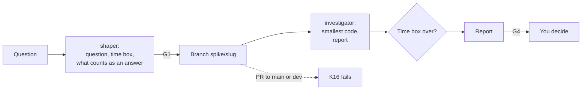

# Run a spike

Use this guide to answer one question with throwaway code in a fixed time box, for example "Can
library X do Y?". The output is an answer. The code stays on a spike branch and never merges.

| | |
| --- | --- |
| Profile | [spike](../../framework/profiles/spike.md) |
| Default mode | human-centric |
| Gates | G1 (a human sets the question), G4 (a human reads the report). G2 and G3 are skipped. |
| Checks | K16 (blocks from the start), K13, K17 |
| Status | Works today. You start each role by hand. CI runs K16 only. |

If the code must stay, do not use this guide. Use [Build a feature](build-a-feature.md).

## Flow



Caption: the investigator is a new session. K16 fails each PR from a `spike/` branch into the main
branch or the integration branch.

## Today

### 1. Set up K16 once

K16 is the control that stops spike code from merging (D25, D30). The hook lets the investigator
write code on a `spike/` branch, and K16 fails the PR.

1. Put both branch names in `.cornerstone/config.yaml`. The two can be the same branch. Write each
   name as a quoted string (D34).

   ```yaml
   profiles: [spike]
   branches: {integration: "dev", main: "main"}
   ```

2. Run `stone render`, and commit the output. `stone render` writes these files for this profile:

   | File | What it is |
   | --- | --- |
   | `.claude/agents/shaper.md`, `.claude/agents/investigator.md` | The two role files |
   | `.cornerstone/hooks/protect-paths.py`, `.claude/settings.json` | The protected-path hook |
   | `.github/workflows/cornerstone-k16.yml` | K16 |

3. In the GitHub settings of the repo, make the `k16` job a required status check. Do this on the
   main branch and on the integration branch (D33).

K16 runs from the base branch, so a commit on the spike branch cannot change or remove it. This
profile has no G3 checks, so `stone render` writes no `cornerstone-checks.yml`.

### 2. Shape the question (G1)

Start the shaper: `claude --agent shaper`. Give it the question. Answer its questions until the
ticket has these parts:

```markdown
## Question
Can library X read a file of 2 GB in under 10 seconds?

## Time box
2 hours

## What counts as an answer
A measured time on the sample file, and the memory use.
```

### 3. Make the spike branch

The name must start with `spike/`:

```bash
git switch -c spike/library-x-speed
```

### 4. Run the investigator

Start the investigator: `STONE_ROLE=investigator claude --agent investigator`. Give it this prompt:

```text
Read issue #63. Build the smallest code that answers the question. You can skip tests.
Stop at the time box, also if the answer is not complete.
Write the report in docs/reports/issue-63.md: the answer, the evidence, the limits, and a recommendation.
```

On a `spike/` branch, the hook lets the investigator change each path except `.claude/` and
`.cornerstone/`. On any other branch, it changes only `paths.reports` (default `docs/reports/`).
Commit with the trailers `Role: investigator` and `Actor: agent`. See
[Run the roles](run-the-roles.md).

### 5. Decide (G4)

Read the report. Pick one of these actions:

| Decision | Action |
| --- | --- |
| The answer is clear | Put the report in the issue or on a normal branch. Close the spike. |
| The code must stay | Rebuild it on a new branch with [Build a feature](build-a-feature.md) or [Make a small change](small-change.md). |
| The answer is not complete | Write the open question in the issue. Start a new spike if it is worth it. |

K16 fails a PR from the spike branch, so do not open one. To keep the report in the repo, copy the
file to a new branch from the integration branch and open the PR from there.

> CAUTION: K16 reads only the head branch name. It does not find spike commits on a branch with
> another name. A renamed spike branch, or a spike branch merged into a feature branch, is not
> caught (D33). Do not do this. At G4, the reviewer must look for spike commits.

## Not built yet

- No tool enforces the time box. You stop the session.
- K16 does not find spike commits on a branch with a different name (D33).
- `stone render` writes no CI job for K13 or K17. Run a secret scan and `stone check-writing` by
  hand if you need them.
