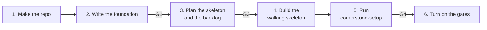

# Start a project

Use this guide when you have an empty folder and an idea.

| | |
| --- | --- |
| Profile | [full-project](../../framework/profiles/full-project.md) |
| Default mode | hybrid: you own the design, an agent helps |
| Gates | G1 (foundation), G2 (plan and backlog), G3, G4 |
| Status | Works today. `stone render` writes the shaper, planner, and reviewer roles, and checks K6, K7, K14, and K15. |

The full-project profile does not build features. It makes the foundation and the backlog. Each
feature then runs as its own [feature](build-a-feature.md) or [small change](small-change.md).

## The order

Write the foundation first. Run `cornerstone-setup` after the walking skeleton exists. `stone render`
needs a test command and the test and check paths. An empty folder has none of them.



## Today

### 1. Make the repo

```bash
mkdir my-app && cd my-app
git init -b main
gh repo create my-app --private --source . --push
```

### 2. Write the foundation (Shape, G1)

1. Start Claude Code in the folder.
2. Run `/workflow:project-setup`.
3. Describe the product in your own words. The skill asks only for the facts that it does not have.

Example prompt:

```text
/workflow:project-setup
I want to build a web app that lets small farms track which fields they planted, and when.
The users are the farmer and a seasonal worker on a phone in the field.
```

The skill writes these files:

| File | Has |
| --- | --- |
| `constitution/mission.md` | Vision, audience, tone, scope, non-goals |
| `constitution/personas.md` | 1 to 5 personas. Each one has 3 to 5 job stories, limits, and evidence. |
| `constitution/principles.md` | The MUST rules for each change |
| `constitution/tech-stack.md` | Approved technology and deploy limits |
| `constitution/roadmap.md` | Phases and milestones, in order |
| `AGENTS.md`, `CLAUDE.md` | How to work in the repo |

Mark each persona `assumed` until you talk to a real user of that type. Then mark it `validated`.

Read the files. Change what is wrong. Commit them on a branch and open a PR. Your approval of that
PR is G1.

### 3. Plan the skeleton and the backlog (Plan, G2)

Start a new session. Ask the agent to write `docs/plans/foundation.md`.

```text
Read constitution/. Write docs/plans/foundation.md with the six plan sections.
Include:
- The architecture rules, each one as a check that CI can run.
- The walking skeleton: the smallest app that builds, deploys, and runs one end-to-end test.
- A backlog of the first 3 features. Give each one acceptance criteria, non-goals,
  a test oracle, and the persona IDs that it serves.
Do not write code.
```

Then make one GitHub issue for each backlog item. Your approval of the plan PR is G2.

### 4. Build the walking skeleton

Build the skeleton in a `pair` session (human-centric mode). No protected paths exist yet, so you
decide each change.

The skeleton is done when:

- The app builds and runs.
- One end-to-end test passes.
- A test command and a check command exist, for example in `package.json` or a `Makefile`.
- CI runs those commands on each PR.

Commit with the trailers `Role: implementer` and `Actor: human`. See
[Run the roles](run-the-roles.md#commit-with-trailers).

### 5. Run cornerstone-setup

Follow [Add Cornerstone to a repo](add-to-a-repo.md). The repo now has the commands and paths that
`stone render` needs.

Put `full-project` in `profiles` of `.cornerstone/config.yaml`. This profile has no label trigger,
so render writes no trigger workflow. Render writes these files:

| Output | Has |
| --- | --- |
| `.claude/agents/` | The shaper, planner, and reviewer roles |
| `.cornerstone/checks/` | K6 (protected paths), K7 (change size), and K15 (instruction size) |
| `.github/workflows/cornerstone-checks.yml` | The G3 job: K6, K7, K14, K15, and `commands.all_checks` |

The profile also lists K4, K5, and K8. Render adds a step for each one that has a command in the
config: `test_integration`, `test_acceptance`, and `architecture`. This is how the architecture rules
of the plan become checks. If a command has no value, render skips the step and warns.
K15 reads `instruction_file_max_lines` from the model profile. K7 uses 600 changed lines.

After the render, use the roles for later work. Use `claude --agent shaper` to shape each backlog
issue. Use `STONE_ROLE=planner claude --agent planner` to change the plan.

### 6. Turn on the gates

In the GitHub settings of the repo:

1. Make the `cornerstone-checks` job a required status check (G3).
2. Require a PR review before a merge (G4).

Start each backlog item with [Build a feature](build-a-feature.md) or
[Make a small change](small-change.md).

## Not built yet

- The foundation still comes from `/workflow:project-setup`. The shaper role shapes tickets, not the
  constitution files.
- K15 and the K4, K5, and K8 steps warn for 2 weeks after render adds them. Then they block.
