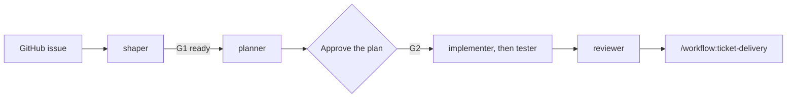

# Spec-driven development

Plan each large change as a short plan before the agent writes code. The plan is the contract. The
agent builds against it, and independent tests and a review check the result.

I use plain Markdown plans from [Cornerstone](../../framework/README.md). I do not use a spec tool.
The flow started with [OpenSpec](https://github.com/Fission-AI/OpenSpec) (MIT license). I keep its
ideas: a proposal before the code, a constitution that each change must agree with, and specs that
stay in the repo.

Each box after the issue is one role. Each role runs in a fresh session. The profile sets which
roles run. A small change has no planner. It has a decision log.

## Set up a repo

1. Run `/workflow:cornerstone-setup`. It writes `constitution/`, `AGENTS.md`, and
   `.cornerstone/config.yaml`.
2. Select the `app-slice` profile for features. `stone render` then writes the planner role file.

## The constitution

The constitution is the set of rules and facts that every change must agree with. The idea comes
from the DeepLearning.AI and JetBrains course on spec-driven development (mission, tech stack,
roadmap). I add principles and personas.

| Part | Where | When the agent reads it |
| --- | --- | --- |
| Principles (MUST rules) | `constitution/principles.md` | Every plan and every change |
| Mission, scope, non-goals | `constitution/mission.md` | Plans: is the work in scope? |
| Personas and job stories | `constitution/personas.md` | Tickets, plans, and acceptance tests |
| Roadmap phases | `constitution/roadmap.md` | Plans: which phase does it serve? |
| Tech stack and limits | `constitution/tech-stack.md` | Plans: the approach |
| How to work in the repo | `AGENTS.md` | Every task. All tools load it. |

Each fact has one owner file, so the copies cannot drift.

## Plan an issue

1. Start the planner with the issue text, in a fresh session.
2. Answer the open questions that the agent asks.
3. Read the plan at `docs/plans/<id>.md` and the task list in `docs/plans/<id>.progress.json`.
4. Approve the plan in a docs PR (G2). Edit the plan, not the code.

The next session finds the plan from the issue ID. It does not need this conversation.

## Build a change

1. Start the implementer for each task in the progress file. It writes the decision log.
2. Start the tester in a separate session. It writes the tests from the plan and the job stories.
3. Start the reviewer. It compares the diff with the plan.
4. Run `/workflow:ticket-delivery` to collect the evidence and open the PR.

If the scope changes during the build, the agent stops. Update the plan first, and get G2 again.

## Why this helps

- You review a short plan, not a large diff.
- The agent has a clear finish line: the tasks and the acceptance criteria.
- The plans stay in the repo. The next person can read why the code is the way it is.
