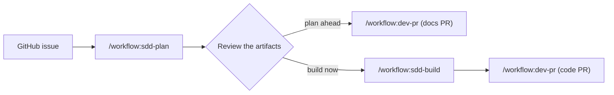

# Spec-driven development

Plan each change as a short spec before the agent writes code. The spec is the contract. The agent
builds against it, and a verify step checks the result.

I use [OpenSpec](https://github.com/Fission-AI/OpenSpec) for the specs, and three skills from this
repo for the flow.

## Set up a repo

1. Install OpenSpec, and run `openspec init` in the repo.
2. Put the repo rules in `openspec/config.yaml`.
3. In `CLAUDE.md` or `AGENTS.md`, name:
   - The integration branch (for example `dev`)
   - The test and lint commands for each folder
   - The backlog file and the change naming rule, if you have them

## Plan an issue

1. Run `/workflow:sdd-plan 123`.
2. Answer the open questions that the agent asks.
3. Read the proposal, design, specs, and tasks.
4. Choose one flow:
   - Plan ahead: the agent opens a docs PR. Build later.
   - Build now: the agent continues with `sdd-build`.

## Build a change

1. Run `/workflow:sdd-build 123`.
2. Approve the scope and the verify plan.
3. The agent applies the tasks, verifies them, archives the change, and opens a PR.

If the scope changes during the build, the agent stops. Update the spec first. Then continue.

## Why this helps

- You review a short plan, not a large diff.
- The agent has a clear finish line: the tasks and the spec scenarios.
- The specs stay in the repo. The next person can read why the code is the way it is.
