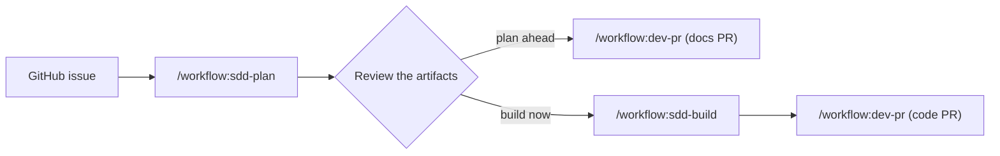

# Spec-driven development

Plan each change as a short spec before the agent writes code. The spec is the contract. The agent
builds against it, and a verify step checks the result.

I use [OpenSpec](https://github.com/Fission-AI/OpenSpec) for the specs, and three skills from this
repo for the flow.

## Set up a repo

1. Install OpenSpec, and run `openspec init` in the repo.
2. Run `/workflow:project-setup`. It writes `constitution/` and `AGENTS.md`, and it wires
   `openspec/config.yaml`.

## The constitution

The constitution is the set of rules and facts that every change must agree with. The idea comes
from the DeepLearning.AI and JetBrains course on spec-driven development (mission, tech stack,
roadmap). I add principles, and I fit it to OpenSpec:

| Part | Where | When the agent reads it |
| --- | --- | --- |
| Principles (MUST rules) | `openspec/config.yaml` `context` | Always. OpenSpec copies `context` into each artifact. |
| Mission, scope, non-goals | `constitution/mission.md` | Proposals (`rules.proposal`) |
| Roadmap phases | `constitution/roadmap.md` | Proposals (`rules.proposal`) |
| Tech stack and limits | `constitution/tech-stack.md` | Designs (`rules.design`) |
| How to work in the repo | `AGENTS.md` | Every task. All tools load it. |

Why this split:

- `context` is OpenSpec's own place for project rules. It replaced `openspec/project.md`.
- The rules that every artifact needs are always present. No file read, no chance to skip them.
- The longer documents load only for the artifact that needs them. This keeps each prompt small.
- Each fact has one owner file, so the copies cannot drift.

## Plan an issue

1. Run `/workflow:sdd-plan 123`.
2. Answer the open questions that the agent asks.
3. Read the proposal, design, specs, and tasks.
4. Choose one flow:
   - Plan ahead: the agent opens a docs PR. Build later.
   - Build now: the agent continues with `sdd-build`.

## Build a change

1. Run `/workflow:sdd-build 123`.
2. Approve the scope and the verify plan.
3. The agent applies the tasks, verifies them, archives the change, and opens a PR.

If the scope changes during the build, the agent stops. Update the spec first. Then continue.

## Why this helps

- You review a short plan, not a large diff.
- The agent has a clear finish line: the tasks and the spec scenarios.
- The specs stay in the repo. The next person can read why the code is the way it is.
