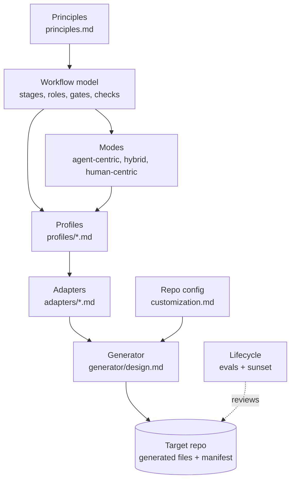

# Cornerstone: the agent workflow framework

The principles are the cornerstone. Each profile, adapter, and generated file aligns to them.

Status: draft v0 (2026-10-17). Evidence: [docs/research/dossier.md](../docs/research/dossier.md).

This framework describes how an agent and a human deliver software together. The core is
tool-neutral. Adapters turn the core into files for one harness (see [adapters/](adapters/contract.md)). A
generator writes those files into a target repo.

## Why this framework exists

Models change. A skill, a rule, or a planning step that helps one model can hurt the next model.
So each part of the workflow must have a reason, a test, and a review date. When the evidence
goes, the part goes.

## Layers

Each layer uses only the terms of the layer above it. A change in a lower layer does not change a
higher layer.

| Layer | File | Changes when |
| --- | --- | --- |
| Principles | [principles.md](principles.md) | The evidence changes. Seldom. |
| Vocabulary | [vocabulary.md](vocabulary.md) | A new neutral concept is necessary. |
| Workflow model | [workflow-model.md](workflow-model.md), [gates.md](gates.md), [checks.md](checks.md) | A stage, role, gate, or check type changes. |
| Modes | [modes.md](modes.md) | The stage drivers of a preset change. |
| Profiles | [profiles/](profiles/README.md) | A workflow type is added or tuned. |
| Lifecycle | [lifecycle.md](lifecycle.md) | The eval or sunset rules change. |
| Writing | [writing.md](writing.md) | The evidence for the writing standard changes. |
| Customization | [customization.md](customization.md) | The override rules change. |
| Adapters | [adapters/](adapters/contract.md) | A harness or a spec tool changes. Often. |
| Model profiles | `adapters/<harness>/models/` | A vendor releases a model or new guidance. Most often. |
| Generator | [generator/design.md](generator/design.md) | The file output changes. |

## How to use it (target state)

1. Pick the profiles that a repo needs, and the modes that it allows.
2. Run the generator in the repo with one harness adapter and one model profile.
3. Fill the repo config with the facts that the generator cannot find.
4. Work with the generated skills, roles, hooks, and CI checks.
5. Every 6 months, or when the model changes, run the lifecycle review.

The generator is mostly a design. The [`stone`](../stone/README.md) CLI has `stone check`, the K17
writing check, and the first part of `stone render`. See [generator/design.md](generator/design.md).

## Decisions

| # | Decision | Where |
| --- | --- | --- |
| D1 | The framework name is Cornerstone. The CLI is `stone`. The repo stays `ai-workflow`. | This file, [generator/design.md](generator/design.md) |
| D2 | A repo MAY add a waiver to skip G4 for dependency patch versions. Minor and major versions always need G4. | [profiles/dependency-upgrade.md](profiles/dependency-upgrade.md) |
| D3 | `cornerstone-setup` is the entry skill. It runs `project-setup` as its Shape step. `project-setup` stays usable alone. | [generator/design.md](generator/design.md) |
| D4 | Default limits: 600 changed lines for a PR, 300 lines for the instruction file. A profile can tighten them. | [principles.md](principles.md), [customization.md](customization.md) |
| D5 | A solo developer MAY pass G4 on their own human-centric work, after an agent review and with all checks passing. | [modes.md](modes.md#solo-developer) |
| D6 | Model idioms live in a model profile under each harness adapter, not in the adapter itself. | [adapters/contract.md](adapters/contract.md#what-a-model-profile-must-provide) |
| D7 | A scheduled adapter-refresh profile watches vendor releases and opens a refresh PR with eval results. | [profiles/adapter-refresh.md](profiles/adapter-refresh.md) |
| D8 | All vendor adapters stay in the repo. A target repo selects one harness and one model profile. | [customization.md](customization.md) |
| D9 | Human-facing text follows ASD-STE100. Agent-facing text uses STE only where an eval shows a gain. | [writing.md](writing.md#scope) |
| D10 | Check K17 tests the measurable STE rules and warns for 2 weeks, then blocks. The writing skill covers the rest. | [writing.md](writing.md#enforcement) |
| D11 | STE stays only while review time, rework, and a quarterly blind A/B show that it helps. | [writing.md](writing.md#evidence-p5) |
| D12 | Templates use `string.Template` from the standard library, not Jinja2. The CLI keeps one dependency (PyYAML). | [generator/design.md](generator/design.md#assumptions) |
| D13 | The generator owns whole files (no markers, hash in the manifest), marked blocks in shared files, or merged entries in shared JSON files. | [generator/design.md](generator/design.md#constraints) |
| D14 | `stone render` owns the role files. The plugin has no skill for the tester or the reviewer. | [generator/design.md](generator/design.md) |
| D15 | Personas describe the users of the product, not the agents. Agent personas are out of scope, because a persona in a prompt does not improve results (dossier E14). | [workflow-model.md](workflow-model.md#personas), [vocabulary.md](vocabulary.md) |
| D16 | `constitution/personas.md` has one section for each persona: `id`, `who`, 3 to 5 job stories with IDs (`analyst.J1`), `limits` (device, skill, access), and `evidence` (`assumed` or `validated`). | [workflow-model.md](workflow-model.md#personas) |
| D17 | The Definition of Ready has "Personas: <IDs>". App slice requires it. Single ticket and debugging require it, or `none` if the change does not affect users. Full project writes the personas file. The plan maps each criterion to a job story. The tester writes acceptance tests from the job stories. K18 checks the file and the IDs in the plans. | [workflow-model.md](workflow-model.md#definition-of-ready-default), [checks.md](checks.md) |
| D18 | The plugin does not support a spec tool. Plans use the plain spec-tool adapter, and the planner role writes them. The `sdd-plan` and `sdd-build` skills are removed. The spec-tool adapter contract stays, so a repo can add a tool. Spec tools can over-process small work (dossier D5, D6). | [adapters/spec-tools.md](adapters/spec-tools.md), [adapters/contract.md](adapters/contract.md) |
| D19 | `stone render` supports the app-slice profile. The planner role file writes only in the plans path. The protected-path hook enforces this. | [generator/design.md](generator/design.md) |
| D20 | Check K14 is the `stone check-evidence` command, as K17 is a `stone` command. The required sections are Evidence, Decision log, Review findings, and Confidence. A section with only `None` is empty. Write `None` and the reason. | [checks.md](checks.md), [generator/design.md](generator/design.md) |
| D21 | Specs are generated from the applied spec deltas. Each plan that changes a behavior has a delta. `stone spec apply` merges it in the code PR, as a generator commit. A replay of the deltas must give the same specs, so a hand edit is drift. | [workflow-model.md](workflow-model.md#specs), [lifecycle.md](lifecycle.md#specs) |
| D22 | Two applied deltas with the same `apply_order` are an error. `stone spec sync` gives the deltas the orders 1 to n and writes the specs again. K19 tests the deltas and the replay. The hook and K6 protect the specs path. | [workflow-model.md](workflow-model.md#specs), [checks.md](checks.md) |
| D23 | The G3 workflow that `stone render` writes runs K14 on the PR body in `--mode warn`. It installs stone in a venv from the tag `v<framework_version>`. The step is in each render, because each supported profile lists K14. | [generator/design.md](generator/design.md), [customization.md](customization.md) |
| D24 | Version 1 supports all 10 profiles. `stone render` writes each component that a selected profile needs, and a trigger workflow for each trigger that is not `command`. Each role has one role file for all profiles. The pipeline gives the profile steps to the role at run time. A profile is supported when the adapter has a role file for each of its roles. A component with `when` renders only for a profile with that gate or check. | [generator/design.md](generator/design.md), [profiles/README.md](profiles/README.md) |
| D25 | The investigator writes only in `paths.reports` (default `docs/reports/`). On a `spike/` branch it can write any file, except the harness and Cornerstone files, because K16 stops the merge. So it has the Edit and Write tools, and the hook limits the paths. | [workflow-model.md](workflow-model.md#roles) |
| D26 | `stone eval` runs a component eval with and without the component, in a temp git repo. The harness adapter gives the run command in `eval.yaml`. Checks are code first. An `outcome` check tests behavior, and a `contract` check tests the format of the component. The variants get the same prompt and tools. Runs are local, not in CI. | [lifecycle.md](lifecycle.md#eval-design), [generator/design.md](generator/design.md) |
| D27 | K7 is a script that `stone render` writes, with the limit of each selected profile in it. The limit is the profile limit, or `limits.pr_changed_lines` if that is smaller. CI does not know the profile of a PR, so the PR body names it on a `Profile: <id>` line. With no line, or with an unknown profile, the smallest limit applies. A `Waiver (P10)` section with text passes, with a notice. The G3 step reads the body through `env` and starts in `--mode warn`. | [checks.md](checks.md), [customization.md](customization.md) |
| D28 | Check K15 is a script that `stone render` writes for a profile with K15. The limit is `instruction_file_max_lines` in the model profile, and the adapter names the instruction file. A component with `ci_step` adds its step to the G3 workflow only if the component renders. The K15 step starts in `--mode warn`. | [checks.md](checks.md), [generator/design.md](generator/design.md) |
| D30 | `stone render` writes K16 as a CI job for each profile that lists K16. The job runs from the base branch, so a spike branch cannot change it. K16 blocks from the start, not after 2 weeks: D25 depends on it, and a warning does not stop a merge (dossier F2, F11). | [checks.md](checks.md#k16-and-the-spike-branch), [profiles/spike.md](profiles/spike.md) |
| D31 | `stone render` writes one CI workflow for each profile trigger that is not `command`. The workflow starts the first role of the profile with the profile steps. That role gets a read-only token, a tool allowlist, and no edit, shell, or web tools. It returns a report. A second job posts the report with its own minimum token. Event text goes to a step only through `env` (dossier F8 to F10). If two selected profiles use one label, each run also needs the label `profile:<id>`. | [generator/design.md](generator/design.md#trigger-workflows) |

## Open questions

None at this time.

## Roadmap

Do these items in order. Each item is one PR or more.

1. On 2026-10-31, change K17 from `--mode warn` to `--mode block` in `.github/workflows/stone.yml`.
   That date is 2 weeks after the K17 merge.
   Two weeks after the K14 step is in that workflow, change K14 to `--mode block` too.
   Two weeks after stone 0.7 merges, change K14 to `--mode block` in the G3 workflow template.
2. Done in stone 0.2: `stone render` for the first harness adapter and the single-ticket profile.
   It writes the role files, the protected-path hook and check K6, a CI workflow, and the manifest.
3. Update the plugin skills from the
   [gap analysis](../docs/research/dossier.md#3-gap-analysis-of-this-repo-brawblanai-workflow-v021).
   `stone render` writes the role files, so the plugin has no tester or reviewer skill (D14).
   - 3a0. Done in plugin 0.4.1 and stone 0.3: user personas and job stories (D15 to D17). Two weeks
     after the merge, change K18 in `stone check` from a warning to an error.
   - 3a1. Done in plugin 0.5.0 and stone 0.4. The plugin has no spec-tool support (D18). The
     app-slice profile has the planner role (D19).
   - 3a2. Done in stone 0.5: the spec format and `stone spec apply` (D21).
   - 3a3. Done in plugin 0.6.0 and stone 0.6: check K19 and `stone spec sync` (D22). The planner,
     the tester, the reviewer, the hook, and the guides use the specs. Two weeks after the merge,
     change K19 from a warning to an error.
   - 3a. Done in plugin 0.3.0: the `cornerstone-setup` entry skill, the repo config of this repo,
     and a `stone render` run in this repo.
   - 3b. Done in plugin 0.4.0. `ticket-delivery` does not self-verify. `dev-pr` has the evidence
     sections. Habit 4 in `docs/tips/README.md` says that the profile sets the plan form
     (resolution 1 in the dossier).
   - 3c. Done in stone 0.5: check K14 (PR evidence) is `stone check-evidence` (D20). Review it
     for false positives by 2027-04-17.
   - 3d. Done in stone 0.7: the G3 workflow that `stone render` writes runs K14 on the PR body
     (D23). Done in stone 0.8: render writes that workflow only for a profile with G3 (D24).
4. Write the evals for the first model profile. Set its status to `active` when they pass.
   - 4a. Done in stone 0.9: the `stone eval` runner and the scenario format (D26).
   - 4b. Next: the evals for `role.tester`, then for `role.planner`.
5. Do the first blind A/B rating of STE text (see [writing.md](writing.md#evidence-p5)) at the end
   of Q4 2026.
6. Version 1: support all 10 profiles (D24). Items 6b to 6h can run in parallel after 6a.
   - 6a. Done in stone 0.8: profile support from the adapter role files, the `when` filter, and the
     investigator role with its hook rule (D24, D25).
   - 6b. Done: K7 (change size) as a generated check in the G3 workflow (D27). Two weeks after the
     merge, change K7 to `--mode block` in the G3 workflow template.
   - 6c. Done: K15 (instruction size) for full-project, and a golden-file test for full-project
     (D28). Two weeks after the merge, change K15 to `--mode block` in the G3 step template.
   - 6d. K10 and K12 as repo commands for refactor-migration. Golden-file test for it.
   - 6e. Done: K16 (no merge to main) for spike, which blocks from the start (D30). Golden-file tests
     for spike, bug-triage, and code-audit.
   - 6f. Done: golden-file tests for debugging, dependency-upgrade, and adapter-refresh.
   - 6g. Trigger workflows: `label:<name>`, `schedule:<cron>`, and `ci:<event>`. Untrusted event
     text goes to a step only through `env`. The adapter names the secret. Part 1 done: the label
     and schedule workflows (D31). Part 2: `ci:issue-opened` and `ci:dependency-pr`.
   - 6h. Update the guides from "When the profile ships" to "Today" for each profile.

   Exit criteria for version 1:

   - `stone render` writes every component that each of the 10 profiles lists, with a golden-file
     test for each profile.
   - Each generated check (K6, K7, K14, K15, K16) blocks, after its 2-week warning time.
   - Each new component has an eval plan and a review date in the manifest (P5).
   - Then tag `v1.0.0`.

## Relation to the plugin in this repo

The `workflow` plugin skills are the first harness implementation of parts of this framework.
The [gap analysis](../docs/research/dossier.md#3-gap-analysis-of-this-repo-brawblanai-workflow-v021)
shows what must change.
