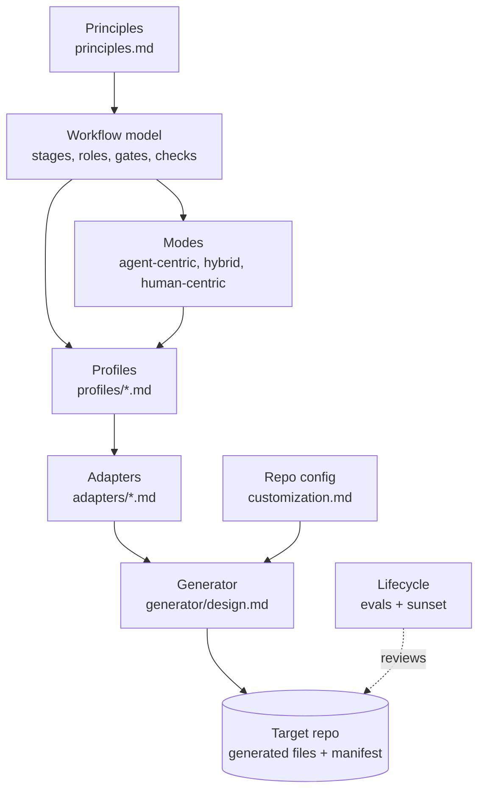

# Cornerstone: the agent workflow framework

> "The stone which the builders refused is become the head stone of the corner." (Psalm 118:22)
>
> The principles are the cornerstone. Each profile, adapter, and generated file aligns to them.

Status: draft v0 (2026-10-17). Evidence: [docs/research/dossier.md](../docs/research/dossier.md).

This framework describes how an agent and a human deliver software together. The core is
tool-neutral. Adapters turn the core into files for one harness (see [adapters/](adapters/contract.md)). A
generator writes those files into a target repo.

## Why this framework exists

Models change. A skill, a rule, or a planning step that helps one model can hurt the next model.
So each part of the workflow must have a reason, a test, and a review date. When the evidence
goes, the part goes.

## Layers

Each layer uses only the terms of the layer above it. A change in a lower layer does not change a
higher layer.

| Layer | File | Changes when |
| --- | --- | --- |
| Principles | [principles.md](principles.md) | The evidence changes. Seldom. |
| Vocabulary | [vocabulary.md](vocabulary.md) | A new neutral concept is necessary. |
| Workflow model | [workflow-model.md](workflow-model.md), [gates.md](gates.md), [checks.md](checks.md) | A stage, role, gate, or check type changes. |
| Modes | [modes.md](modes.md) | The stage drivers of a preset change. |
| Profiles | [profiles/](profiles/README.md) | A workflow type is added or tuned. |
| Lifecycle | [lifecycle.md](lifecycle.md) | The eval or sunset rules change. |
| Customization | [customization.md](customization.md) | The override rules change. |
| Adapters | [adapters/](adapters/contract.md) | A harness or a spec tool changes. Often. |
| Generator | [generator/design.md](generator/design.md) | The file output changes. |

## How to use it (target state)

1. Pick the profiles that a repo needs, and the modes that it allows.
2. Run the generator in the repo with one harness adapter.
3. Fill the repo config with the facts that the generator cannot find.
4. Work with the generated skills, roles, hooks, and CI checks.
5. Every 6 months, or when the model changes, run the lifecycle review.

The generator is a design only in v0. See [generator/design.md](generator/design.md).

## Decisions

| # | Decision | Where |
| --- | --- | --- |
| D1 | The framework name is Cornerstone. The CLI is `stone`. The repo stays `ai-workflow`. | This file, [generator/design.md](generator/design.md) |
| D2 | A repo MAY add a waiver to skip G4 for dependency patch versions. Minor and major versions always need G4. | [profiles/dependency-upgrade.md](profiles/dependency-upgrade.md) |
| D3 | `cornerstone-setup` is the entry skill. It runs `project-setup` as its Shape step. `project-setup` stays usable alone. | [generator/design.md](generator/design.md) |
| D4 | Default limits: 600 changed lines for a PR, 300 lines for the instruction file. A profile can tighten them. | [principles.md](principles.md), [customization.md](customization.md) |
| D5 | A solo developer MAY pass G4 on their own human-centric work, after an agent review and with all checks passing. | [modes.md](modes.md#solo-developer) |

## Open questions

None at this time.

## Relation to the plugin in this repo

The `workflow` plugin skills are the first harness implementation of parts of this framework.
The [gap analysis](../docs/research/dossier.md#3-gap-analysis-of-this-repo-brawblanai-workflow-v021)
shows what must change.
