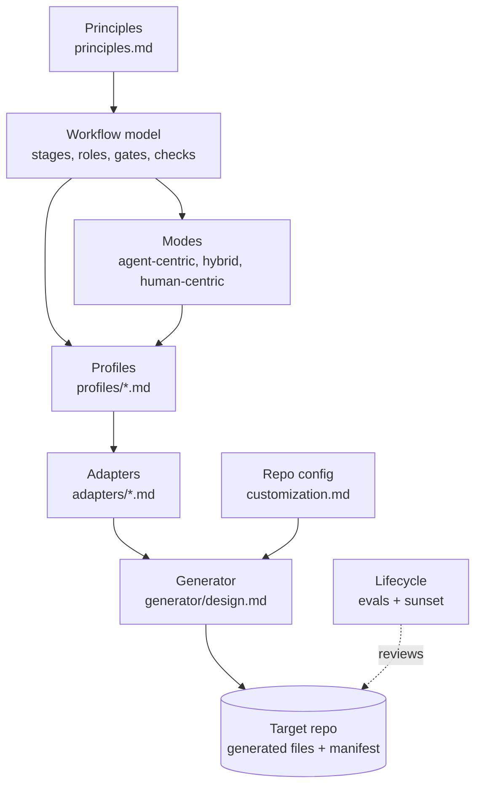

# Cornerstone: the agent workflow framework

The principles are the cornerstone. Each profile, adapter, and generated file aligns to them.

Status: draft v0 (2026-10-17). Evidence: [docs/research/dossier.md](../docs/research/dossier.md).

This framework describes how an agent and a human deliver software together. The core is
tool-neutral. Adapters turn the core into files for one harness (see [adapters/](adapters/contract.md)). A
generator writes those files into a target repo.

## Why this framework exists

Models change. A skill, a rule, or a planning step that helps one model can hurt the next model.
So each part of the workflow must have a reason, a test, and a review date. When the evidence
goes, the part goes.

## Layers

Each layer uses only the terms of the layer above it. A change in a lower layer does not change a
higher layer.

| Layer | File | Changes when |
| --- | --- | --- |
| Principles | [principles.md](principles.md) | The evidence changes. Seldom. |
| Vocabulary | [vocabulary.md](vocabulary.md) | A new neutral concept is necessary. |
| Workflow model | [workflow-model.md](workflow-model.md), [gates.md](gates.md), [checks.md](checks.md) | A stage, role, gate, or check type changes. |
| Modes | [modes.md](modes.md) | The stage drivers of a preset change. |
| Profiles | [profiles/](profiles/README.md) | A workflow type is added or tuned. |
| Lifecycle | [lifecycle.md](lifecycle.md) | The eval or sunset rules change. |
| Writing | [writing.md](writing.md) | The evidence for the writing standard changes. |
| Customization | [customization.md](customization.md) | The override rules change. |
| Adapters | [adapters/](adapters/contract.md) | A harness or a spec tool changes. Often. |
| Model profiles | `adapters/<harness>/models/` | A vendor releases a model or new guidance. Most often. |
| Generator | [generator/design.md](generator/design.md) | The file output changes. |

## How to use it (target state)

1. Pick the profiles that a repo needs, and the modes that it allows.
2. Run the generator in the repo with one harness adapter and one model profile.
3. Fill the repo config with the facts that the generator cannot find.
4. Work with the generated skills, roles, hooks, and CI checks.
5. Every 6 months, or when the model changes, run the lifecycle review.

The generator is mostly a design. The [`stone`](../stone/README.md) CLI has `stone check`, the K17
writing check, and the first part of `stone render`. See [generator/design.md](generator/design.md).

## Decisions

| # | Decision | Where |
| --- | --- | --- |
| D1 | The framework name is Cornerstone. The CLI is `stone`. The repo stays `ai-workflow`. | This file, [generator/design.md](generator/design.md) |
| D2 | A repo MAY add a waiver to skip G4 for dependency patch versions. Minor and major versions always need G4. | [profiles/dependency-upgrade.md](profiles/dependency-upgrade.md) |
| D3 | `cornerstone-setup` is the entry skill. It runs `project-setup` as its Shape step. `project-setup` stays usable alone. | [generator/design.md](generator/design.md) |
| D4 | Default limits: 600 changed lines for a PR, 300 lines for the instruction file. A profile can tighten them. | [principles.md](principles.md), [customization.md](customization.md) |
| D5 | A solo developer MAY pass G4 on their own human-centric work, after an agent review and with all checks passing. | [modes.md](modes.md#solo-developer) |
| D6 | Model idioms live in a model profile under each harness adapter, not in the adapter itself. | [adapters/contract.md](adapters/contract.md#what-a-model-profile-must-provide) |
| D7 | A scheduled adapter-refresh profile watches vendor releases and opens a refresh PR with eval results. | [profiles/adapter-refresh.md](profiles/adapter-refresh.md) |
| D8 | All vendor adapters stay in the repo. A target repo selects one harness and one model profile. | [customization.md](customization.md) |
| D9 | Human-facing text follows ASD-STE100. Agent-facing text uses STE only where an eval shows a gain. | [writing.md](writing.md#scope) |
| D10 | Check K17 tests the measurable STE rules and warns for 2 weeks, then blocks. The writing skill covers the rest. | [writing.md](writing.md#enforcement) |
| D11 | STE stays only while review time, rework, and a quarterly blind A/B show that it helps. | [writing.md](writing.md#evidence-p5) |
| D12 | Templates use `string.Template` from the standard library, not Jinja2. The CLI keeps one dependency (PyYAML). | [generator/design.md](generator/design.md#assumptions) |
| D13 | The generator owns whole files (no markers, hash in the manifest), marked blocks in shared files, or merged entries in shared JSON files. | [generator/design.md](generator/design.md#constraints) |
| D14 | `stone render` owns the role files. The plugin has no skill for the tester or the reviewer. | [generator/design.md](generator/design.md) |
| D15 | Personas describe the users of the product, not the agents. Agent personas are out of scope, because a persona in a prompt does not improve results (dossier E14). | [workflow-model.md](workflow-model.md#personas), [vocabulary.md](vocabulary.md) |
| D16 | `constitution/personas.md` has one section for each persona: `id`, `who`, 3 to 5 job stories with IDs (`analyst.J1`), `limits` (device, skill, access), and `evidence` (`assumed` or `validated`). | [workflow-model.md](workflow-model.md#personas) |
| D17 | The Definition of Ready has "Personas: <IDs>". App slice requires it. Single ticket and debugging require it, or `none` if the change does not affect users. Full project writes the personas file. The plan maps each criterion to a job story. The tester writes acceptance tests from the job stories. K18 checks the file and the IDs in the plans. | [workflow-model.md](workflow-model.md#definition-of-ready-default), [checks.md](checks.md) |
| D18 | The plugin does not support a spec tool. Plans use the plain spec-tool adapter, and the planner role writes them. The `sdd-plan` and `sdd-build` skills are removed. The spec-tool adapter contract stays, so a repo can add a tool. Spec tools can over-process small work (dossier D5, D6). | [adapters/spec-tools.md](adapters/spec-tools.md), [adapters/contract.md](adapters/contract.md) |
| D19 | `stone render` supports the app-slice profile. The planner role file writes only in the plans path. The protected-path hook enforces this. | [generator/design.md](generator/design.md) |
| D20 | Check K14 is the `stone check-evidence` command, as K17 is a `stone` command. The required sections are Evidence, Decision log, Review findings, and Confidence. A section with only `None` is empty. Write `None` and the reason. | [checks.md](checks.md), [generator/design.md](generator/design.md) |
| D21 | Specs are generated from the applied spec deltas. Each plan that changes a behavior has a delta. `stone spec apply` merges it in the code PR, as a generator commit. A replay of the deltas must give the same specs, so a hand edit is drift. | [workflow-model.md](workflow-model.md#specs), [lifecycle.md](lifecycle.md#specs) |
| D22 | Two applied deltas with the same `apply_order` are an error. `stone spec sync` gives the deltas the orders 1 to n and writes the specs again. K19 tests the deltas and the replay. The hook and K6 protect the specs path. | [workflow-model.md](workflow-model.md#specs), [checks.md](checks.md) |
| D23 | The G3 workflow that `stone render` writes runs K14 on the PR body in `--mode warn`. It installs stone in a venv from the tag `v<framework_version>`. The step is in each render, because each supported profile lists K14. | [generator/design.md](generator/design.md), [customization.md](customization.md) |
| D24 | Version 1 supports all 10 profiles. `stone render` writes each component that a selected profile needs, and a trigger workflow for each trigger that is not `command`. Each role has one role file for all profiles. The pipeline gives the profile steps to the role at run time. A profile is supported when the adapter has a role file for each of its roles. A component with `when` renders only for a profile with that gate or check. | [generator/design.md](generator/design.md), [profiles/README.md](profiles/README.md) |
| D25 | The investigator writes only in `paths.reports` (default `docs/reports/`). On a `spike/` branch it can write any file, except the harness and Cornerstone files, because K16 stops the merge. So it has the Edit and Write tools, and the hook limits the paths. | [workflow-model.md](workflow-model.md#roles) |
| D26 | `stone eval` runs a component eval with and without the component, in a temp git repo. The harness adapter gives the run command in `eval.yaml`. Checks are code first. An `outcome` check tests behavior, and a `contract` check tests the format of the component. The variants get the same prompt and tools. Runs are local, not in CI. | [lifecycle.md](lifecycle.md#eval-design), [generator/design.md](generator/design.md) |
| D27 | K7 is a script that `stone render` writes, with the limit of each selected profile in it. The limit is the profile limit, or `limits.pr_changed_lines` if that is smaller. CI does not know the profile of a PR, so the PR body names it on a `Profile: <id>` line. With no line, or with an unknown profile, the smallest limit applies. A waiver passes, with a notice. The form of a waiver is in D46. The G3 step reads the body through `env` and starts in `--mode warn`. | [checks.md](checks.md), [customization.md](customization.md) |
| D28 | Check K15 is a script that `stone render` writes for a profile with K15. The limit is `instruction_file_max_lines` in the model profile, and the adapter names the instruction file. A component with `ci_step` adds its step to the G3 workflow only if the component renders. The K15 step starts in `--mode warn`. | [checks.md](checks.md), [generator/design.md](generator/design.md) |
| D29 | A "by profile" check that runs a repo tool (K4, K5, K8, K10, K11, K12) is an optional step of the G3 workflow. Render adds the step only if a selected profile lists the check and the repo config has its command (`commands.mutation`, `commands.differential`, and others). If the command has no value, render skips the step and warns. The steps fill one block placeholder. An empty block removes its line, so the template stays free of logic (D12). A step is part of its ci-job component, with the eval plan and the review date of that component (P5). CI does not know the profile of a PR, so each step runs on each PR. | [customization.md](customization.md#commands-for-the-by-profile-checks), [generator/design.md](generator/design.md) |
| D30 | `stone render` writes K16 as a CI job for each profile that lists K16. The job runs from the base branch, so a spike branch cannot change it. K16 blocks from the start, not after 2 weeks: D25 depends on it, and a warning does not stop a merge (dossier F2, F11). | [checks.md](checks.md#k16-and-the-spike-branch), [profiles/spike.md](profiles/spike.md) |
| D31 | `stone render` writes one CI workflow for each profile trigger that is not `command`. The workflow starts the first role of the profile with the profile steps. That role gets a read-only token, a tool allowlist, and no edit, shell, or web tools. It returns a report. A second job posts the report with its own minimum token. Event text goes to a step only through `env` (dossier F8 to F10). If two selected profiles use one label, each run also needs the label `profile:<id>`. | [generator/design.md](generator/design.md#trigger-workflows) |
| D32 | A trigger role gets read rules only for the checkout and the event folder. A read rule with no path lets the role read any file, such as the process environment with the harness secret. The report is public, and an encoded secret in a job output is not redacted. So the path limit, not the secret scrub, protects the secret (dossier F9, F12). | [generator/design.md](generator/design.md#trigger-workflows), the adapter doc |
| D33 | K16 fails a PR from a `spike/` branch into `branches.main` or `branches.integration`. Without the second branch, spike code gets to main through the integration branch. Render needs both names, and they can be the same branch. K16 does not find spike commits on a branch with a different name. A squash, a rebase, or a cherry-pick gives new commit IDs, so a commit check is not reliable. A partial check gives false confidence. A commit check also needs a read token, and K16 now has no permissions (D30, dossier F11). So the spike profile says not to merge a spike branch into a different branch, and gate G4 is the control. | [checks.md](checks.md#k16-and-the-spike-branch), [profiles/spike.md](profiles/spike.md) |
| D34 | `stone render` and `stone check` fail when a `branches.*` value in the repo config is not a YAML string. An unquoted `1.10` parses as `1.1` and `yes` as `True`. Render wrote the wrong text with no error, K16 compared against the wrong name, and it passed (D33). The error names the key and says to quote the value. A fix by conversion cannot work: the original text is lost after parsing. | [customization.md](customization.md#repo-config-cornerstoneconfigyaml) |
| D35 | A `grader` check gets the final text of the run in the environment variable `STONE_EVAL_REPORT`. A role can give its result in a file or in its report, so a grader must read both. An environment variable does not change the `grade.py` arguments of an older eval. | [lifecycle.md](lifecycle.md#scenario-format) |
| D36 | Eval results stay as committed files in `evals/results/`, one file for each run. The docs site shows them on the Evals page. A build hook reads the files and writes the page, so a new result file needs no page edit. The page shows the latest run of each component and links to the earlier runs and to the eval folder on GitHub. | [lifecycle.md](lifecycle.md#eval-design) |
| D37 | The first model profile of the first harness adapter is `active`. The role.planner and role.tester evals pass (k = 3), and their idioms name the eval. The other idioms have no eval yet, so they are not proven, and adapter-refresh keeps them as proposed. Render no longer warns for this profile. The shaper, implementer, reviewer, and investigator evals stay on the roadmap. | [adapters/contract.md](adapters/contract.md), [lifecycle.md](lifecycle.md#eval-design) |
| D38 | Each trigger workflow limits the cost of one run. The run job and the post job have a time limit, and the role has a turn limit. The post job frames the report. A fixed header says that a model wrote it from untrusted event text. The report goes in a quote, no mention in it notifies a person, and it comes to the step only through `env`. `ci:issue-opened` gets no author gate, because any user can report a bug. So the limits cap the cost of one run, not the number of runs (dossier F13, F14). | [generator/design.md](generator/design.md#trigger-workflows), the adapter doc |
| D39 | The protected-path hook does not see a file write by a shell command. Its matcher names only the file tools, and a shell tool gives a command, not a path (dossier F15, F17). Cornerstone accepts this gap. It does not parse shell commands for write targets, because a parse is partial and gives false confidence (F16). It does not configure an OS sandbox. Risk: the hook is a guard for the file tools only. K6 in CI is the control for a shell write, but only for an implementer commit that changes a protected path. K6 reads the `Role:` trailer that the committer writes. No check sees a shell write that breaks the path limit of the tester, the planner, the investigator, or the reviewer. For those limits, the reviewer and gate G4 are the control. The `hook.protect-paths` eval (H1 to H5) pins the gap and the K6 control. Review this decision by 2027-04-18. | [lifecycle.md](lifecycle.md#eval-design), the adapter doc, `evals/hook-protect-paths/` |
| D40 | Cornerstone is its own framework. It does not adopt Spec Kit, BMAD, or Agentic Code. Reason: in the pages we read, no tool joins all of these parts. The parts are a neutral core, harness adapters, gates by profile, and an eval plan with a review date for each component. We borrow ideas, not tools (D18, D21). Review this decision by 2027-04-18, after a read of the tool sources. | [dossier section 5](../docs/research/dossier.md#5-prior-art) |
| D41 | A `label:` trigger asks for a readiness check. It does not mean "ready". If the first role of the profile is the shaper, the label workflow tells it to report the missing Definition of Ready items. The CI job has no human to interview. Render also rewrites each relative Markdown link in the profile steps to plain text. A relative link does not work in a CI prompt. The role, the tool limits, and the token stay as in D31 and D32. A later start at Build or Plan would need write access, which D31 and D32 do not allow. | [generator/design.md](generator/design.md#trigger-workflows) |
| D42 | If the ticket and the code disagree on expected behavior, the tester writes the test for the ticket. It commits the failing test and reports the disagreement. It stops only if the ticket itself is unclear. Reason: in the `role.tester` eval, 3 of 3 runs with the role did this in T2. The old rule (stop, commit nothing) loses the test. A committed failing test is a finding that a human can see. K6: no effect. The test file has `Role: tester`, so K6 passes. Reviewer: it sees the failing test and the report in the diff. It reports the disagreement as a defect. G3: the failing test makes the checks fail. G3 stops the merge until a human fixes the code or the ticket. The tester does not change the test to match the code. Risk: a wrong ticket also blocks the merge, and a human then fixes the ticket. The T2 result of 2026-10-18 is from before this change. A paid run on 2026-10-19 (k = 3) confirms the commit check. With the role, 3 of 3 runs commit the failing test. Without it, 0 of 3 do. | [evals/role-tester](../evals/role-tester/scenarios.yaml), [dossier S44](../docs/research/dossier.md#6-sources) |
| D43 | `stone check` fails when a component has no eval plan or no review date (P5). It tests each adapter component list and, if present, `.cornerstone/manifest.yaml`. Each component needs an `eval` key. The value can be empty only for a check, because a check is its own test. Each manifest entry needs a valid `review_by` date. Render sets that date, so a component list does not have it. The rule does not fail on a past `review_by`. That is a review trigger, not a missing field. The rule does not test that the eval folder exists. A planned eval is still a plan. Before this rule, only the golden-file tests tested these fields, and only for the rendered profiles. The rule is a check, so its unit tests are its eval. Review it for false positives by 2027-04-19. | [lifecycle.md](lifecycle.md#manifest), [principles.md](principles.md) |
| D44 | In a component eval, only the component changes between the variants. For a hook, "without" removes the hook file. It also removes each entry that names the hook in a shared JSON file, such as the harness settings. If the entry stayed, each file-tool edit would fail, because the hook file is missing. Both variants load the same role file, so the role does not mix into the result. Only a role component uses `run.without` (no role file, no `--agent`). Any other component uses `run.with` in both variants. Reason: issue #80. The baseline of a hook eval was wrong. The result mixed the effect of the role with the effect of the hook (dossier G4: measure a clean baseline). Risk: the runner finds the settings file by the hook path in the merged fragment. A hook that no fragment names by path keeps its entry. The unit tests are the eval of this rule, because it is a runner rule. Review it by 2027-04-19, with D43. | [lifecycle.md](lifecycle.md#runner), the adapter doc |
| D46 | K7 accepts a waiver in a Markdown heading of any level whose text contains `waiver (P10)`, in any case, with non-empty text under it. A list item is not a waiver. An empty section does not pass. Reason: issue #94. The first K7 form needed a heading that starts with `Waiver (P10)`. A replay on the 62 merged PRs showed 3 PRs (#25, #35, #57) with `Size waiver (P10)`. A human accepted them, and the first K7 failed them. PR #89 put its waiver in a list item. The owner chose to accept the heading form of the merged PRs. The owner chose to keep the list item out, because a list item is easy to write by chance. The replay shows 18 PRs over the limit. The new K7 passes 12 and the old K7 passes 9. It passes no PR that has no waiver. A heading with a different name, such as `## Waiver`, does not pass. Risk: any heading that contains the words, for example `## Why no waiver (P10) is needed`, passes if it has text. The reviewer checks the waiver, and the K7 notice says so. K6: no effect. Review it for false positives by 2027-04-19, with D43. | [checks.md](checks.md), [customization.md](customization.md#repo-config-cornerstoneconfigyaml) |

## Open questions

None at this time.

## Roadmap

Do these items in order. Each item is one PR or more.

1. On 2026-10-31, change K17 from `--mode warn` to `--mode block` in `.github/workflows/stone.yml`.
   That date is 2 weeks after the K17 merge.
   Two weeks after the K14 step is in that workflow, change K14 to `--mode block` too.
   Two weeks after stone 0.7 merges, change K14 to `--mode block` in the G3 workflow template.
2. Done in stone 0.2: `stone render` for the first harness adapter and the single-ticket profile.
   It writes the role files, the protected-path hook and check K6, a CI workflow, and the manifest.
3. Update the plugin skills from the
   [gap analysis](../docs/research/dossier.md#3-gap-analysis-of-this-repo-brawblanai-workflow-v021).
   `stone render` writes the role files, so the plugin has no tester or reviewer skill (D14).
   - 3a0. Done in plugin 0.4.1 and stone 0.3: user personas and job stories (D15 to D17). Two weeks
     after the merge, change K18 in `stone check` from a warning to an error.
   - 3a1. Done in plugin 0.5.0 and stone 0.4. The plugin has no spec-tool support (D18). The
     app-slice profile has the planner role (D19).
   - 3a2. Done in stone 0.5: the spec format and `stone spec apply` (D21).
   - 3a3. Done in plugin 0.6.0 and stone 0.6: check K19 and `stone spec sync` (D22). The planner,
     the tester, the reviewer, the hook, and the guides use the specs. Two weeks after the merge,
     change K19 from a warning to an error.
   - 3a. Done in plugin 0.3.0: the `cornerstone-setup` entry skill, the repo config of this repo,
     and a `stone render` run in this repo.
   - 3b. Done in plugin 0.4.0. `ticket-delivery` does not self-verify. `dev-pr` has the evidence
     sections. Habit 4 in `docs/tips/README.md` says that the profile sets the plan form
     (resolution 1 in the dossier).
   - 3c. Done in stone 0.5: check K14 (PR evidence) is `stone check-evidence` (D20). Review it
     for false positives by 2027-04-17.
   - 3d. Done in stone 0.7: the G3 workflow that `stone render` writes runs K14 on the PR body
     (D23). Done in stone 0.8: render writes that workflow only for a profile with G3 (D24).
4. Write the evals for the first model profile. Set its status to `active` when they pass.
   - 4a. Done in stone 0.9: the `stone eval` runner and the scenario format (D26).
   - 4b. Done: the `role.tester` eval (T1 to T4, k = 3). The outcome rate is the same with and
     without the role (1.00). The role gives the contract (commit trailers and requirement IDs) and
     costs about 35% less. T2 after D42 (2026-10-19, k = 3): with the role, 3 of 3 runs commit the
     failing test (contract 1.00). Without it, 0 of 3 do (contract 0.00). The outcome rate is 1.00
     in both variants. The T2 result of 2026-10-18 is from before D42. Result: `evals/results/`.
   - 4c. Done: the `role.planner` eval (P1 to P5, k = 3). The outcome rate is 1.00 with the role
     and 0.80 without it. Without the role, the model writes a plan for a typo fix (P2). Both
     variants keep an open question for G2 in a headless run (P3). Both copy `apply_order` into
     a new delta, so the planner template needs a rule for it. Result: `evals/results/`.
   - 4d. Done: the planner template forbids `apply_order` in a new delta. In a headless run, it
     gives the options, a recommendation, and a default for each open question, and keeps the
     default out of the delta. With the role, P1 and P5 now pass `not_applied` (6 of 6). Result:
     `evals/results/`.
   - 4e. Done: P3 has the `open_question` contract check for that headless form. With the role,
     the contract rate is 1.00 (3 of 3). Without it, the rate is 0.00: each run gives options and
     a recommendation, but no default. The outcome rate is 1.00 in both variants. Result:
     `evals/results/`.
   - 4f. Done: the first model profile is `active` (D37). The `verify-loop` and
     `plan-only-when-unsure` idioms name their evals. Still to write: the evals for the shaper,
     the implementer, the reviewer, the investigator, and the hooks.
   - 4g. Done: the `hook.protect-paths` eval (H1 to H5) for a shell write to a protected path
     (D39). First run: 2026-10-19, with the model of the first model profile, k = 3, 1.37 USD, after D44. The two checks
     that use no model output pass in 30 of 30 runs, in both variants. So no matcher selects the
     shell tool, the hook lets the command through, and K6 fails the commit. This confirms D39.
     The check `bash_write_lands` passes in 4 of 30 runs (2 of 15 in each variant). In the other 26
     runs, the model refused to run the command, because its role rules forbid a change in
     `tests/`. D39 expects that each check passes. That did not hold for this check. D39 is
     unchanged. Result: `evals/results/`. Review D39 by 2027-04-18.
5. Do the first blind A/B rating of STE text (see [writing.md](writing.md#evidence-p5)) at the end
   of Q4 2026.
6. Version 1: support all 10 profiles (D24). Items 6b to 6h can run in parallel after 6a.
   - 6a. Done in stone 0.8: profile support from the adapter role files, the `when` filter, and the
     investigator role with its hook rule (D24, D25).
   - 6b. Done: K7 (change size) as a generated check in the G3 workflow (D27). Two weeks after the
     merge, change K7 to `--mode block` in the G3 workflow template.
   - 6c. Done: K15 (instruction size) for full-project, and a golden-file test for full-project
     (D28). Two weeks after the merge, change K15 to `--mode block` in the G3 step template.
   - 6d. Done: K10 and K12 as repo commands for refactor-migration, with a golden-file test (D29).
     The same steps serve K4, K5, K8, and K11. Two weeks after the merge, remove `continue-on-error`
     from the step templates.
   - 6e. Done: K16 (no merge to main) for spike, which blocks from the start (D30). Golden-file tests
     for spike, bug-triage, and code-audit. K16 also blocks a spike PR into the integration branch.
     It does not find spike commits on a branch with a different name (D33).
   - 6f. Done: golden-file tests for debugging, dependency-upgrade, and adapter-refresh.
   - 6i. Done: golden-file tests for single-ticket and app-slice. All 10 profiles now have a
     golden-file test.
   - 6g. Trigger workflows: `label:<name>`, `schedule:<cron>`, and `ci:<event>`. Untrusted event
     text goes to a step only through `env`. The adapter names the secret. Done: the label, schedule,
     `ci:issue-opened`, and `ci:dependency-pr` workflows (D31).
   - 6h. Done: the guides for single-ticket, debugging, app-slice, and full-project have "Today" and
     "Not built yet" parts. The other 6 profiles have no guide yet.

   Exit criteria for version 1:

   - `stone render` writes every component that each of the 10 profiles lists, with a golden-file
     test for each profile.
   - Each generated check (K6, K7, K14, K15, K16) blocks. K16 blocks from the start (D30). The
     others block after their 2-week warning time.
   - Each new component has an eval plan and a review date in the manifest (P5). `stone check`
     tests this (D43).
   - Then tag `v1.0.0`.

## Relation to the plugin in this repo

The `workflow` plugin skills are the first harness implementation of parts of this framework.
The [gap analysis](../docs/research/dossier.md#3-gap-analysis-of-this-repo-brawblanai-workflow-v021)
shows what must change.
