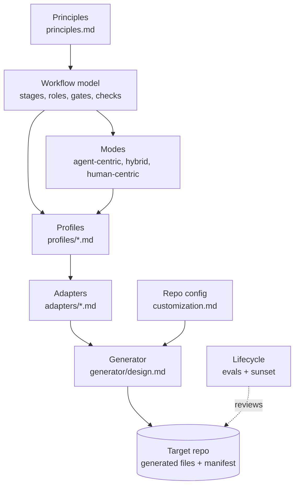

# Cornerstone: the agent workflow framework

The principles are the cornerstone. Each profile, adapter, and generated file aligns to them.

Status: version 1.2.0 (2026-10-22). Evidence: [docs/research/dossier.md](../docs/research/dossier.md).

This framework describes how an agent and a human deliver software together. The core is
tool-neutral. Adapters turn the core into files for one harness (see [adapters/](adapters/contract.md)). A
generator writes those files into a target repo.

## Why this framework exists

Models change. A skill, a rule, or a planning step that helps one model can hurt the next model.
So each part of the workflow must have a reason, a test, and a review date. When the evidence
goes, the part goes.

## Layers

Each layer uses only the terms of the layer above it. A change in a lower layer does not change a
higher layer.

| Layer | File | Changes when |
| --- | --- | --- |
| Principles | [principles.md](principles.md) | The evidence changes. Seldom. |
| Vocabulary | [vocabulary.md](vocabulary.md) | A new neutral concept is necessary. |
| Workflow model | [workflow-model.md](workflow-model.md), [gates.md](gates.md), [checks.md](checks.md) | A stage, role, gate, or check type changes. |
| Modes | [modes.md](modes.md) | The stage drivers of a preset change. |
| Profiles | [profiles/](profiles/README.md) | A workflow type is added or tuned. |
| Lifecycle | [lifecycle.md](lifecycle.md) | The eval or sunset rules change. |
| Writing | [writing.md](writing.md) | The evidence for the writing standard changes. |
| Customization | [customization.md](customization.md) | The override rules change. |
| Adapters | [adapters/](adapters/contract.md) | A harness or a spec tool changes. Often. |
| Model profiles | `adapters/<harness>/models/` | A vendor releases a model or new guidance. Most often. |
| Generator | [generator/design.md](generator/design.md) | The file output changes. |

## How to use it (target state)

1. Pick the profiles that a repo needs, and the modes that it allows.
2. Run the generator in the repo with one harness adapter and one model profile.
3. Fill the repo config with the facts that the generator cannot find.
4. Work with the generated skills, roles, hooks, and CI checks.
5. Every 6 months, or when the model changes, run the lifecycle review.

The generator is mostly a design. The [`stone`](../stone/README.md) CLI has `stone check`, the K17
writing check, and the first part of `stone render`. See [generator/design.md](generator/design.md).

## Decisions

| # | Decision | Where |
| --- | --- | --- |
| D1 | The framework name is Cornerstone. The CLI is `stone`. The repo stays `ai-workflow`. | This file, [generator/design.md](generator/design.md) |
| D2 | A repo MAY add a waiver to skip G4 for dependency patch versions. Minor and major versions always need G4. The waiver file is not built yet (D51). | [profiles/dependency-upgrade.md](profiles/dependency-upgrade.md) |
| D3 | `setup` is the entry skill. It runs `project-setup` as its Shape step. `project-setup` stays usable alone. | [generator/design.md](generator/design.md) |
| D4 | Default limits: 600 changed lines for a PR, 300 lines for the instruction file. A profile can tighten them. | [principles.md](principles.md), [customization.md](customization.md) |
| D5 | A solo developer MAY pass G4 on their own human-centric work, after an agent review and with all checks passing. | [modes.md](modes.md#solo-developer) |
| D6 | Model idioms live in a model profile under each harness adapter, not in the adapter itself. | [adapters/contract.md](adapters/contract.md#what-a-model-profile-must-provide) |
| D7 | A scheduled adapter-refresh profile watches vendor releases and opens a refresh PR with eval results. | [profiles/adapter-refresh.md](profiles/adapter-refresh.md) |
| D8 | All vendor adapters stay in the repo. A target repo selects one harness and one model profile. | [customization.md](customization.md) |
| D9 | Human-facing text follows ASD-STE100. Agent-facing text uses STE only where an eval shows a gain. | [writing.md](writing.md#scope) |
| D10 | Check K17 tests the measurable STE rules and warns for 2 weeks, then blocks. The writing skill covers the rest. | [writing.md](writing.md#enforcement) |
| D11 | STE stays only while review time, rework, and a quarterly blind A/B show that it helps. | [writing.md](writing.md#evidence-p5) |
| D12 | Templates use `string.Template` from the standard library, not Jinja2. The CLI keeps one dependency (PyYAML). | [generator/design.md](generator/design.md#assumptions) |
| D13 | The generator owns whole files (no markers, hash in the manifest), marked blocks in shared files, or merged entries in shared JSON files. | [generator/design.md](generator/design.md#constraints) |
| D14 | `stone render` owns the role files. The plugin has no skill for the tester or the reviewer. | [generator/design.md](generator/design.md) |
| D15 | Personas describe the users of the product, not the agents. Agent personas are out of scope, because a persona in a prompt does not improve results (dossier E14). | [workflow-model.md](workflow-model.md#personas), [vocabulary.md](vocabulary.md) |
| D16 | `constitution/personas.md` has one section for each persona: `id`, `who`, 3 to 5 job stories with IDs (`analyst.J1`), `limits` (device, skill, access), and `evidence` (`assumed` or `validated`). | [workflow-model.md](workflow-model.md#personas) |
| D17 | The Definition of Ready has "Personas: <IDs>". App slice requires it. Single ticket and debugging require it, or `none` if the change does not affect users. Full project writes the personas file. The plan maps each criterion to a job story. The tester writes acceptance tests from the job stories. K18 checks the file and the IDs in the plans. | [workflow-model.md](workflow-model.md#definition-of-ready-default), [checks.md](checks.md) |
| D18 | The plugin does not support a spec tool. Plans use the plain spec-tool adapter, and the planner role writes them. The `sdd-plan` and `sdd-build` skills are removed. The spec-tool adapter contract stays, so a repo can add a tool. Spec tools can over-process small work (dossier D5, D6). | [adapters/spec-tools.md](adapters/spec-tools.md), [adapters/contract.md](adapters/contract.md) |
| D19 | `stone render` supports the app-slice profile. The planner role file writes only in the plans path. The protected-path hook enforces this. | [generator/design.md](generator/design.md) |
| D20 | Check K14 is the `stone check-evidence` command, as K17 is a `stone` command. The required sections are Evidence, Decision log, Review findings, and Confidence. A section with only `None` is empty. Write `None` and the reason. | [checks.md](checks.md), [generator/design.md](generator/design.md) |
| D21 | Specs are generated from the applied spec deltas. Each plan that changes a behavior has a delta. `stone spec apply` merges it in the code PR, as a generator commit. A replay of the deltas must give the same specs, so a hand edit is drift. | [workflow-model.md](workflow-model.md#specs), [lifecycle.md](lifecycle.md#specs) |
| D22 | Two applied deltas with the same `apply_order` are an error. `stone spec sync` gives the deltas the orders 1 to n and writes the specs again. K19 tests the deltas and the replay. The hook and K6 protect the specs path. | [workflow-model.md](workflow-model.md#specs), [checks.md](checks.md) |
| D23 | The G3 workflow that `stone render` writes runs K14 on the PR body. It started in `--mode warn` and blocks since D49. It installs stone in a venv from the tag `v<framework_version>`. The step is in each render, because each supported profile lists K14. | [generator/design.md](generator/design.md), [customization.md](customization.md) |
| D24 | Version 1 supports all 10 profiles. `stone render` writes each component that a selected profile needs, and a trigger workflow for each trigger that is not `command`. Each role has one role file for all profiles. The pipeline gives the profile steps to the role at run time. A profile is supported when the adapter has a role file for each of its roles. A component with `when` renders only for a profile with that gate or check. | [generator/design.md](generator/design.md), [profiles/README.md](profiles/README.md) |
| D25 | The investigator writes only in `paths.reports` (default `docs/reports/`). On a `spike/` branch it can write any file, except the harness and Cornerstone files, because K16 stops the merge. So it has the Edit and Write tools, and the hook limits the paths. | [workflow-model.md](workflow-model.md#roles) |
| D26 | `stone eval` runs a component eval with and without the component, in a temp git repo. The harness adapter gives the run command in `eval.yaml`. Checks are code first. An `outcome` check tests behavior, and a `contract` check tests the format of the component. The variants get the same prompt and tools. Runs are local, not in CI. | [lifecycle.md](lifecycle.md#eval-design), [generator/design.md](generator/design.md) |
| D27 | K7 is a script that `stone render` writes, with the limit of each selected profile in it. The limit is the profile limit, or `limits.pr_changed_lines` if that is smaller. CI does not know the profile of a PR, so the PR body names it on a `Profile: <id>` line. With no line, or with an unknown profile, the smallest limit applies. A waiver passes, with a notice. The form of a waiver is in D46. The G3 step reads the body through `env`. It started in `--mode warn` and blocks since D45. | [checks.md](checks.md), [customization.md](customization.md) |
| D28 | Check K15 is a script that `stone render` writes for a profile with K15. The limit is `instruction_file_max_lines` in the model profile, and the adapter names the instruction file. A component with `ci_step` adds its step to the G3 workflow only if the component renders. The K15 step started in `--mode warn` and blocks since D52. | [checks.md](checks.md), [generator/design.md](generator/design.md) |
| D29 | A "by profile" check that runs a repo tool (K4, K5, K8, K10, K11, K12) is an optional step of the G3 workflow. Render adds the step only if a selected profile lists the check and the repo config has its command (`commands.mutation`, `commands.differential`, and others). If the command has no value, render skips the step and warns. The steps fill one block placeholder. An empty block removes its line, so the template stays free of logic (D12). A step is part of its ci-job component, with the eval plan and the review date of that component (P5). CI does not know the profile of a PR, so each step runs on each PR. | [customization.md](customization.md#commands-for-the-by-profile-checks), [generator/design.md](generator/design.md) |
| D30 | `stone render` writes K16 as a CI job for each profile that lists K16. The job runs from the base branch, so a spike branch cannot change it. K16 blocks from the start, not after 2 weeks: D25 depends on it, and a warning does not stop a merge (dossier F2, F11). | [checks.md](checks.md#k16-and-the-spike-branch), [profiles/spike.md](profiles/spike.md) |
| D31 | `stone render` writes one CI workflow for each profile trigger that is not `command`. The workflow starts the first role of the profile with the profile steps. That role gets a read-only token, a tool allowlist, and no edit, shell, or web tools. It returns a report. A second job posts the report with its own minimum token. Event text goes to a step only through `env` (dossier F8 to F10). If two selected profiles use one label, each run also needs the label `profile:<id>`. | [generator/design.md](generator/design.md#trigger-workflows) |
| D32 | A trigger role gets read rules only for the checkout and the event folder. A read rule with no path lets the role read any file, such as the process environment with the harness secret. The report is public, and an encoded secret in a job output is not redacted. So the path limit, not the secret scrub, protects the secret (dossier F9, F12). | [generator/design.md](generator/design.md#trigger-workflows), the adapter doc |
| D33 | K16 fails a PR from a `spike/` branch into `branches.main` or `branches.integration`. Without the second branch, spike code gets to main through the integration branch. Render needs both names, and they can be the same branch. K16 does not find spike commits on a branch with a different name. A squash, a rebase, or a cherry-pick gives new commit IDs, so a commit check is not reliable. A partial check gives false confidence. A commit check also needs a read token, and K16 now has no permissions (D30, dossier F11). So the spike profile says not to merge a spike branch into a different branch, and gate G4 is the control. | [checks.md](checks.md#k16-and-the-spike-branch), [profiles/spike.md](profiles/spike.md) |
| D34 | `stone render` and `stone check` fail when a `branches.*` value in the repo config is not a YAML string. An unquoted `1.10` parses as `1.1` and `yes` as `True`. Render wrote the wrong text with no error, K16 compared against the wrong name, and it passed (D33). The error names the key and says to quote the value. A fix by conversion cannot work: the original text is lost after parsing. | [customization.md](customization.md#repo-config-cornerstoneconfigyaml) |
| D35 | A `grader` check gets the final text of the run in the environment variable `STONE_EVAL_REPORT`. A role can give its result in a file or in its report, so a grader must read both. An environment variable does not change the `grade.py` arguments of an older eval. | [lifecycle.md](lifecycle.md#scenario-format) |
| D36 | Eval results stay as committed files in `evals/results/`, one file for each run. The docs site shows them on the Evals page. A build hook reads the files and writes the page, so a new result file needs no page edit. The page shows the latest run of each component and links to the earlier runs and to the eval folder on GitHub. | [lifecycle.md](lifecycle.md#eval-design) |
| D37 | The first model profile of the first harness adapter is `active`. The role.planner and role.tester evals pass (k = 3), and their idioms name the eval. The other idioms have no eval yet, so they are not proven, and adapter-refresh keeps them as proposed. Render no longer warns for this profile. The shaper, implementer, reviewer, and investigator evals stay on the roadmap. | [adapters/contract.md](adapters/contract.md), [lifecycle.md](lifecycle.md#eval-design) |
| D38 | Each trigger workflow limits the cost of one run. The run job and the post job have a time limit, and the role has a turn limit. The post job frames the report. A fixed header says that a model wrote it from untrusted event text. The report goes in a quote, no mention in it notifies a person, and it comes to the step only through `env`. `ci:issue-opened` gets no author gate, because any user can report a bug. So the limits cap the cost of one run, not the number of runs (dossier F13, F14). | [generator/design.md](generator/design.md#trigger-workflows), the adapter doc |
| D39 | The protected-path hook does not see a file write by a shell command. Its matcher names only the file tools, and a shell tool gives a command, not a path (dossier F15, F17). Cornerstone accepts this gap. It does not parse shell commands for write targets, because a parse is partial and gives false confidence (F16). It does not configure an OS sandbox. Risk: the hook is a guard for the file tools only. K6 in CI is the control for a shell write, but only for an implementer commit that changes a protected path. K6 reads the `Role:` trailer that the committer writes. An agent with a shell can write a false trailer, and K6 then applies the wrong path limits. Cornerstone accepts this limit (issue #81). The reviewer and gate G4 are the control for a false trailer. No check sees a shell write that breaks the path limit of the tester, the planner, the investigator, or the reviewer. For those limits, the reviewer and gate G4 are the control. The `hook.protect-paths` eval (H1 to H5) pins the gap and the K6 control. Review this decision by 2027-04-18. | [lifecycle.md](lifecycle.md#eval-design), the adapter doc, `evals/hook-protect-paths/` |
| D40 | Cornerstone is its own framework. It does not adopt an existing spec-driven framework. The adapter doc [spec-tools.md](adapters/spec-tools.md#frameworks-we-do-not-adopt-d40) names the ones we read. Reason: in the pages we read, no tool joins all of these parts. The parts are a neutral core, harness adapters, gates by profile, and an eval plan with a review date for each component. We borrow ideas, not tools (D18, D21). Review this decision by 2027-04-18, after a read of the tool sources. | [dossier section 5](../docs/research/dossier.md#5-prior-art) |
| D41 | A `label:` trigger asks for a readiness check. It does not mean "ready". If the first role of the profile is the shaper, the label workflow tells it to report the missing Definition of Ready items. The CI job has no human to interview. Render also rewrites each relative Markdown link in the profile steps to plain text. A relative link does not work in a CI prompt. The role, the tool limits, and the token stay as in D31 and D32. A later start at Build or Plan would need write access, which D31 and D32 do not allow. | [generator/design.md](generator/design.md#trigger-workflows) |
| D42 | If the ticket and the code disagree on expected behavior, the tester writes the test for the ticket. It commits the failing test and reports the disagreement. It stops only if the ticket itself is unclear. Reason: in the `role.tester` eval, 3 of 3 runs with the role did this in T2. The old rule (stop, commit nothing) loses the test. A committed failing test is a finding that a human can see. K6: no effect. The test file has `Role: tester`, so K6 passes. Reviewer: it sees the failing test and the report in the diff. It reports the disagreement as a defect. G3: the failing test makes the checks fail. G3 stops the merge until a human fixes the code or the ticket. The tester does not change the test to match the code. Risk: a wrong ticket also blocks the merge, and a human then fixes the ticket. The T2 result of 2026-10-18 is from before this change. A paid run on 2026-10-19 (k = 3) confirms the commit check. With the role, 3 of 3 runs commit the failing test. Without it, 0 of 3 do. | [evals/role-tester](../evals/role-tester/scenarios.yaml), [dossier S44](../docs/research/dossier.md#6-sources) |
| D43 | `stone check` fails when a component has no eval plan or no review date (P5). It tests each adapter component list and, if present, `.cornerstone/manifest.yaml`. Each component needs an `eval` key. The value can be empty only for a check, because a check is its own test. Each manifest entry needs a valid `review_by` date. Render sets that date, so a component list does not have it. The rule does not fail on a past `review_by`. That is a review trigger, not a missing field. The rule does not test that the eval folder exists. A planned eval is still a plan. Before this rule, only the golden-file tests tested these fields, and only for the rendered profiles. The rule is a check, so its unit tests are its eval. Review it for false positives by 2027-04-19. | [lifecycle.md](lifecycle.md#manifest), [principles.md](principles.md) |
| D44 | In a component eval, only the component changes between the variants. For a hook, "without" removes the hook file. It also removes each entry that names the hook in a shared JSON file, such as the harness settings. If the entry stayed, each file-tool edit would fail, because the hook file is missing. Both variants load the same role file, so the role does not mix into the result. Only a role component uses `run.without` (no role file, no `--agent`). Any other component uses `run.with` in both variants. Reason: issue #80. The baseline of a hook eval was wrong. The result mixed the effect of the role with the effect of the hook (dossier G4: measure a clean baseline). Risk: the runner finds the settings file by the hook path in the merged fragment. A hook that no fragment names by path keeps its entry. The unit tests are the eval of this rule, because it is a runner rule. Review it by 2027-04-19, with D43. | [lifecycle.md](lifecycle.md#runner), the adapter doc |
| D45 | K17 and K7 block after a shorter warning time than 2 weeks. Rule: a check may block early if a replay on the merged PRs of the repo shows no false positive. Replay on 2026-10-19 on 62 merged PRs, with `stone check-writing --diff` and `change_size.py` and each PR body. K17 found only real errors (1 PR on changed lines, 3 PR bodies). K7 would have failed 8 PRs with no waiver, and a waiver passed the 9 others over the limit. K14 stays a warning: 28 of 62 PR bodies miss the required sections, because the PR body sections in `AGENTS.md` differ from them. K15 stays on its date: no profile of this repo renders it. Reason: the warning time exists to find false positives, and the replay found none for K17 and K7. Risk: a replay does not cover a PR type that has not happened yet. A PR can still carry a waiver (K7). Review it by 2027-04-19, with D43 and D44. | [checks.md](checks.md#rules-for-checks), [writing.md](writing.md) |
| D46 | K7 accepts a waiver in a Markdown heading of any level whose text contains `waiver (P10)`, in any case, with non-empty text under it. A list item is not a waiver. An empty section does not pass. Reason: issue #94. The first K7 form needed a heading that starts with `Waiver (P10)`. A replay on the 62 merged PRs showed 3 PRs (#25, #35, #57) with `Size waiver (P10)`. A human accepted them, and the first K7 failed them. PR #89 put its waiver in a list item. The owner chose to accept the heading form of the merged PRs. The owner chose to keep the list item out, because a list item is easy to write by chance. The replay shows 18 PRs over the limit. The new K7 passes 12 and the old K7 passes 9. It passes no PR that has no waiver. A heading with a different name, such as `## Waiver`, does not pass. Risk: any heading that contains the words, for example `## Why no waiver (P10) is needed`, passes if it has text. The reviewer checks the waiver, and the K7 notice says so. K6: no effect. Review it for false positives by 2027-04-19, with D43. | [checks.md](checks.md), [customization.md](customization.md#repo-config-cornerstoneconfigyaml) |
| D47 | The repo has one PR body form: Summary, Why this change, Validation run, Risks, Rollback plan, Evidence, Decision log, Review findings, Confidence. `AGENTS.md` and the `ticket-delivery` skill list the same nine sections in the same order. K14 keeps its four required sections and tests the heading names exactly. Reason: issue #96. `AGENTS.md` listed 5 sections and K14 needed 4 others, so a PR that followed `AGENTS.md` failed K14. A replay on the 64 merged PRs showed that 17 of the 46 PRs after K14 fail. 16 of them used the old form. #83 named its heading `Confidence (K14)`. The repo has no PR template file in `.github`. The G3 step does not list sections, so it needs no change. Review it with D45. | [checks.md](checks.md), [AGENTS.md](../AGENTS.md) |
| D48 | The task text of the `hook.protect-paths` eval lifts the role rule "do not change tests" for the run. The repo owner approves the test, and the workspace is a throw-away copy. Reason: issue #97. In the first run (D39), the model obeyed its role file. It refused to run the command in 26 of 30 runs, so `bash_write_lands` failed for a reason that is not the hook. Evidence: the transcripts of that run (4 of 30 runs started the command). In the run of 2026-10-21, with the task text, 30 of 30 runs started it. D39 is unchanged. Risk: the eval now tests a model that follows the task text over its role file. It does not show how often a model writes a protected path with no such text. A refusal is a model-dependent control against a shell write. K6 stays the control (D39). Review it by 2027-04-18, with D39. | [lifecycle.md](lifecycle.md#eval-design), `evals/hook-protect-paths/` |
| D49 | K14 blocks early, under the rule of D45. Replay on 2026-10-21 with `stone check-evidence --mode block` on the 10 PRs merged from #84 on. The 7 PRs with the form of D47 (#86, #87, #88, #89, #90, #99, #100) pass. The 3 PRs with the old form (#84, #91, #92) fail on all 4 sections, and these are true positives. So the replay shows no false positive. The G3 template uses `--mode block` for K14. K15 and `continue-on-error` in the step templates keep their date of 2026-11-01 (issue #63). D52 ends that date. Risk: a PR that has no D47 body fails K14 and cannot merge until the author adds the sections. The error text names the missing section. Review it with D45 by 2027-04-19. | [checks.md](checks.md#rules-for-checks), [customization.md](customization.md) |
| D50 | `stone render` writes `models_tested` of each manifest entry from the result files in `evals/results/`. `stone check` fails when a manifest entry has no owner. It also fails when a result file names a model that `models_tested` does not list (P5). The owner comes from `owners.default` in the repo config, as before. There is no new config field. Render reads the component and the model from the first lines of the result file, not from the file name. A component id and a model id both contain dashes. Render replaces the list on each run, so no one edits it by hand. A check keeps its empty eval plan (D43). Reason: issue #95. All 10 manifest entries had `models_tested: []`, but 2 components (`hook.protect-paths`, `role.tester`) had result files. The owner chose to enforce P5 and not to relax it. Risk: after `stone eval`, the repo must run `stone render` before `stone check` passes again. A component with no result file can keep `models_tested: []`, because P5 does not ask for a model before the first run. A result file of a component that is not in the manifest is ignored. Review it with D43 by 2027-04-19. | [lifecycle.md](lifecycle.md#manifest), [principles.md](principles.md) |
| D51 | Until a feature is built, the docs describe only what `stone render`, `stone check`, and the hooks do. A promise that is not built is marked "not built yet". Reason: the issues #98, #77, #78, and #79 each found a doc that promised more than the code does. The owner chose to change the docs. Effect: K6 limits only the implementer (#98). The planner puts the new K8 rules as text in the plan, and a human adds them to the K8 config (#77). Render and check do not read profile overrides or the waiver of D2. Today a waiver is a record in the PR body, and a human decides at G4 (#78). The bug-triage investigator posts a comment, and a human applies the labels (#79). Risk: a reader who needs a feature that is not built must do it by hand. The issues #78 and #79 stay open as build work after v1. Review it with D39 by 2027-04-18. | [checks.md](checks.md#rules-for-checks), [customization.md](customization.md#repo-config-cornerstoneconfigyaml), [profiles/bug-triage.md](profiles/bug-triage.md) |
| D52 | K15 blocks early under the rule of D45, and the step templates no longer have `continue-on-error`. The owner decided this on 2026-10-21 (issue #63). K15 replay: 65 of the 70 merge commits on `main` from 2026-10-17 have an `AGENTS.md`, and all 65 pass. The file has 83 to 88 lines, the limit is 300 (D4). The script counts only that file, and not a file that imports it. The 5 older commits have no instruction file. K15 correctly reports a missing file there, and this is not a false positive. The rendered `instruction_size.py` of the full-project fixture passes on the 88-line file, passes on 300 lines, and fails on 301 lines. So the replay shows no false positive. The G3 step template uses `--mode block` for K15. The K10 step and the `repo-command` step lose `continue-on-error`. Reason: a by-profile step runs a repo command (D29). A step renders only if the repo config has the command, so a repo that has the command wants it to pass. A failing command is a real failure. The warning time exists to find false positives of a check script, and these steps have no script of ours. Effect: a failing command fails the job, and G3 blocks the merge. Risk: a repo command that is flaky or slow now stops all PRs of that repo. The repo owner fixes the command, or removes it from `commands` and renders again. A replay does not cover a repo that has not rendered the steps yet. Review it with D45 by 2027-04-19. | [checks.md](checks.md#rules-for-checks), [customization.md](customization.md#commands-for-the-by-profile-checks) |
| D53 | K18 and K19 are errors, under the rule of D45. Replay on 2026-10-21 of `stone check` on the 70 first-parent commits of `main` since 2026-10-17, and on the 5 fixtures in `evals/`. The shop and cart fixtures have personas, plans, and specs. The replay found 0 K18 findings and 0 K19 findings, so it shows no false positive. The unit tests cover the true positives of both checks. Reason: the owner wants v1 this week, and the replay found no false positive. Risk: this repo has no personas file and no spec at any commit. So the repo history does not test the checks. Only the fixtures and the unit tests do. A repo with a real personas file can find a case that is not covered. The error text names the line and the fix. `stone spec sync` fixes a tie or a drift after a merge. Review it with D45 by 2027-04-19. | [checks.md](checks.md), [workflow-model.md](workflow-model.md#personas) |
| D54 | The link check of `stone check` reads only the files that Cornerstone owns by default. These are `AGENTS.md`, the file that imports it, and these folders: `constitution/`, `.cornerstone/`, plans, specs, and the framework folder. `checks.links.paths` in the repo config adds paths. `stone check --links all` tests each Markdown file, as before. The check also decodes percent-encoding. It resolves a link that starts with `/` from the repo root. It tests links in the `<...>` form. Reason: issue #124. In a repo with old docs, about 250 findings were false or were in files that Cornerstone does not own. The issue lists the first six paths. The framework folder is an addition by the implementer, not from the issue. `stone check` already validates that folder, and this repo would lose the link check of its own framework files without it. The owner decided to keep it. Risk: a broken link in a file outside the scope is not reported by default. In this repo, the default scope has 34 of 139 Markdown files. This repo sets `checks.links.paths: [.]`, so it tests all its files. Review it by 2027-04-21. | [customization.md](customization.md) |
| D55 | The protected-path hook finds the role in this order: the role name in the hook input, then the environment variable `STONE_ROLE`, then `implementer`. The hook uses the input name only if it is a hook role (implementer, tester, planner, investigator, reviewer). Any other name, such as a helper agent of the harness, falls back to `STONE_ROLE`. An empty `STONE_ROLE` now gives `implementer`. Before, it gave no limit. Reason: issue #126. A desktop app or a subagent cannot set an environment variable for one session. A local test on 2026-10-21 confirmed that the harness sends the name of the role file in a role session and in a subagent. A session with no role gets no name (dossier F18, S50). The owner chose to keep `implementer` for a session with no role, and to add no `human` role. Setup files come from `stone render`, a shell command, so the hook does not block it. Risk: a role session can start a subagent of another role. The hook then uses the role of the subagent. So an implementer can start a tester subagent that changes the tests. No check finds this. The guide says to start a role subagent only from a session with no role. The reviewer and G4 are the control, as in D39. A harness version that does not send the name gives `implementer`, and the guide says to set `STONE_ROLE`. The `hook.protect-paths` eval tests each path with no model output (H6 to H8). K6: no change. Review it with D39 by 2027-04-18. | [adapters/contract.md](adapters/contract.md), the adapter doc, `evals/hook-protect-paths/` |
| D56 | `delivery: local` in the repo config is a local-only setup. `stone render` writes no workflow file (every `ci-job` component). It prints a warning that G3 is local only. It also prints the git ignore patterns for the rendered files and for the plan, spec, and report folders. It writes no ignore file. `stone gate` runs K6, K7, and `commands.all_checks` on the machine, and prints a table as the G3 evidence for the PR. `stone render` and `stone check` fail if `paths.plans` or `paths.reports` overlaps a harness folder, `.cornerstone/`, `paths.tests`, or `paths.checks`, in either direction. Issue #120 and its comment ask for this. Reason: a developer must be able to try the roles before the team adopts them. Other contributors see no change. The owner chose the full issue in one PR. It is under the P10 limit. The owner chose to print the ignore patterns, not write them. Risk: P1 is weaker. The evidence comes from the developer machine, so the developer can skip or change a check. No required status check stops a merge. G3 is not waived: the gate stays on, but a person runs it. K6 counts a commit with no `Role:` trailer as an implementer commit. So a human change to a protected path fails K6 in a repo where commits have no trailers. Git does not ignore a file that it already tracks, such as the harness settings. Evidence: dossier P1 on checks that decide; the unit tests in `stone/tests/test_local_delivery.py`. Eval plan: the unit tests, and the hook eval `hook.protect-paths`, which already shows the block. Review it by 2027-04-22. | [customization.md](customization.md), [add-to-a-repo.md](../docs/guides/add-to-a-repo.md) |
| D57 | `commits` in the repo config sets who commits, where the role record goes, and the message format. `by: human` makes the implementer and the tester end with a proposed commit message. `trailers: notes` writes `Role:` and `Actor:` to the git notes ref `refs/notes/cornerstone`. Check K6 reads the trailer first, then the note, and fetches the ref from `origin` if it can. `trailers: none` does not render K6 and warns, and `stone gate` shows K6 as skipped. `stone check` fails on an unknown value, and on a `message_format` path that is not a file. Reason: issue #121. A shared repo cannot always show trailers. D56 left one gap. A person who keeps trailers out of a shared history needs a way to run K6, or to skip it in the open. The owner chose all 5 items in one PR, and chose to skip K6 and say so, not to ignore commits with no trailer. Risk: with `none`, no check stops an implementer commit that changes a protected path, so P2 depends on the hook and on review. With `notes`, a note can be lost in a rebase or when the ref is not pushed. Then K6 counts the commit as an implementer commit and can fail. The role file still says that K6 fails the commit, even with `none`. Evidence: dossier S10 and B6, which say that role separation needs a check, not a prompt; the unit tests in `stone/tests/test_commit_config.py`. Eval plan: the unit tests, and the golden fixtures that show the default render does not change. Review it by 2027-04-22. | [customization.md](customization.md#commits-commits) |
| D58 | `adoption: opt-in` in the repo config limits the G3 workflow to marked PRs. The marker is a body line that starts with `Profile: <id>`, or the label `cornerstone`. A first step of the workflow sets an output, and each Cornerstone step has an `if` on it. The job always runs, so a required status check still reports. The workflow also runs on the PR events `edited`, `labeled`, and `unlabeled`. In this mode, K6 skips a commit with `Actor: human` and no `Role:`. The implementer and tester role files tell the role to add the marker. The role files also drop the K6 text when `commits.trailers` is `none` (follow-up of D57). Reason: issue #122. A team can adopt Cornerstone for some work and leave the other PRs as they are. The owner chose a step-level marker check, and chose the K6 human rule for opt-in mode only. Risk: an unmarked PR gets no G3, so G3 is not on for each PR that can merge (gates rule 1). Anyone can remove the marker from a PR, and the human rule lets a person change a protected path with `Actor: human`. Branch protection or review is then the only control for that PR. D59 narrows the marker: the line must name a profile of the repo config. Evidence: dossier S10 and B6, which say that a check, not a prompt, must enforce role separation; the unit tests in `stone/tests/test_adoption.py`. Eval plan: the unit tests, which run the marker script, and the golden fixtures. Review it by 2027-04-23. | [customization.md](customization.md#opt-in-adoption-adoption-opt-in) |
| D59 | `specialists` in the repo config connects review agents of the repo to the roles (issue #123). `stone render` writes `.cornerstone/specialists.md` and one manifest entry with `source: repo` for each specialist. The reviewer file reads the specialist findings as an input. `stone specialists` matches the triggers (paths, labels, `personas_with`) and checks the findings reports. A missing report is a missing review. A high finding of a `blocks: true` specialist blocks G4, and the command exits with 1. The command starts no agent, because the reviewer has no tool to do so (P2). Paths use the match module of D62 (D65). The same PR sets two follow-ups of D58. The marker line must name a profile of the repo config. The docs recommend branch protection with a required human review for opt-in repos. Reason: a human must remember when to run a specialist, and its findings were not part of the G4 evidence. The owner chose a command that tests the match. The owner chose a generated file that the reviewer and `ticket-delivery` read. The owner chose to add the two follow-ups to this PR. Risk: nothing in CI enforces a blocking finding. `ticket-delivery` and the human at G4 enforce it. A person can write a report file without a real review. A specialist has no eval plan unless the repo sets one, so P5 is only a warning. Evidence: dossier S10, which says that separate sessions improve review, and B6, which says that a prompt alone does not make a fresh audit. Eval plan: the unit tests in `stone/tests/test_specialists.py`. Review it by 2027-04-24. | [customization.md](customization.md#specialist-reviews-specialists) |
| D60 | `tickets` in the repo config says where the ticket lives: `github` (default) or `file` with a `path` that has `{id}` (issue #137). With `file`, the shaper file gets `Write` and `Edit` and the form of the `## Definition of Ready` section. The implementer, tester, and reviewer files name the ticket file. The protect-paths hook adds `shaper` to its roles, and lets the shaper change only the ticket file. This extends D55: a session with `agent_type` `shaper` used the implementer rules before, and now it uses the shaper rule. With the default `github`, the shaper changes no file. `stone check` fails on an unknown source, on a missing or bad path, and on a path that overlaps `paths.tests` or `paths.checks`. Reason: with a file ticket, the shaper could only report the fields, and a person had to copy them. The owner chose a `Field: value` form under a fixed heading, and chose to allow a ticket path in a harness folder. Risk: the shaper can write any file that matches the pattern, so a typo in the ID creates a new file. A Bash write by the shaper is not blocked. K6 does not check the ticket file. Evidence: dossier S10 and B10, which say that separate sessions improve results. Eval plan: the unit tests in `stone/tests/test_tickets.py`, and the golden fixtures. Review it by 2027-04-25. | [customization.md](customization.md#tickets-as-files-tickets) |
| D61 | `framework/upgrades.yaml` records each release (issue #141). An entry has the kind and the manual steps. It also lists the config keys that it adds, renames, or removes, and the generated files that change. The command `stone upgrade` reads it. It prints a plan, and runs `stone render` as a dry run to find the drift. The option `--apply` changes only `framework_version`, then renders. It stops if a person must act first. The check `stone check` tests the record. It also warns if `framework_version` is not the version of the installed `stone`. The file [versioning.md](versioning.md) says what patch, minor, and major mean. It also has the release checklist. Reason: a repo had no way to see what changed in a release. The owner chose one PR for the whole issue. The owner chose a YAML record with a short guide. The owner chose a command that prints a plan and applies only the version. Risk: the record is written by hand, so a PR can forget an entry. AGENTS.md asks for it, but no check finds a missing entry. `--apply` does not add new optional keys. The kind rules in `stone check` do not find a breaking change that is marked as minor. Evidence: dossier B10, which says to check each change with a program, and the unit tests in `stone/tests/test_upgrade.py`. Eval plan: the unit tests. Review it by 2027-04-26. | [versioning.md](versioning.md), [upgrade-cornerstone.md](../docs/guides/upgrade-cornerstone.md) |
| D62 | A value in `paths.tests` or `paths.checks` can be a glob. A value with no `*`, `?`, or `[` keeps the prefix rule, so an existing config does not change. A glob starts at the repo root. `*`, `?`, and `[...]` match in one folder level, and `**` matches any number of levels. A glob also covers each path under a folder that it matches. The hook and K6 import one rendered module, the component `hook.path-match`. `stone check` uses the template of that module to test each glob. So the match code has one copy in a repo. The owner first chose an inline part. Then the owner chose the module, because the part put two copies in each repo and more in the golden files. If the module is missing or broken, the hook blocks each edit, and K6 fails. Render and `stone check` fail on a glob that is not valid. They do not test that a glob matches a file. The match function is our own code, so it is the same on each Python version from 3.11. Reason: issue #119. A repo can keep each test next to its source file. In one repo, 117 of 124 test files were next to their source. No prefix can protect them, so P2 did not hold. The owner chose these rules over fnmatch, where `*` also matches `/`, and over the gitignore rules. Replay on 2026-10-22 under D45: the K6 of main and the new K6 gave the same output on the 86 merged PRs of this repo. A K6 with each protected path as a `**` glob also gave the same output. Risk: this repo has no glob in its config, so the replay tests the glob code only in the second run. A glob that matches too much protects too much. The tester then cannot write a source file, and the hook says which path. The module is a new component. Its eval is the `hook.protect-paths` folder (scenario H9) and the unit tests. Review it with D39 by 2027-04-18. | [customization.md](customization.md#repo-config-cornerstoneconfigyaml), the adapter doc, `evals/hook-protect-paths/` |
| D63 | The default model profile of the adapter uses Sonnet for the implementer and the tester. The shaper, the planner, the reviewer, and the investigator keep Opus. The role files (implementer, tester) say to run the checks once at the end, and again after a fix to a failing check. They say to save the output and to read only the failures and the last 40 lines. The implementer stops after 2 failed fixes and reports that the ticket needs a session with a stronger model. Each role file says to do one ticket in a session and to start the next role in a new session. `run_parallel.py -q` shows only the failed units and the summary. This repo uses it for `commands.test_unit` and `commands.all_checks`. The role files get an `effort` line from `defaults.effort` of the model profile: The effort is medium for the shaper, the implementer, and the tester. It is high for the planner and the reviewer. The personal `global/settings.json` sets `effortLevel: medium` and has no `modelSettings` block. `AGENTS.md` loses 'Framework changes', which moves to [contributing.md](contributing.md). Reason: issue #147. Usage data showed these shares. Context above 150k tokens: 56%. 4 or more parallel sessions: 41%. Sessions of 8 hours or more: 40%. Always-on context: 20%. A Sonnet implementer and an Opus reviewer cost less. They also give a review by a different model (P2). The owner wrote the tiers in the issue. Risk: a Sonnet implementer can need more fix loops, or can miss a subtle defect. The stop rule limits the loops, and the Opus reviewer is the control for the defects. The `role.tester` eval on 2026-10-22 passed 12 of 12 runs with Sonnet (with only, k = 3). The implementer has no eval. Evidence: dossier S10, which says that separate sessions improve results, and the usage data in issue #147. Eval plan: After 2 weeks, compare the usage data with issue #147. Expect lower shares for context above 150k, parallel sessions, and always-on context. Expect no increase in failed reviews. Review it by 2027-04-22. | The model profile of the adapter, [contributing.md](contributing.md) |
| D64 | The golden tests keep one copy of each rendered file that has the same bytes in each profile. That copy is in `stone/tests/golden/_shared/`. Each profile folder keeps only the files that change by profile, for example the manifest, the workflows, and the checks. One test helper renders each profile and compares each written file with the profile folder or with `_shared/`. A file that is missing, or that is in neither folder, fails the test. With `STONE_UPDATE_GOLDEN=1`, the helper writes a file to `_shared/` only if each profile renders the same bytes. Each manifest keeps its hash lines, so a template change still changes one line in each manifest. That line is the guard against an unplanned change. `.gitattributes` marks `stone/tests/golden/` as `linguist-generated`, so GitHub collapses those diffs in a review. The prefix rule has one copy: `evals/hook-protect-paths/grade.py` imports it from `stone.evals`. Reason: issue #148. The 11 golden folders held 8575 lines. With one copy of each distinct file, they hold 4947 lines. PR #145 had 2550 changed lines, and 1220 of them were golden lines. The owner chose options B, C, and D. Option A removes only `path_match.py`, because no other golden file is the same as its template. Risk: the golden test files are no longer self-contained, so a defect in the helper affects each golden test. Eval plan: count the golden lines in the next 3 PRs that change a template, and compare them with PR #145. Review it by 2027-04-22. | `stone/tests/golden/`, `stone/tests/test_golden_*.py`, `.gitattributes` |
| D65 | `when.paths` of a specialist uses the match of `paths.tests` (D62). `stone specialists` imports `covers` from the rendered module `.cornerstone/lib/path_match.py`, as the hook and K6 do. It loads the module only if a specialist has `when.paths`. If the module is missing or broken, the command stops and says to run `stone render`. `stone render` and `stone check` fail on a `when.paths` glob that is not valid. `specialists.glob_regex` is removed. Rule changes: a value with no glob character uses the prefix rule, so `docs` matches `docs/a.md`. A glob covers each path under a folder that it matches, so `src/*` matches `src/x/a.py`. `[...]` is a character class. `**` in a level with other characters is `*`. A value that starts with `./` or `/` no longer matches. Reason: issue #138. Two glob rules gave different results for the same value. The owner chose the rendered module over the adapter template and over a module in `stone`. The rendered module needs no framework folder, and it is the same code that the hook runs. The owner chose the D62 rules with no change. Risk: a trigger can match more files than before, so a specialist can run more often. A repo with an old `when.paths` value (`./src/*`) gets no match and no error. `upgrades.yaml` names this step. The command fails in a repo that has `when.paths` but no rendered module. Evidence: no new source. The rules and their replay are those of D62. Eval plan: the 8 assertions of `MatchTest.test_glob` give the same result on the shared matcher. The unit tests in `stone/tests/test_specialists.py` cover a missing module and a glob that is not valid. Review it with D59 by 2027-04-24. | [customization.md](customization.md#specialist-reviews-specialists), the adapter doc |
| D66 | Check K20 runs the specialist rule of D59 in CI (issue #139). The command `stone check-specialists BODY` reads the `Ticket: <id>` and `Personas: <ids>` lines of the PR body. The labels come from the PR labels. K20 fails on a blocking finding. It also fails on a missing report of a `blocks: true` specialist, and on a matched change with no `Ticket:` line. A missing report of a `blocks: false` specialist is a warning. A heading with `waiver (K20)` in its text and text under it passes, with a notice, as in D46. Render adds the K20 step to the G3 workflow only if a selected profile lists K20 and the repo config has `specialists`. The step has the opt-in `if` of D58. `stone gate` runs K20 with `--body` and `--labels`, and skips it with no body. K20 is a baseline check of each profile with G3. It is a warning for 2 weeks under checks rule 3, and blocks from 2026-11-05. A replay under D45 is not possible, because no merged PR has a specialist. Reason: with D59, no CI check failed a PR with a blocking finding, so a person could merge it. The owner chose the PR body and the PR labels, a failure for a missing blocking review, and the waiver heading. Risk: the specialist must commit its report in the PR, or K20 reports it as missing. Anyone who can edit the PR body or the report can pass K20. The reviewer and G4 are the control, as in D59. A repo must use framework 1.2.0 or later, because the G3 workflow installs stone from that tag. Evidence: dossier S10 and B6, which say that a check, not a prompt, must enforce a rule. Eval plan: the unit tests in `stone/tests/test_specialists.py`. K20 is a check, so its tests are its eval (D43). Review it for false positives by 2027-04-27. | [checks.md](checks.md), [customization.md](customization.md#specialist-reviews-specialists) |
| D67 | `paths.plans` and `paths.reports` accept `{id}` as the last folder level, for example `.stone/plans/{id}/`. Each ticket then has its own folder, and the file names do not change: `.stone/plans/MEG-1/MEG-1.decisions.md`. `stone render` writes `<ticket-id>` for `{id}` in the role text. It writes `*` for `{id}` in the hook lists. The hook then lets a role write in each ticket folder. It blocks a flat file of the base folder. K18, K19, and `stone spec apply` read `<base>/*/*.md`, and they skip a flat file. The specialists write `<reports>/<ticket-id>/<ticket-id>.<id>.md`. The overlap check and the ignore list use the part before `{id}`. `stone render` and `stone check` fail on a bad value. A bad value has `{id}` twice, or `{id}` not at the end. It can also have no folder before `{id}`, a `..`, or a glob character. A list of 2 or more values is bad too. A value with no `{id}` has the same result as before. Reason: issue #146. A flat plans folder holds 4 or more files for each ticket, and a person cannot find one set. The workaround is one config edit and one render for each ticket, and K18 and `stone spec apply` then see only one ticket. The owner chose to include `paths.reports` in the same change. Risk: a spec delta that is in the flat folder is not read after a repo sets `{id}`, and no finding names it. `upgrades.yaml` tells the repo to move the old files. Evidence: no new source. The match is the one of D62. Eval plan: unit tests cover the render, the hook, K18, K19, `stone spec apply`, the specialists, and the invalid values. They also cover a value with no `{id}`, which gives the old result. After 3 tickets in a repo that uses `{id}`, check that no file is left in the flat folder. Review it by 2027-04-22. | [customization.md](customization.md#repo-config-cornerstoneconfigyaml), `stone/src/stone/specs.py` |
| D68 | This repo has a branch `dev` for merged work. `main` holds only released code (issue #157). Each feature, fix, and chore PR goes into `dev` (`branches.integration: dev`). A release is a PR from `dev` into `main`. The owner merges it, then tags the merge commit `vX.Y.Z`. The docs workflow `pages` deploys the site only on a push of a tag `v*`. It builds on each PR, so the required check `build` always reports. The workflow `stone` also runs on a push to `dev`. Branch protection on `dev` and `main` requires the checks `stone`, `checks`, and `build`, and blocks force pushes and deletion. The default branch of the GitHub repo stays `main`. The environment `github-pages` has a tag policy `v*`. Reason: the docs site showed each merged change at once, so the site and the released `stone` version differed. The owner made the 4 decisions in the issue. Risk: the owner can still merge as the only admin (`enforce_admins` is `false`). A tag `v*` on a commit that is not a release merge deploys that commit. Work on `dev` that no one releases stays out of the site. This repo only: the framework core, the gates, the checks, and the roles do not change, so `upgrades.yaml` has no new entry. Evidence: no new source. Eval plan: on the first release under this flow, run it as a dry run. A PR merged into `dev` before the tag must not change the site. The site must change after the tag, and a push to `main` or `dev` must start no deploy job. Review it by 2027-04-22. | [versioning.md](versioning.md#release-checklist), `.github/workflows/pages.yml` |
| D69 | `stone eval` can measure guidance: the text that tells an agent how to write. A guidance eval has `variants` in its `scenarios.yaml`, a name for each text. Each variant puts files in the workspace, for example one instruction file. The prompt, the tools, and the fixture stay the same. The variants replace `with` and `without`, and `--variant` takes a variant name. The component is not in the adapter component list. The runner finds it by the `component` and `variants` keys of an eval folder under `evals/`. `stone render` does not write guidance. The `none` variant is the baseline. The report gives the outcome pass rate of each variant minus `none`. The first eval is `guidance.writing` (`evals/writing-guidance/`). It tests 4 writing tasks with the K17 rules, pinned in `grader-ste.txt`. Reason: the writing rules are 189 words in every session and 860 words when the writing skill loads. Nothing showed what a shorter text gives up (P5, G3). The owner chose to extend `stone eval`, and not to write a separate script, so that the data keeps one format. Risk: the variant files are snapshots, so they can differ from the live text. The grader tests rules that a program can test, not whether a reader understands the text. A blind human rating (G8) is still needed before the live text changes. The run loads only the instruction file of the workspace. A probe on 2026-10-23 showed that the adapter run command keeps the user-level rules out of the run. The run command is in `eval.yaml` of the adapter and has no role file. Evidence: no new source. The match is the eval design of D26 and dossier G3, G4, and G6. Eval plan: unit tests cover the variant loader, the variant files in the workspace, the report, and the grader. Calibrate the grader with a strong, a weak, and a partial text before each real run. Review it by 2027-04-23. | [lifecycle.md](lifecycle.md#runner), [evals/README.md](../evals/README.md) |
| D70 | `stone render` keeps the indent and the final newline of a JSON file that it merges into (issue #165). It reads the indent from the first indented line of the file: a tab, or N spaces. A new file, or a file with no indented line, uses 2 spaces. Drift tests the parsed JSON, not the text, so a change of whitespace only is not drift. Reason: the hooks merge into a JSON settings file, and a repo with a tab formatter failed its lint after each render. Risk: a file with mixed indent keeps the indent of its first indented line. This is a patch (1.2.1): no new config key. Evidence: no new source. Eval plan: unit tests cover a tab file, a 4-space file, a 2-space file, a new file, and the final newline. Review it by 2027-04-23. | `stone/src/stone/render.py` |
| D71 | Each generated role file gives the role the tool that returns structured output. A trigger workflow runs the first role of the profile as a named role with a report schema. The tool list of the role file then limits the tools of the run, and the role returns the report only through that tool. Reason: issue #166. In a product repo on 1.2.0, the shaper ended with success and no structured output. So the run job failed, and no report was posted. A probe with the reference harness gave no structured output without the tool and a report with it. In a session with no schema, the tool name has no effect. The run keeps the limits of D32: it has no shell, no file edits, and no web tools. Each role gets the tool, because a profile can start with any role. Risk: a later harness version can rename the tool. Then the run job fails again with the same error. Evidence: no new source. The adapter records the tool name and the tested versions. Eval plan: a unit test fails if a trigger runs a role whose file does not list the tool. A live test runs the rendered shaper with the rendered run arguments and fails if the structured output has no `report`. It runs only where the harness CLI is installed. Run it after each harness or action update. Review it by 2027-04-23. | the adapter doc, `stone/src/stone/render.py` |
| D72 | `ci.env` and `ci.secrets` in the repo config add an `env:` block to the `All checks` step of the G3 workflow, and to no other step. `ci.env` gives plain values, written as quoted strings. `ci.secrets` gives names, written as `${{ secrets.NAME }}`, so no value is in the file. `stone check` and `stone render` fail a name that does not match `^[A-Z_][A-Z0-9_]*$`, a name in both keys, and a `ci.env` value with `${{`. Without the keys the workflow is byte-identical to 1.2.x. Issue #163. Reason: a test that needs a secret was skipped in CI after the move to Cornerstone. Risk: a PR can change the command and print the secret. Fork PRs get an empty value, so the test must skip. Non-goals: GitHub environments, and secrets for the role jobs. Evidence: the unit tests in `stone/tests/test_ci_env.py`. Eval plan: the unit tests. Review it by 2027-04-23. | [customization.md](customization.md), the adapter doc |
| D73 | The repo config has an optional key `ci.setup`. `stone render` turns it into steps before `Install` in the G3 job. `node` gives a pinned `actions/setup-node` step with `cache: npm`. `steps` gives `uses`/`with`/`run` items in order. A `uses` item without a 40-character commit SHA fails `stone check` and `stone render`. Without `ci.setup`, the workflow is byte-identical to 1.2.x. Reason: issue #162. A repo could not pin Node, so a change of the default Node of the runner image broke dependency-cruiser. It could not cache the packages either. Risk: a repo step can run any code in the G3 job. The SHA pin and the review of the config PR are the controls. No setup steps for the role jobs, no Node matrix, and no change to `commands.install`. This is a minor change (1.3.0): a new optional key. Evidence: no new source. Eval plan: unit tests cover the render, the default output, and each config problem. Review it by 2027-04-23. | the adapter doc, `stone/src/stone/ci_setup.py` |
| D74 | `ci.branches` in the repo config limits K6, K7, K14, and K20 to PRs into the listed base branches (issue #164). These four steps get an `if:` on `github.base_ref`. With `adoption: opt-in`, the `if:` also needs the marker (D58). The filter uses the base branch only, not the head branch. The workflow trigger has no branch filter, so the required check reports on each PR. Each other step runs on each PR, and `stone check` fails a list without `branches.integration`. Without the key, the rendered workflow does not change, so this is a minor change (1.3.0). Reason: a promotion PR from `dev` to `staging` failed K6, K7, and K14 in a product repo on 1.2.0. Its 668 commits from before Cornerstone had no `Role:` trailer, and K6 has no waiver. A promotion PR has no `Ticket:` line, so K20 also fails it when the repo has `specialists`. The owner added K20 before the 1.3.0 release. After the release, the same change would change the meaning of a key, which is a major change. Risk: a ticket PR into an unlisted branch, for example a hotfix into `main`, gets no K6, K7, K14, or K20. A person gates it with G5 and a required review. Evidence: no new source. Eval plan: unit tests cover the `if:` with and without the marker, the default bytes, and the check. In the product repo, a promotion PR must show the four steps as skipped, and a ticket PR into `dev` must run them. Review it by 2027-04-23. | [customization.md](customization.md#gate-steps-by-base-branch-cibranches), `stone/src/stone/render.py` |
| D75 | A manual run of the `pages` workflow on `main` deploys the docs site (it changes D68). The workflow has a `workflow_dispatch` trigger. The deploy job runs on a push of a tag `v*`, or on a manual run from `main`. A manual run from another branch builds the site and does not deploy it. The environment `github-pages` allows the tag `v*` and the branch `main`. Use it for a docs change between releases: a PR from `dev` into `main` with no tag, then a manual run. Reason: after 1.3.0, the home page showed an old version, and only a new release could fix the site. Risk: a PR from `dev` into `main` carries all of `dev`. If `dev` has unreleased code, that code goes onto `main` without a version. Step 1 of the procedure in versioning.md tells the owner to check this first. This repo only: the framework core does not change, so `upgrades.yaml` has no new entry. Evidence: no new source. Eval plan: run it once for the version line of #185. The site must show the new line, and `main` must have no tag. Review it by 2027-04-27. | [versioning.md](versioning.md#a-docs-change-between-releases), `.github/workflows/pages.yml` |
| D76 | The core names no tool and no harness folder (P12, issue #117). D40 no longer names the spec-driven frameworks. The adapter doc `spec-tools.md` names them, and D40 keeps its meaning. `stone render` takes the harness folders that the hook protects from `protected_dirs` in the adapter `components.yaml`, not from its own code. The core adds only `.cornerstone/`. `stone check` now tests two cases. Case 1 is a tool name in a core doc. Case 2 is the folder of a harness in the code of `stone`, outside the allowed files. Reason: the audit of v1.0.0 found both cases, and the old test found only a harness name in a core doc. Risk: two files keep the folder in a message or a default: `framework_check.py` and `writing_check.py`. They are on the allowed list, and a later change can move them to the adapter. This is a patch (1.3.1): the rendered output does not change, and the golden files are the same. Evidence: no new source. Eval plan: unit tests for both cases, and the golden tests. Review it by 2027-04-27. | [spec-tools.md](adapters/spec-tools.md), `stone/src/stone/framework_check.py` |
| D77 | K18 reads a `Personas:` label at any position in a line, outside fenced code blocks, inline code, and HTML comments (issue #192). A persona that a mid-line label names and the personas file does not have is a warning, and it does not fail `stone check`. A label at the start of a line keeps its behavior and stays an error (D53). There is no config key. Reason: [versioning.md](versioning.md) says that a stricter check is a major change if the repo did not change its config. 1.4.0 is a minor release. A warning keeps the release minor. The warning can become an error only in a major release. Replay under D45 on the 112 first-parent commits of `dev` since 2026-10-17, and on the fixtures in `evals/`: 0 new warnings, so 0 false positives. Risk: prose such as `Personas: see below` in the middle of a line gives a warning for each word. The replay found no such text. | [checks.md](checks.md), [workflow-model.md](workflow-model.md#personas) |
| D78 | `stone check-rules` runs two checks for this repo only: R1 and R2 (issue #116, part 1). R1 fails a `uses:` in `.github/workflows/` that is not a full 40-character commit SHA. A local action (`./...`) and a `docker://` image with a `sha256` digest pass. R2 fails a PR that changes a file under `plugins/cornerstone/skills/`. It also fails if the PR does not change `version` in the plugin file. R2 compares the merge base with HEAD and needs `--base`. If the plugin file is gone at HEAD (a rename), R2 passes. `.github/workflows/stone.yml` runs the command and blocks. Scope: the owner chose this repo only. `stone render` does not write R1 or R2 for a target repo. A new default check makes target repos stricter, and that is a major change (versioning.md). 1.4.0 is a minor release. The command is new, and no config key or generated file changes, so `upgrades.yaml` has no new entry. R1 and R2 have no K number, because the K catalog is for checks that profiles list. Replay on 2026-10-27 under D45, on the 120 merge commits of `main` and `dev`. R1 ran on the head of each PR. R2 ran on each PR diff. R1 found 0 failures. R2 ran on 20 PRs that changed a skill under the old path `plugins/workflow/skills/`, and passed 18 that raised `version`. It failed 2 PRs (#167 and #173) that renamed the plugin folder. That was a false positive: the old `plugin.json` no longer exists at HEAD. The check now passes when the plugin file is gone at HEAD and was there at the merge base. After the fix, the replay shows 0 false positives. Only 2 PRs touched the current path, both the rename. So the replay tests the current path less than the old one. Risk: R1 reads `uses:` lines with a pattern, not a YAML parser. A line that starts with `uses:` inside a `run: |` text can fail it. R2 does not know a skill change that needs no bump, for example a typo fix. A PR with that change must still raise `version`. The harness facts (the workflow folder, the plugin file) are defaults of the command and options, not core rules (P12). Other rules of the issue (event text through `env`, commit format, K9 limits) stay open for a later part. Evidence: no new source. Eval plan: the unit tests in `stone/tests/test_repo_rules.py` (a check is its own test, D43). Review it for false positives by 2027-04-27. | [contributing.md](contributing.md), `stone/src/stone/repo_rules.py` |
| D79 | Review of the early blocking of K7, K14, K15, K17, and the repo commands (D45, D49, D52), issue #112. The owner removed the wait for 2026-11-05, so the cut-off date is 2026-10-28. Scope: the 64 PRs merged from 2026-10-21 to 2026-10-28 (27 into `dev`, 37 into `main`). The review read each attempt of their `cornerstone-checks` and `stone` runs. Failures by check: K7 1 (true), K14 2 (true), K17 9 in 6 PR bodies, and the repo command step 2. K15 had 0, because no profile of this repo renders it. K17 had 2 false positives: rule 8 counted a dotted token as more than one word. `1.4.0` was 3 words and `versioning.md` was 2 (PR #196, and line 6 of PR #133). Now a dot between two letters or digits stays in the word. This is a patch: K17 is less strict, and no generated file changes. The repo command step had 1 true failure (#101) and 1 flaky test (#100), and #101 covered the cause of the flake. So K7, K14, and the repo commands stay blocking. Bot PRs: the window had 0 bot PRs. The owner chose a manual path with no config key. A person adds the K14 sections and, if needed, a waiver, and then starts a new run. A bot commit on a protected path fails K6, and issue #201 tracks this. Risk: one week of PRs by one author. The window had no bot PR and no PR of a target repo. Evidence: [early-blocking-review.md](../docs/reports/early-blocking-review.md). Eval plan: the unit tests of the word count. Review it with D45 by 2027-04-19. | [writing.md](writing.md#what-k17-tests), [customization.md](customization.md#bot-prs-dependabot-renovate) |
| D80 | Check K20 blocks by default in 1.4.0, a minor release (issue #153). This is an exception to the rule in [versioning.md](versioning.md) that a stricter check is a major change. The step of the G3 workflow runs with `--mode block`, and `stone gate` shows K20 as `FAIL` on a blocking finding. A `Waiver (K20)` section still passes, with a notice. There is no opt-in key. Reason: D66 announced the block date in 1.2.0. No known repo has `specialists`, so no repo gets a new failure. The owner decided on 2026-10-28 not to wait for 2026-11-05. A replay under D45 has no data, because no merged PR had a specialist. Risk: a repo with `specialists` that upgrades fails G3 on a blocking finding. The upgrade step in `upgrades.yaml` names the change and the waiver. Eval plan: the unit tests in `stone/tests/test_check_specialists.py`. K20 is a check, so its tests are its eval (D43). | [checks.md](checks.md), [versioning.md](versioning.md) |
| D81 | A repo that cannot use branch rules has a fallback for G5 on a base branch that is not in `ci.branches` (issue #199). A person reviews and approves each PR into that branch before the merge, and the repo writes this rule in its `AGENTS.md`. The docs state that this control depends on a person, and that CI does not enforce it. `stone` has no check for it. A repo-local hook that runs K6, K7, or K14 must skip them for a base branch that is not in `ci.branches`. No code, no config key, and no generated file changes. |
| D82 | Check K21, `stone check-ready <ticket>`, reports a Definition of Ready field that is missing or empty (issue #115, P3, P6). The input is a ticket file, or an issue body on standard input. The profile comes from `--profile`, or from a `Profile: <id>` line in the ticket. The fields for each profile come from the table in workflow-model.md. A profile that names its own G1 fields uses them: debugging needs a problem, reproduction, and personas, not the acceptance criteria. A field counts if a `Field: value` line under `## Definition of Ready` has it, or if a heading with its name has text. An issue heading `Why this change` counts as the problem. A field is empty if it has no text, a placeholder, `?`, `<...>`, or `none`. Only `Personas` accepts `none`, and app-slice does not. Mode: warn. The owner chose this, so 1.4.0 stays a minor release (versioning.md). K21 can block only in a major release. Single-ticket and debugging list K21, because their G1 is `check`. No workflow runs K21, and no config key or generated file changes, so `upgrades.yaml` has no new entry. Replay on 2026-10-28 under D45, with `--profile single-ticket` on the 71 issues of this repo. 8 pass. The findings: no non-goals 61, no test oracle 63, no personas 62, no acceptance criteria 18, no problem 1. A sample of the acceptance-criteria findings showed that these issues have no criteria, so the findings are true. The problem finding is #85, which uses the heading `Why`. Before the `Why this change` label, 28 issues failed on the problem. This repo writes its issues in that form. Risk: a ticket can pass with text that is not testable. K21 tests that a field is there, not its quality. The shaper and G1 test the quality. Evidence: no new source. The v1.0.0 audit found 0 of 28 issues with all fields. Eval plan: the unit tests of `stone/tests/test_ready_check.py` (a check is its own test, D43). Review it for false positives by 2027-04-28. | [checks.md](checks.md), [workflow-model.md](workflow-model.md#definition-of-ready-default), `stone/src/stone/ready_check.py` |
| D83 | A `Waiver (K6)` section passes a bot commit on a protected path (issue #201). The owner chose a waiver in the PR body, the same form as `Waiver (P10)`. The K6 step gets the PR body and the PR author through `env`. K6 passes a commit with a notice only if three things are true. The PR author login ends in `[bot]`. The commit author name ends in `[bot]`. The body has a heading with `waiver (K6)` and text under it. Each other commit on a protected path still fails, also on the same PR. The PR author condition is stricter than the issue asked. An agent can write any commit author name, but it cannot open a PR as a bot account. `stone gate` passes no PR author, so a local run gives no bot waiver. Reason: D79 found that a bot PR on a protected path, such as an action SHA update, cannot pass K6. A person cannot add a trailer to a bot commit without a rewrite of the bot branch. This is a minor change: K6 is less strict, and the old usage `protected_paths.py <base>` still works. `upgrades.yaml` lists the changed workflow and script. Risk: a person with write access can add the waiver to a bot PR. Then a bot change of a workflow merges with no K6 failure. G4 stays the control: a human reviews and approves the change. The bot suffix is a fact of the reference platform, so it stays in the adapter script (P12). Evidence: no new source. Replay: none, because no bot PR was merged in this repo (D79). Eval plan: the unit tests of the rendered script. Review it by 2027-04-28. | [checks.md](checks.md), [customization.md](customization.md#bot-prs-dependabot-renovate) |
| D84 | `stone check` validates the profile override files `.cornerstone/profiles/<profile>.yaml` (issue #78, part 1). It changes D51 for the overrides: the file form in customization.md is now checked. The owner chose the full scope: validation, then render with waived loosening in part 2. The keys are `extends`, `mode`, `drivers`, `checks_add`, `limits`, and `waivers`. Each waiver has exactly one of `gate`, `check`, or `limit`, and a reason, an owner, and an `until` date (rule 3). A waiver with an `until` date in the past fails. A gate waiver can name only G1, G2, or G4. A check waiver cannot name K6, K7, K14, K16, or K17. G3 always runs K6, K7, and K14. K16 is the control for spike code, and K17 runs in each profile. A larger `limits.pr_changed_lines` needs an active limit waiver. A smaller value needs none. A gate waiver, `mode`, and `drivers` are records only, because render does not use them. This includes the G4 waiver of D2. A repo with no override file sees no change, so this is a minor change. No config key or generated file changes, so `upgrades.yaml` has no new entry. Risk: a waiver ends on a date, so `stone check` can fail on a day with no change to the repo. The message names the waiver and the date. Evidence: no new source. Replay: none, because no repo has an override file. Eval plan: the unit tests (a check is its own test, D43). Review it by 2027-04-28. | [customization.md](customization.md#profile-override-cornerstoneprofilesprofileyaml), `stone/src/stone/overrides.py` |
| D85 | `stone render` applies a valid profile override file (issue #78, part 2). It fails on a file that `stone check` fails (D84). `checks_add` adds a check to the profile, so a check with a step, for example K8, gets its step in the G3 workflow. An active waiver with `check: <K>` removes the check from the profile. `limits.pr_changed_lines` becomes the K7 limit of the profile. A larger value needs an active waiver with `limit: pr_changed_lines`, and it wins over the repo config limit. A gate waiver, `mode`, and `drivers` have no effect on the rendered files. After the `until` date of a waiver, `stone check` and `stone render` fail. The owner chose waived loosening, not only additions. Reason: rule 3 of customization.md allows a waiver to remove a check or loosen a limit, and the docs promised the file since v1. A repo with no override file sees no change, so this is a minor change. `upgrades.yaml` has a step for a repo that has an override file. Risk: a waiver can remove a check for months. The reason, the owner, and the end date are in the file, and a reviewer sees the file change in a PR. A render after the end date fails, so a repo cannot keep a waiver past its date with no change. Evidence: no new source. Replay: none, because no repo has an override file. Eval plan: the unit tests of render with an override file. Review it by 2027-04-28. | [customization.md](customization.md#profile-override-cornerstoneprofilesprofileyaml), `stone/src/stone/render.py` |

## Open questions

None at this time.

## Roadmap

Do these items in order. Each item is one PR or more.

1. Done early (D45, D49, D52): K17 is `--mode block` in `.github/workflows/stone.yml`. K7, K14,
   and K15 are `--mode block` in the G3 workflow template. Done on 2026-10-21 (D52): the step
   templates have no `continue-on-error`.
2. Done in stone 0.2: `stone render` for the first harness adapter and the single-ticket profile.
   It writes the role files, the protected-path hook and check K6, a CI workflow, and the manifest.
3. Update the plugin skills from the
   [gap analysis](../docs/research/dossier.md#3-gap-analysis-of-this-repo-brawblanai-workflow-v021).
   `stone render` writes the role files, so the plugin has no tester or reviewer skill (D14).
   - 3a0. Done in plugin 0.4.1 and stone 0.3: user personas and job stories (D15 to D17). K18 is an
     error since 2026-10-21 (D53).
   - 3a1. Done in plugin 0.5.0 and stone 0.4. The plugin has no spec-tool support (D18). The
     app-slice profile has the planner role (D19).
   - 3a2. Done in stone 0.5: the spec format and `stone spec apply` (D21).
   - 3a3. Done in plugin 0.6.0 and stone 0.6: check K19 and `stone spec sync` (D22). The planner,
     the tester, the reviewer, the hook, and the guides use the specs. K19 is an error since
     2026-10-21 (D53).
   - 3a. Done in plugin 0.3.0: the `setup` entry skill, the repo config of this repo,
     and a `stone render` run in this repo.
   - 3b. Done in plugin 0.4.0. `ticket-delivery` does not self-verify. It has the evidence
     sections. Habit 4 in `docs/tips/README.md` says that the profile sets the plan form
     (resolution 1 in the dossier).
   - 3c. Done in stone 0.5: check K14 (PR evidence) is `stone check-evidence` (D20). Review it
     for false positives by 2027-04-17.
   - 3d. Done in stone 0.7: the G3 workflow that `stone render` writes runs K14 on the PR body
     (D23). Done in stone 0.8: render writes that workflow only for a profile with G3 (D24).
     K14 blocks since D49.
4. Write the evals for the first model profile. Set its status to `active` when they pass.
   - 4a. Done in stone 0.9: the `stone eval` runner and the scenario format (D26).
   - 4b. Done: the `role.tester` eval (T1 to T4, k = 3). The outcome rate is the same with and
     without the role (1.00). The role gives the contract (commit trailers and requirement IDs) and
     costs about 35% less. T2 after D42 (2026-10-19, k = 3): with the role, 3 of 3 runs commit the
     failing test (contract 1.00). Without it, 0 of 3 do (contract 0.00). The outcome rate is 1.00
     in both variants. The T2 result of 2026-10-18 is from before D42. Result: `evals/results/`.
   - 4c. Done: the `role.planner` eval (P1 to P5, k = 3). The outcome rate is 1.00 with the role
     and 0.80 without it. Without the role, the model writes a plan for a typo fix (P2). Both
     variants keep an open question for G2 in a headless run (P3). Both copy `apply_order` into
     a new delta, so the planner template needs a rule for it. Result: `evals/results/`.
   - 4d. Done: the planner template forbids `apply_order` in a new delta. In a headless run, it
     gives the options, a recommendation, and a default for each open question, and keeps the
     default out of the delta. With the role, P1 and P5 now pass `not_applied` (6 of 6). Result:
     `evals/results/`.
   - 4e. Done: P3 has the `open_question` contract check for that headless form. With the role,
     the contract rate is 1.00 (3 of 3). Without it, the rate is 0.00: each run gives options and
     a recommendation, but no default. The outcome rate is 1.00 in both variants. Result:
     `evals/results/`.
   - 4f. Done: the first model profile is `active` (D37). The `verify-loop` and
     `plan-only-when-unsure` idioms name their evals. Still to write: the evals for the shaper,
     the implementer, the reviewer, the investigator, and the hooks.
   - 4g. Done: the `hook.protect-paths` eval (H1 to H5) for a shell write to a protected path
     (D39). First run: 2026-10-19, with the model of the first model profile, k = 3, 1.37 USD, after D44. The two checks
     that use no model output pass in 30 of 30 runs, in both variants. So no matcher selects the
     shell tool, the hook lets the command through, and K6 fails the commit. This confirms D39.
     The check `bash_write_lands` passes in 4 of 30 runs (2 of 15 in each variant). In the other 26
     runs, the model refused to run the command, because its role rules forbid a change in
     `tests/`. D39 expects that each check passes. That did not hold for this check. D39 is
     unchanged. Result: `evals/results/`. Review D39 by 2027-04-18.
     Second run: 2026-10-21, k = 3, 1.17 USD, after D48 (issue #97). The task text now lifts the
     role rule for the run. Every check passes in 30 of 30 runs, in both variants, and pass^k is 1
     in all 10 rows. So all 30 runs started the command and the write landed, as D39 expects. The
     outcome rate with the hook minus the rate without it is +0.00. This is one run for each
     scenario, so the 95 percent lower bound of the pass rate is about 0.90 (30 of 30). The eval
     shows the gap and the K6 control. It does not show how often a model writes a protected
     path with no such text. Result: `evals/results/`.
5. Do the first blind A/B rating of STE text (see [writing.md](writing.md#evidence-p5)) at the end
   of Q4 2026.
6. Done on 2026-10-21: version 1.0.0 supports all 10 profiles (D24). Items 6b to 6h ran in parallel after 6a.
   - 6a. Done in stone 0.8: profile support from the adapter role files, the `when` filter, and the
     investigator role with its hook rule (D24, D25).
   - 6b. Done: K7 (change size) as a generated check in the G3 workflow (D27). K7 blocks since D45.
   - 6c. Done: K15 (instruction size) for full-project, and a golden-file test for full-project
     (D28). K15 is `--mode block` in the G3 step template since 2026-10-21 (D52).
   - 6d. Done: K10 and K12 as repo commands for refactor-migration, with a golden-file test (D29).
     The same steps serve K4, K5, K8, and K11. The step templates have no `continue-on-error`
     since 2026-10-21 (D52).
   - 6e. Done: K16 (no merge to main) for spike, which blocks from the start (D30). Golden-file tests
     for spike, bug-triage, and code-audit. K16 also blocks a spike PR into the integration branch.
     It does not find spike commits on a branch with a different name (D33).
   - 6f. Done: golden-file tests for debugging, dependency-upgrade, and adapter-refresh.
   - 6i. Done: golden-file tests for single-ticket and app-slice. All 10 profiles now have a
     golden-file test.
   - 6g. Trigger workflows: `label:<name>`, `schedule:<cron>`, and `ci:<event>`. Untrusted event
     text goes to a step only through `env`. The adapter names the secret. Done: the label, schedule,
     `ci:issue-opened`, and `ci:dependency-pr` workflows (D31).
   - 6h. Done: the guides for single-ticket, debugging, app-slice, and full-project have "Today" and
     "Not built yet" parts. The other 6 profiles have no guide yet.

   Exit criteria for version 1:

   - `stone render` writes every component that each of the 10 profiles lists, with a golden-file
     test for each profile.
   - Each generated check (K6, K7, K14, K15, K16) blocks. K16 blocks from the start (D30). K7,
     K14, and K15 block early under the rule of D45 (D45, D49, D52).
   - Each new component has an eval plan and a review date in the manifest (P5). `stone check`
     tests this (D43).
   - Done on 2026-10-21: all criteria are met, and the tag is `v1.0.0`. The known limits are in
     [the principles audit](../docs/reports/v1-principles-audit.md) and in the open issues.

## Relation to the plugin in this repo

The `cornerstone` plugin skills are the first harness implementation of parts of this framework.
The [gap analysis](../docs/research/dossier.md#3-gap-analysis-of-this-repo-brawblanai-workflow-v021)
shows what must change.
