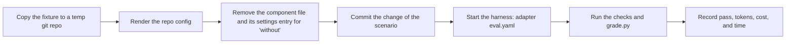

# Component lifecycle

Each generated component (rule, skill, role, hook, check, CI job) has a lifecycle. The goal is to
remove components that no longer help the current model (P5).

## Manifest

The generator writes a manifest in the target repo. Default path: `.cornerstone/manifest.yaml`.

```yaml
framework_version: 0.1.0
components:
  - id: role.tester
    kind: role                  # rule | skill | role | hook | check | ci-job
    purpose: Write independent tests from the ticket and the diff.
    principle: [P2]
    source: framework           # framework | repo
    owner: <github-username>
    eval: evals/role-tester/    # empty only for checks (a check is its own test)
    models_tested: [<model-id>]
    added: 2026-10-17
    review_by: 2027-04-17       # added + 6 months
    why_not_a_check: Test design needs judgment.   # required for kind: rule | skill
    files: [<generated file paths>]
    hash: <sha256 of the generated content>
```

`stone check` tests these fields (D43, D50). It fails in these cases:

- A component has no `eval` key, or an empty `eval` and a kind that is not `check`. A component
  whose id starts with `check.` is a check of any kind, for example `check.k16` (D99).
- A manifest entry has no valid `review_by`.
- A manifest entry has an empty `owner`.
- A result file in `evals/results/` names a model that `models_tested` of its component does not
  list.

`stone render` keeps the `owner` of an entry. If the owner is empty or the entry is new, it sets
`owner` from `owners.default` in the repo config. It sets `models_tested` from the result files:
for each component, the models of all its result files, sorted. It reads the component and the
model from the first lines of the result file (`# Eval results: <component>` and
``Model: `<model>` ``). After a `stone eval` run, run `stone render` and commit the manifest. A
component with no result file has `models_tested: []`.

## Review triggers

| Trigger | Action |
| --- | --- |
| `review_by` date passes | Review the component (procedure below). |
| The model changes for a role | Run all evals for components that the role uses. |
| A vendor releases a new model, or a model profile changes | Run the [adapter-refresh](profiles/adapter-refresh.md) profile. |
| The harness version changes in a major way | Run all evals. |
| An eval fails 2 runs in a row | Review the component. |
| A human edits a generated file | The generator reports drift. The owner decides: keep the edit in the repo config, or discard it. |

## Review procedure

1. Run the component's eval with the component and without it.
2. Compare the results. Use the same tasks and the same model.
3. If the component does not improve the result, remove it.
4. If the component improves the result, set `review_by` to 6 months later.
5. If the component is a rule or a skill, read `why_not_a_check` again. If a check can now do the
   job, replace the component with a check.
6. Record the result in the manifest and in the PR that changes it.

> CAUTION: Do not remove a check only because its eval is missing. A check is its own test. Review a
> check for false positives and for cost instead.

## Personas

A persona is not a component, but it can also go out of date. At each lifecycle review, and at G2
for a plan that names a persona, do these steps:

1. List each persona in the personas file with `evidence: assumed`.
2. Show the list to the human who approves. A plan that serves only assumed personas is a risk
   (P11). Record it in the plan's risks section.
3. The human decides: validate the persona with real users, or keep it as assumed and accept the
   risk.
4. When research confirms a persona, set `evidence: validated` and add the source in the file.

## Specs

Specs and spec deltas are not components, but they cost the planner time and the human review time.
Review the spec rules on 2027-04-18, and after the first 10 plans with a delta. Measure:

| Measure | Keep the specs if |
| --- | --- |
| Review findings where the code and the spec disagree | They go down, or stay at zero |
| Human time to approve a plan with a delta | It is not more than 1.5 times a plan with no delta |
| Deltas that a human rejects as too large for the change | Fewer than 1 in 5 (dossier D5) |

If the specs do not help, stop the deltas. The applied specs stay as documentation.

## Eval design

| Item | Rule | Source |
| --- | --- | --- |
| Size | Start with 3 to 5 scenarios for each component. Grow to 20–50 tasks for each profile from real failures. | dossier G4, G6 |
| Baseline | Always measure without the component first. | G4 |
| Grader | Use a code-based grader first. Use a model grader only for judgment, and calibrate it against a human. | G6 |
| Consistency | Report pass^k (all k trials pass) for roles in CI. | G7 |
| Cost | Record tokens and time for each run. A component that adds cost with no gain fails. | G3 |
| Transcripts | Read some transcripts at each review. A score alone can hide a bad grader. | G6 |
| Human readers | For a component that changes human-facing text, use a blind A/B rating by a human. See [writing.md](writing.md#evidence-p5). | G8 |
| Models | Run the eval on each model that the repo uses for that role. | G5 |

Default eval folder: `evals/<component-id>/` with `scenarios.yaml` and a grader script.

### Scenario format

The folder name comes from the `eval` field of the component in the adapter component list.

```yaml
component: role.tester
role: tester
task: Write tests for this ticket.     # added before each prompt, in both variants
scenarios:
  - id: T1
    title: Tests for each criterion of a pure function
    fixture: fixtures/slugify          # copied to a new git repo, committed as the base
    change: fixtures/slugify.diff      # optional: committed as an implementer commit
    prompt: |
      Ticket SLUG-1: ...
    expect:
      - {check: unchanged, paths: [src/]}
      - {check: grader, name: kills_mutants, mutants: [mutants/slugify-m1.diff]}
      - {check: commit_trailer, trailer: "Role: tester", kind: contract}
```

| Check | Passes if |
| --- | --- |
| `file_exists`, `file_absent` | A file matches the glob `path`, or no file matches it. |
| `unchanged` | The run changed no file under `paths`. |
| `only_changed` | The run changed files only under `paths`. |
| `matches` | The regex `pattern` is in `path`. The path `@report` is the final text of the run. |
| `sections_in_order` | The headings of `path` contain each name in `sections`, in that order. |
| `json_valid` | `path` is a JSON object with each key in `required`. |
| `command` | The command `run` exits with the code `exit` (default 0). |
| `commit_trailer` | A commit of the run has the line `trailer`. |
| `spec_delta_valid` | `path` is a spec delta with no format error. |
| `grader` | `grade.py <name> --workspace <path> --args <json>` prints `{"pass": true}` as its last line. The environment variable `STONE_EVAL_REPORT` has the final text of the run. |

Each check has a `kind`:

- `outcome` (default): the check tests behavior. A run without the component can pass it.
- `contract`: the check tests the output format of the component. A run without the component
  cannot know it.

The two variants get the same prompt, tools, and hook. The only difference is the component file.
The report gives the outcome pass rate and the contract pass rate in different columns. Use the
outcome rate to compare the variants.

### Runner

`stone eval <component-id>` does these steps for each scenario, variant, and trial (D26):



- The workspace is in the system temp folder, so that no instruction file in a parent folder goes
  into the run.
- The harness adapter gives the command for each variant in `eval.yaml`. The core has no harness
  name (P12). The `output` map of `eval.yaml` uses these names: `report` (the final text),
  `cost_usd`, `input_tokens`, `output_tokens`, `turns`, and `structured_output` (a trigger eval). The table shows "—" for a name that is
  not in the map.
- The runner reads the last JSON object of the harness output. If `eval.yaml` has `output_where`,
  it reads the last object with those keys and values.
- The setup commits the fixture on `main`. Then the work continues on the branch
  `feature/eval-work`, because a role does not commit to the default branch.
- Git in the workspace does not read the global or the system git config. Thus each machine gives
  the same result. Add a `.gitignore` to each fixture for the files that a build or a test writes,
  for example a bytecode cache. If not, `unchanged` and `only_changed` count those files.
- A run stops at `--timeout`, with each process that the harness started.
- The runner cannot yet remove a component that is merged into a shared file. For that component,
  use `--variant with`. For a hook, "without" removes the hook file and each entry that names it in
  a shared JSON file that the adapter merges (D44). A missing hook file with its entry kept would
  make each file-tool edit fail.
- Only the component changes between the variants. For a role, "without" has no role file and uses
  `run.without`. For another component (a hook), both variants load the same role file and use
  `run.with` (D44). Thus a difference between the variants comes from the component.
- The runner writes the transcripts and `runs.jsonl` to `.cornerstone/eval-runs/`. Do not commit
  them. It writes the result table to `evals/results/`. Add the table to the PR.
- A guidance eval (D69) tests text, not a file that `stone render` writes. Its `scenarios.yaml` has `variants`: a name for each text, and the files that the variant puts in the workspace (`{copy: <file in the eval folder>, to: <path in the repo>}`). All variants use `run.with`. The runner commits the files before the agent starts. Use `--variant <name>` for one variant. The variant `none` is the baseline, and the report gives the outcome rate of each other variant minus `none`. The runner finds the eval by its `component` key, so the component needs no entry in the adapter component list. Pass `--model`, because the role has no model in the model profile.
- A trigger eval (D101) tests one trigger workflow for one profile. The component id is the id in the adapter component list and the profile, for example `trigger.label.single-ticket`. One eval folder serves all profiles of the trigger. A scenario with `profiles` runs only for those profiles. The scenarios need no `role`: the role is the first role of the profile. Each scenario has an `event` file. The runner copies it to the place where the workflow reads its event data. The optional `number` (default 1) is the issue or PR number of the event.
  - `with` runs the role with the prompt and the role arguments of the rendered workflow (`trigger.with` in `eval.yaml`). The report is the `report` field of the structured output (D71). Then the runner runs the shell steps of the post job, with a fake forge CLI on `PATH`. Nothing is posted. The path `@posted` (and `STONE_EVAL_POSTED` for `grade.py`) is the text that the post job gave to the forge CLI. `STONE_EVAL_GH_CALLS` has the arguments of each call, one on each line. A post step gets no variable of the caller except `HOME`, `LANG`, `LC_ALL`, and `TMPDIR`. It gets a fake token and an empty CLI config folder. The fake forge CLI is first on `PATH`. The system folders stay, because the step needs their shell tools. So a real forge CLI that a step calls by its full path has only the fake token.
  - `without` is the same role run by hand (`trigger.without`): the same event file, the prompt of the scenario, no report schema, and no post job. `$event_file` in the prompt is the path of the event file. The report is the final text, and `@posted` is empty.
  - Limits: the runner does not run the steps that the action adds, and it does not run the job conditions. It posts only if the structured report is not empty, as the post job does.
- Use `--check-only` to validate the scenarios without a run.

## Metrics for each profile

Collect these for each merged item. Record the mode and the stage drivers with each item. Compare
the metrics before and after a workflow change, and between modes for the same profile.

| Metric | Meaning |
| --- | --- |
| Lead time | Time from G1 to merge |
| Human time | Time a human spends at gates |
| Loops | Number of Build–Verify loops |
| Rework | Follow-up fixes within 30 days |
| Escaped defects | Bugs found after merge that the item caused |
| Cost | Tokens or usage for each item |
| PR size | Lines changed |
