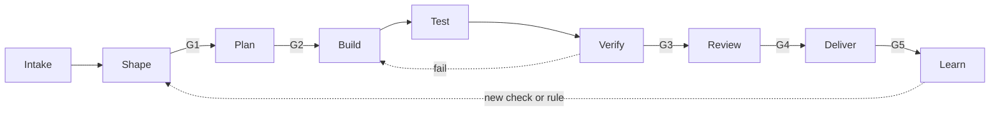

# Workflow model

The workflow model has stages, roles, and artifacts. A [profile](profiles/README.md) selects the
stages, roles, [gates](gates.md), and [checks](checks.md) for one type of work. A
[mode](modes.md) selects who drives each stage: an agent, a human, or a pair.

## Stages



Caption: work moves left to right. A gate stops the work until its approver passes it.

The "Role" column names the role. The [mode](modes.md#presets) decides if a human or an agent fills it.

| Stage | Goal | Input | Output artifact | Role |
| --- | --- | --- | --- | --- |
| Intake | Record and sort the work. | A request, a bug report, an alert, a schedule | A ticket with a type and a priority | human or investigator |
| Shape | Make the ticket ready. | The ticket | A ticket that meets the Definition of Ready | shaper with a human |
| Plan | Decide the approach. | The ready ticket, the repo | A plan artifact, or an empty decision log | planner |
| Build | Change the code. | The plan or the ticket | Commits, the decision log | implementer |
| Test | Write independent tests. | The ticket, the plan, the diff | Test commits, a test report | tester |
| Verify | Run the checks. | The branch | Check output | checks (no model) |
| Review | Compare the result with the ticket and the plan. | The diff, the check output, the decision log | Review findings, then a human decision | reviewer, then a human |
| Deliver | Merge and release. | The approved PR | A merged PR, a release | human or automation |
| Learn | Improve the workflow. | Failures, review findings, metrics | New checks, changed components, manifest updates | human with an agent |

### Loop limits

- If Verify fails, the work goes back to Build. After 3 failed loops, the work stops, and a human
  decides.
- If the tester and the implementer disagree on expected behavior, the work stops. A human decides
  from the ticket. The ticket gets the answer, so the next run has it.

## Roles

| Role | Job | Reads | Writes | Must not |
| --- | --- | --- | --- | --- |
| shaper | Interview the human until the ticket meets the Definition of Ready. | Ticket, repo docs | Ticket fields | Write code |
| planner | Write the plan artifact or decide that no plan is necessary. | Ticket, code, repo docs | Plan artifact | Write code |
| implementer | Change the code to meet the ticket and the plan. | Ticket, plan, code | Source code, decision log | Change protected paths (tests, checks, CI, check config) |
| tester | Write tests from the ticket and the plan. Write the acceptance tests from the job stories of the ticket's personas. Test the public behavior. | Ticket, plan, personas file, diff, code | Test files, test report | Change source code |
| reviewer | Find defects and scope drift. Report only gaps that affect correctness or the ticket. | Ticket, plan, diff, check output, decision log | Review findings | Change any file |
| investigator | Read, run, and report. Used for triage, debugging analysis, audits, and spikes. | Code, logs, issues | Findings report | Change files outside its scratch area |

The scratch area of the investigator is the reports path. On a branch with the `spike/` prefix, it
is the whole work tree, except the harness and Cornerstone files. K16 stops a merge of that branch.

Roles are actor-neutral. The "Must not" column applies to a human in the role too. See the
[separation rule for all actors](modes.md#separation-rule-for-all-actors).

### Session rules

These rules apply to each stage that an agent drives.

- Each role runs in its own session. The implementer, tester, and reviewer MUST NOT share a session.
- The pipeline starts each role. A role does not start another role, except an investigator that
  fans out read-only sub-tasks.
- A session ends after one unit of work. It writes its state to files before it ends.

## Artifacts

| Artifact | Format | Default path in the target repo | Made by |
| --- | --- | --- | --- |
| Ticket | Issue with the ready fields | Issue tracker | human, shaper |
| Plan artifact | Markdown with set sections | `docs/plans/<id>.md` | planner |
| Decision log | Markdown list: decision, options, choice, reason | `docs/plans/<id>.decisions.md` | implementer, planner |
| Progress file | JSON task list with a `passes` field | `docs/plans/<id>.progress.json` | planner, implementer |
| Spec delta | Markdown: ADDED, MODIFIED, and REMOVED requirements (see [Specs](#specs)) | `docs/plans/<id>.spec.md` | planner |
| Spec | Markdown: the current requirements of one capability | `docs/specs/<capability>.md` | `stone spec apply` (generator) |
| Test report | Markdown: tests added, behavior covered, gaps | PR comment | tester |
| Review findings | Markdown: finding, severity, evidence | PR review | reviewer |
| Findings report | Markdown: defects, risks, improvements | `docs/reports/<id>.md` | investigator |
| Personas file | Markdown: one section for each persona (see [Personas](#personas)) | `constitution/personas.md` | shaper with a human (full-project) |

Paths are defaults. The repo config can change them. See [customization.md](customization.md).

### Plan artifact sections

1. Understanding (the problem in 3 sentences or fewer, and a `Personas: <IDs>` line from the ticket)
2. Files to change
3. Approach
4. Acceptance criteria coverage (each criterion, the job story ID that it serves, and how it is
   verified)
5. Out of scope and risks
6. Open questions

### Definition of Ready (default)

| Field | Required for |
| --- | --- |
| Problem or goal | All profiles |
| Acceptance criteria, each one testable | Profiles with a Build stage |
| Non-goals | Profiles with a Build stage |
| Test oracle: how a person knows that it works | Profiles with a Build stage |
| Reproduction steps, expected and actual result | Bug triage, debugging |
| Time box | Spike, audit |
| Personas: the IDs of the personas that the change serves | App slice. Single ticket and debugging: the IDs, or `none` if the change does not affect users. |

### Personas

A persona is a type of person who uses the product. It is not an agent role. The framework does not
give agents personas, because a persona in a model prompt does not improve results (dossier E14).

Full-project writes the personas file. Each later ticket names its personas in the Definition of
Ready. The plan maps each acceptance criterion to a job story. The tester writes the acceptance
tests from those job stories.

The personas file has one `##` section for each persona, with these fields:

| Field | Value |
| --- | --- |
| `id` | A slug, for example `analyst`. Unique in the file. |
| `who` | One line. |
| `jobs` | 3 to 5 job stories. Each one is `<id>.J<n>: When I ..., I want to ..., so that ...`. |
| `limits` | `device`, `skill`, and `access`. |
| `evidence` | `assumed` or `validated`. A lifecycle review flags each assumed persona (see [lifecycle.md](lifecycle.md#personas)). |

Check K18 tests this format and the persona and job story IDs in the plans. Dossier: D12, D13.

### Specs

A plan artifact describes one change. A spec describes the product as it is now. The plans stay
in the repo as history, and the specs show the result of all of them (dossier D14).

The planner writes a spec delta next to the plan when the change adds, changes, or removes a
behavior. Each section of the delta is one change:

```markdown
## ADDED export.R3: Export a filtered report

The user MUST be able to export only the rows that the filter shows.

### Scenario: export with a filter
- WHEN the user sets a filter and selects Export
- THEN the CSV file has only the rows that the filter shows

## MODIFIED export.R1: <the new title>
<the full new text, with its scenarios>

## REMOVED export.R2: <title>
<the reason, optional>
```

Rules:

1. A requirement ID is `<capability>.R<n>`. The number never changes, and a removed number is not
   used again. Each capability has one spec file.
2. ADDED and MODIFIED sections have at least one `### Scenario:` with WHEN and THEN lines.
   MODIFIED gives the full new text, not only the difference.
3. A human approves the delta with the plan (G2). The delta is part of the plan.
4. Before the code PR opens, run `stone spec apply <plan id>`. It gives the delta the next
   `apply_order`, and it writes the specs. Commit its output alone, with `Role: generator`. The
   hook stops the implementer, the tester, and the planner when a file tool changes the specs
   path. It does not see a shell command (D38). K6 fails an implementer commit that changes it.
5. `stone spec apply` writes the specs. A replay of all applied deltas, in `apply_order`, must give
   the same files. A person changes a spec only with a new delta. Thus the plans folder is permanent
   history: do not delete an applied delta. The specs folder holds only the generated specs.
6. A ticket with no change to a behavior has no delta.
7. Two applied deltas must not have the same `apply_order`. This occurs when two branches apply a
   delta and both merge. After you merge the base branch, run `stone spec sync`. It gives the
   applied deltas the orders 1 to n, and it writes the specs again. Commit its output alone, with
   `Role: generator`.

Check K19 tests these rules in `stone check`.

The tester names each test for a requirement with its ID, so the reviewer can match the tests to
the spec. Eval plan and review date: [lifecycle.md](lifecycle.md#specs).
