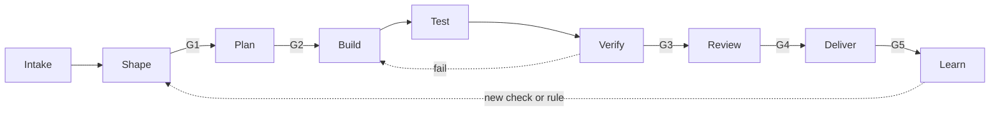

# Workflow model

The workflow model has stages, roles, and artifacts. A [profile](profiles/README.md) selects the
stages, roles, [gates](gates.md), and [checks](checks.md) for one type of work. A
[mode](modes.md) selects who drives each stage: an agent, a human, or a pair.

## Stages

Caption: work moves left to right. A gate stops the work until its approver passes it.

The "Role" column names the role. The [mode](modes.md#presets) decides if a human or an agent fills it.

| Stage | Goal | Input | Output artifact | Role |
| --- | --- | --- | --- | --- |
| Intake | Record and sort the work. | A request, a bug report, an alert, a schedule | A ticket with a type and a priority | human or investigator |
| Shape | Make the ticket ready. | The ticket | A ticket that meets the Definition of Ready | shaper with a human |
| Plan | Decide the approach. | The ready ticket, the repo | A plan artifact, or an empty decision log | planner |
| Build | Change the code. | The plan or the ticket | Commits, the decision log | implementer |
| Test | Write independent tests. | The ticket, the plan, the diff | Test commits, a test report | tester |
| Verify | Run the checks. | The branch | Check output | checks (no model) |
| Review | Compare the result with the ticket and the plan. | The diff, the check output, the decision log | Review findings, then a human decision | reviewer, then a human |
| Deliver | Merge and release. | The approved PR | A merged PR, a release | human or automation |
| Learn | Improve the workflow. | Failures, review findings, metrics | New checks, changed components, manifest updates | human with an agent |

### Loop limits

- If Verify fails, the work goes back to Build. After 3 failed loops, the work stops, and a human
  decides.
- If the tester and the implementer disagree on expected behavior, the work stops. A human decides
  from the ticket. The ticket gets the answer, so the next run has it.

## Roles

| Role | Job | Reads | Writes | Must not |
| --- | --- | --- | --- | --- |
| shaper | Interview the human until the ticket meets the Definition of Ready. | Ticket, repo docs | Ticket fields | Write code |
| planner | Write the plan artifact or decide that no plan is necessary. | Ticket, code, repo docs | Plan artifact | Write code |
| implementer | Change the code to meet the ticket and the plan. | Ticket, plan, code | Source code, decision log | Change protected paths (tests, checks, CI, check config) |
| tester | Write tests from the ticket and the plan. Test the public behavior. | Ticket, plan, diff, code | Test files, test report | Change source code |
| reviewer | Find defects and scope drift. Report only gaps that affect correctness or the ticket. | Ticket, plan, diff, check output, decision log | Review findings | Change any file |
| investigator | Read, run, and report. Used for triage, debugging analysis, audits, and spikes. | Code, logs, issues | Findings report | Change files outside its scratch area |

Roles are actor-neutral. The "Must not" column applies to a human in the role too. See the
[separation rule for all actors](modes.md#separation-rule-for-all-actors).

### Session rules

These rules apply to each stage that an agent drives.

- Each role runs in its own session. The implementer, tester, and reviewer MUST NOT share a session.
- The pipeline starts each role. A role does not start another role, except an investigator that
  fans out read-only sub-tasks.
- A session ends after one unit of work. It writes its state to files before it ends.

## Artifacts

| Artifact | Format | Default path in the target repo | Made by |
| --- | --- | --- | --- |
| Ticket | Issue with the ready fields | Issue tracker | human, shaper |
| Plan artifact | Markdown with set sections | `docs/plans/<id>.md` | planner |
| Decision log | Markdown list: decision, options, choice, reason | `docs/plans/<id>.decisions.md` | implementer, planner |
| Progress file | JSON task list with a `passes` field | `docs/plans/<id>.progress.json` | planner, implementer |
| Test report | Markdown: tests added, behavior covered, gaps | PR comment | tester |
| Review findings | Markdown: finding, severity, evidence | PR review | reviewer |
| Findings report | Markdown: defects, risks, improvements | `docs/reports/<id>.md` | investigator |

Paths are defaults. The repo config can change them. See [customization.md](customization.md).

### Plan artifact sections

1. Understanding (the problem in 3 sentences or fewer)
2. Files to change
3. Approach
4. Acceptance criteria coverage (each criterion and how it is verified)
5. Out of scope and risks
6. Open questions

### Definition of Ready (default)

| Field | Required for |
| --- | --- |
| Problem or goal | All profiles |
| Acceptance criteria, each one testable | Profiles with a Build stage |
| Non-goals | Profiles with a Build stage |
| Test oracle: how a person knows that it works | Profiles with a Build stage |
| Reproduction steps, expected and actual result | Bug triage, debugging |
| Time box | Spike, audit |
