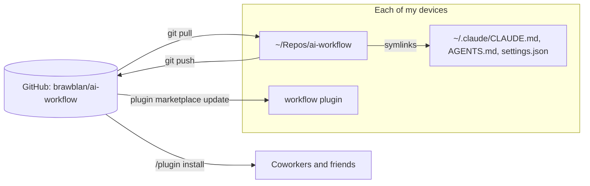

# global

My personal agent rules and Claude Code settings. Copy what you like. The rest of this page is for
me, the owner: it keeps all my devices on the same version. Git is the source of truth.

| File | What it has |
| --- | --- |
| [`AGENTS.md`](AGENTS.md) | My rules for each agent session, in each repo |
| [`CLAUDE.md`](CLAUDE.md) | `@AGENTS.md` |
| [`settings.json`](settings.json) | Claude Code settings. It declares the `brawblan` marketplace and enables the `workflow` plugin. |

## How the sync works



`settings.json` declares the marketplace (GitHub source) and enables the plugin. So a new device
needs only the clone and `install.sh`.

## New device

1. Clone the repo:

   ```bash
   git clone https://github.com/brawblan/ai-workflow.git ~/Repos/ai-workflow
   ```

2. Link the global files. The script backs up each file that it replaces.

   ```bash
   ~/Repos/ai-workflow/install.sh
   ```

3. Start Claude Code. It reads the marketplace from the linked `settings.json`.
   If `/plugin` does not show `workflow@brawblan`, run:

   ```
   /plugin install workflow@brawblan
   ```

## Change the workflow

1. Edit the files in `~/Repos/ai-workflow`.
2. If you changed a skill, increase `version` in
   [`plugins/workflow/.claude-plugin/plugin.json`](../plugins/workflow/.claude-plugin/plugin.json).
3. Run `claude plugin validate .` from the repo root.
4. To test a skill before you push, run `claude --plugin-dir plugins/workflow`.
5. Commit and push.
6. Run `/plugin marketplace update brawblan`, also on this device.

## Get changes on another device

1. Run `git -C ~/Repos/ai-workflow pull`.
2. In Claude Code, run `/plugin marketplace update brawblan`.
3. Restart Claude Code.

The global files are symlinks, so they change at once after the pull.

## If a link breaks

Claude Code can write `settings.json` (for example from `/config`). If a write replaces the link
with a plain file, run `./install.sh` again. The script backs up the plain file and prints a
`diff` command. Copy the changes that you want into `global/`.
