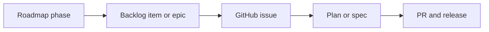

# Roadmap

<!-- Guide: This file owns the order of the work. It holds phases and milestones only. The work
items live in the backlog or in GitHub issues. Link to them. Do not copy them. Remove each Guide
comment when you fill the file. -->

## How the roadmap connects to the work

- A phase has a goal and exit criteria. It lists the epics or issues that reach the goal.
- A spec or change names the phase that it serves.
- If work does not serve a phase, add it to a phase, or put it in "Later".

## Now

<!-- Guide: The current phase. One goal. 3 to 7 items. -->

### Phase 1: <name>

- **Goal:** <one sentence>
- **Exit criteria:** <observable result that ends the phase>
- **Work, in order:**
  1. <epic or issue link> — <why it is first>

## Next

### Phase 2: <name>

- **Goal:** <one sentence>
- **Depends on:** <phase or item>
- **Work:** <epic or issue links>

## Later

- <idea or epic> — <what must be true before it starts>

## Change log

| Date | Change | Reason |
| --- | --- | --- |
| <YYYY-MM-DD> | <phase added, reordered, or done> | <reason> |
