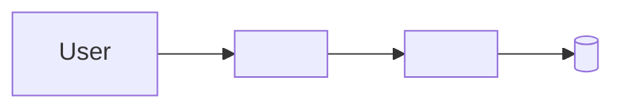

# Tech stack

<!-- Guide: This file owns technology choices and technical limits. Designs must use only what is
approved here. Get facts from the manifests (package.json, pyproject.toml, go.mod), CI, and infra
code. Do not list a tool that the repo does not use. Remove each Guide comment when you fill it. -->

## Overview

<!-- Guide: A Mermaid diagram of the parts and how they connect. 12 nodes or fewer. -->

## Approved technology

| Area | Choice | Version rule | Notes |
| --- | --- | --- | --- |
| Language | <TypeScript 5, Python 3.12> | <pinned / latest minor> | |
| Frontend | <framework, router, data fetching, UI kit> | | |
| Backend | <framework, validation> | | |
| Data | <database, warehouse, ORM or driver> | | |
| Auth | <provider> | | |
| Testing | <unit, integration, E2E tools> | | |
| Lint and format | <tool> | | |
| Infra and deploy | <cloud, IaC tool, CI> | | |

## Ownership

<!-- Guide: Which folder or service owns which logic. In a single-app repo, list the main modules.
If the principles already state ownership, link to them instead. -->

| Folder | Owns |
| --- | --- |
| `<path>` | <responsibility> |

## Environments and deploy limits

| Environment | Where it runs | Deploys from |
| --- | --- | --- |
| local | <docker compose, emulators> | — |
| staging | <host> | <branch> |
| production | <host> | <branch> |

Limits:

- <for example: no new cloud project per environment; secrets only in the secret manager>

## Quality gates

| Gate | Command | Runs in CI |
| --- | --- | --- |
| Lint | `<command>` | yes |
| Typecheck | `<command>` | yes |
| Unit tests | `<command>` | yes |
| E2E | `<command>` | <yes / no> |

## Add or change a dependency

1. Check this file. If the need is already covered, use the approved choice.
2. If you add a new library, service, or tool, update this file in the same PR.
3. If the choice is large or hard to reverse, write a decision record first (for example `docs/adr/`).

## Not approved

- <tool> — <reason, and what to use instead>
