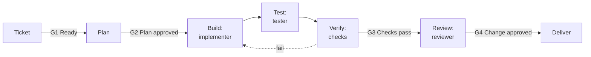

---
hide:
  - navigation
  - toc
---

# Cornerstone

**Agent-assisted software delivery, where checks decide that work is done.**

Cornerstone tells a human and an agent how to deliver software together. It sets who does each
stage, which gates stop the work, and which checks decide that work is done. The core names no tool.
Adapters turn it into files for your harness.

[Get started](docs/guides/README.md){ .md-button .md-button--primary }
[Read the principles](framework/principles.md){ .md-button }

## The problem

Agents write code fast. But an agent stops when the work looks done. It can write tests that agree
with its own mistakes, and it can drift from the ticket. Also, models change. A rule that helps one
model can hurt the next model.

## What Cornerstone does

<div class="grid cards" markdown>

-   :material-check-decagram:{ .lg .middle } **Checks decide**

    ---

    CI output, not an agent claim, shows that work is done. The checks run outside the agent
    session.

-   :material-account-switch:{ .lg .middle } **The writer is not the judge**

    ---

    The implementer, the tester, and the reviewer each run in a fresh session. A hook and a CI
    check stop the implementer from changing the tests.

-   :material-clipboard-check:{ .lg .middle } **Judgment goes into the inputs**

    ---

    A human makes the ticket ready: acceptance criteria, non-goals, a test oracle, and the users
    that it serves. Then the prompt can be simple.

-   :material-scale-balance:{ .lg .middle } **Ceremony scales with risk**

    ---

    Ten profiles, from a spike to a full project. Each profile sets its plan form and its gates.

-   :material-swap-horizontal:{ .lg .middle } **Neutral core, thin adapters**

    ---

    The core names no harness, vendor, or model. When a tool changes, only its adapter changes.

-   :material-timer-sand:{ .lg .middle } **Each part earns its place**

    ---

    Each rule, role, and hook has an eval and a review date. When the evidence goes, the part
    goes.

</div>

## How the work moves



Each role is a separate session. A human approves G1, G2, and G4. Only checks pass G3. The profile
selects the gates that apply. See the [workflow model](framework/workflow-model.md) and the
[gates](framework/gates.md).

## Start in three steps

1. Install the CLI from a clone of the repo:

    ```bash
    git clone https://github.com/brawblan/ai-workflow.git
    pip install ./ai-workflow/stone
    ```

2. Install the plugin in Claude Code:

    ```text
    /plugin marketplace add brawblan/ai-workflow
    /plugin install workflow@brawblan
    ```

3. In your repo, run `/workflow:cornerstone-setup`. It asks only for the facts that it cannot find.
   Then `stone render` writes the roles, the hooks, and the CI checks.

## Pick your situation

<div class="grid cards" markdown>

-   :material-folder-plus:{ .lg .middle } [**Start a project**](docs/guides/start-a-project.md)

    An empty folder and an idea. Write the foundation and the personas first.

-   :material-source-repository:{ .lg .middle } [**Add to a repo**](docs/guides/add-to-a-repo.md)

    A repo with code and no agent framework.

-   :material-transfer:{ .lg .middle } [**Migrate**](docs/guides/migrate.md)

    From Spec Kit, OpenSpec, BMAD, or rule files.

-   :material-pencil:{ .lg .middle } [**Make a small change**](docs/guides/small-change.md)

    One clear change, from ticket to PR.

-   :material-bug:{ .lg .middle } [**Fix a bug**](docs/guides/fix-a-bug.md)

    The failing test comes before the fix.

-   :material-puzzle:{ .lg .middle } [**Build a feature**](docs/guides/build-a-feature.md)

    You approve the plan. An agent builds it, one task at a time.

</div>

## Status

Draft v0. The framework is complete enough to use on one profile. The `stone` CLI validates the
framework, checks the writing standard, and renders the single-ticket profile. Claude Code is the
first harness adapter. The next steps are in the [roadmap](framework/README.md#roadmap).

Each rule cites its evidence in the [research dossier](docs/research/dossier.md).
