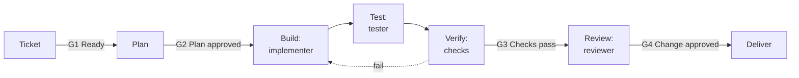

---
hide:
  - navigation
  - toc
---

# Cornerstone

**A general workflow layer for coding agents that you update when the models improve.**

Version 1.6.0. All 10 profiles are supported, and each generated check blocks.

Cornerstone is a wrapper around the way that you work with a coding agent. It sets who does each
stage, which gates stop the work, and which checks decide that work is done.

I made it because models change fast. A rule that helps one model can hurt the next model. So the
core names no tool and no model. The details for each model are in one small model profile. When
a new model comes out, you change that profile, run the evals, and keep only the changes that help.
The rest of your workflow stays the same.

[Get started](docs/guides/README.md){ .md-button .md-button--primary }
[Read the principles](framework/principles.md){ .md-button }

## What you get

| Part | What it is |
| --- | --- |
| [Roles](framework/workflow-model.md) | Six agent roles: shaper, planner, implementer, tester, reviewer, and investigator. Each role runs in its own session. |
| [Profiles](framework/profiles/README.md) | Ten workflow types, from a spike to a full project. Each sets its plan form, roles, gates, and checks. |
| [Gates](framework/gates.md) | Five stop points, G1 to G5. A human or CI must pass each one. |
| [Checks](framework/checks.md) | 24 CI checks, K1 to K24: tests, protected paths, change size, secrets, PR evidence, and more. |
| [Hooks](framework/adapters/claude-code.md) | Local guards. For example, a hook stops the implementer when it tries to change a test. |
| [Adapters and model profiles](framework/adapters/contract.md) | The only place for harness and model details. Claude Code is the full adapter. OpenCode supports eval runs. |
| [`stone` CLI](stone/README.md) | Writes the roles, hooks, and CI checks into your repo. It also validates the framework and the writing. |
| [Code index](docs/guides/code-index.md) | `stone-index` is a local index of the files in a repo. An agent asks it where a symbol is, and reads fewer files. The rule cut output tokens by 13 to 30 percent (D109). On one large multi-file task, M3, it cost 11 to 25 percent less (3 trials, no SE). Over all scenarios the cost saving is inside the noise ([evidence](docs/guides/code-index.md#result-first)). |
| [Plugin skills](docs/guides/README.md) | `setup`, `project-setup`, `ticket-delivery`, and `ste-writing`, for use in the agent session. |
| [Evals and lifecycle review](framework/lifecycle.md) | A test and a review date for each part, so that a part with no evidence leaves. |
| [Research dossier](docs/research/dossier.md) | The cited evidence for each rule. |

## What Cornerstone does

<div class="grid cards" markdown>

-   :material-update:{ .lg .middle } **Moves with the models**

    ---

    A new model needs only a new model profile. The adapter-refresh profile watches vendor
    releases and opens a PR with eval results.

-   :material-check-decagram:{ .lg .middle } **Checks decide**

    ---

    CI output, not an agent claim, shows that work is done. The checks run outside the agent
    session.

-   :material-account-switch:{ .lg .middle } **The writer is not the judge**

    ---

    The implementer, the tester, and the reviewer each run in a fresh session. A hook and a CI
    check stop the implementer from changing the tests.

-   :material-clipboard-check:{ .lg .middle } **Judgment goes into the inputs**

    ---

    A human makes the ticket ready: acceptance criteria, non-goals, a test oracle, and the users
    that it serves. Then the prompt can be simple.

-   :material-scale-balance:{ .lg .middle } **Ceremony scales with risk**

    ---

    Each profile sets its plan form and its gates. A spike gets few gates. A full project gets all
    of them.

-   :material-timer-sand:{ .lg .middle } **Each part earns its place**

    ---

    Each rule, role, and hook has an eval and a review date. When the evidence goes, the part
    goes.

</div>

## Why use it

Agents write code fast. But an agent stops when the work looks done. It can claim a check that it
did not run. It can write tests that agree with its own mistakes. It can drift from the ticket.
Cornerstone puts a check or a human gate at each of these points.

## Who it is for

- A developer who uses a coding agent on real repos and wants the result checked.
- A team that wants one process for many types of work.
- A person who uses Spec Kit, OpenSpec, or BMAD and wants a layer that does not depend on one tool.

It is not a prompt library or an IDE. At this time the full adapter is for Claude Code. An adapter
for OpenCode supports `stone eval` only.

## How it compares

Many tools cover one part: a gated flow, role agents, or a file generator. In the sources that we
read, none joins a neutral core, harness adapters, gates by profile, and an eval and review date for
each part. See the [prior art](docs/research/dossier.md#5-prior-art).

## How the work moves



Each role is a separate session. A human approves G1, G2, and G4. Only checks pass G3. The profile
selects the gates that apply. See the [workflow model](framework/workflow-model.md) and the
[gates](framework/gates.md).

## Start in three steps

1. Install the CLI from a clone of the repo:

    ```bash
    git clone https://github.com/brawblan/ai-workflow.git
    pip install ./ai-workflow/stone
    ```

2. Install the plugin in Claude Code. Use the newest release tag for `vX.Y.Z`, so that the tag pins
   the plugin ([how to move the pin](framework/adapters/claude-code.md#install-the-plugin-from-a-pinned-ref)):

    ```text
    /plugin marketplace add brawblan/ai-workflow#vX.Y.Z
    /plugin install cornerstone@brawblan
    ```

3. In your repo, run `/cornerstone:setup`. It asks only for the facts that it cannot find.
   Then `stone render` writes the roles, the hooks, and the CI checks.

## Pick your situation

<div class="grid cards" markdown>

-   :material-folder-plus:{ .lg .middle } [**Start a project**](docs/guides/start-a-project.md)

    An empty folder and an idea. Write the foundation and the personas first.

-   :material-source-repository:{ .lg .middle } [**Add to a repo**](docs/guides/add-to-a-repo.md)

    A repo with code and no agent framework.

-   :material-transfer:{ .lg .middle } [**Migrate**](docs/guides/migrate.md)

    From Spec Kit, OpenSpec, BMAD, or rule files.

-   :material-pencil:{ .lg .middle } [**Make a small change**](docs/guides/small-change.md)

    One clear change, from ticket to PR.

-   :material-bug:{ .lg .middle } [**Fix a bug**](docs/guides/fix-a-bug.md)

    The failing test comes before the fix.

-   :material-puzzle:{ .lg .middle } [**Build a feature**](docs/guides/build-a-feature.md)

    You approve the plan. An agent builds it, one task at a time.

</div>

## Status

The table shows the current version. Version 1.0.0 met the exit criteria on 2026-10-21.

| Area | State |
| --- | --- |
| Profiles | `stone render` writes every component of all 10 profiles. Each profile has a golden-file test and a guide. |
| Checks | Each generated check blocks: K6, K7, K14, K15, and K16. K17 blocks in this repo. |
| Adapters | Claude Code is the full harness adapter. Its model profile for Claude 5 is `active`. OpenCode supports `stone eval` only. |
| Evals | There are evals for all six roles, the protected-path hook, the trigger workflows, and the writing guidance. See [evals](evals/README.md). |
| Open | The first blind A/B rating of STE text, at the end of Q4 2026. See the [roadmap](framework/README.md#roadmap). |

Each rule cites its evidence in the [research dossier](docs/research/dossier.md).
